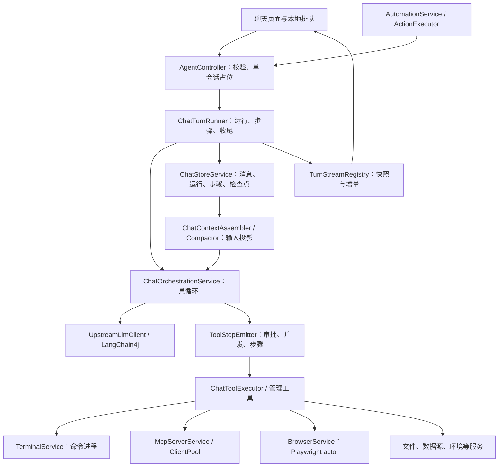

# Nora Agent 架构审查 · 2026-10-10

审查对象：`D:\claude\Nora` 当前工作区，基于 `fa043c8` 及现有未提交改动。此次只新增审查报告，没有修改业务代码、提交或部署。

后续修正与本地验收见 [Agent 架构修正设计及验证记录](agent-architecture-fixes-2026-10-10.md)。下文保留初次审查时的架构与证据，未以修正后的状态改写历史发现。

## 结论

现有主链路已经具备可用 Agent 的基础：LangChain4j 模型适配、无须先说文本的工具调用、受控并发、后台命令、审批与提问、执行过程持久化、SSE 重连、上下文预算和检查点。继续换框架、增加提示词或拆更多服务，都不是当前最有价值的工作。

主要缺口是**任务状态和资源的归属没有完全统一**：页面管理排队，Runner 管轮次，终端管理进程，MCP 池管理连接，上下文又主要依赖消息记录。正常路径能运行，遇到离页、取消、断连、保存失败、长时间执行时，这几套状态容易产生不同结论。

优先修正执行结果的真实性和保存失败后的恢复，再补会话的项目上下文与服务端队列。长任务需要保留简短的当前工作状态，不能主要依赖截断后的过程摘录让模型重新找线索。

## 范围与证据

按用户要求安排了一个独立子代理初审。子代理返回了源码发现，随后因使用额度限制中止；主代理接手复核并补完报告。没有把子代理的初步判断直接当作结论。

| 范围 | 本次核实方式 |
| --- | --- |
| 请求、轮次、插入、停止、保存、恢复 | 追踪 Controller → Runner → Store → 流注册表及客户端恢复链路 |
| 模型请求、工具循环、并发、权限 | 阅读编排、LangChain4j 适配、工具发射、执行分派、审批及循环检测 |
| 上下文、引用、记忆、技能、预算 | 阅读装配、结构化引用、工作区引导、轮内整理与语义检查点 |
| 终端、MCP、浏览器 | 追踪资源创建、调用、等待、取消、替换和关闭；核对本地 MCP SDK 2.0.1 源码 |
| 前端交互 | 阅读排队、插入、编辑重发、草稿及聊天状态管理；未进行本轮浏览器实测 |
| 自动化、访问边界、部署 | 抽查自动化领取与统一对话入口、网关鉴权；只读采样 megumin 容器边界与资源 |

本次 `codebase-memory` 图谱工具不可调用，使用源码搜索和调用链阅读作为回退，未宣称图谱覆盖率。线上只核对运行环境，未逐文件比对线上 JAR 与本地工作区，因此下列代码结论以本地当前实现为准。

优先级：P1 为可能丢失执行证据或诱发重复副作用的问题；P2 为正常使用场景下的正确性或设计缺口；P3 为可后置的效率优化。源码可以确认路径存在，实际发生频率未经故障注入或负载测量。

## 当前架构

这套分层可以保留。问题主要发生在层与层之间的生命周期和数据契约，不是缺一个新的 Agent 框架。

### 已有基础，后续改造应保留

- 模型客户端已经通过 LangChain4j 适配；支持 Anthropic、Chat Completions、Responses。不能再按早期手写协议实现评价当前代码。[模型适配][llm]
- 工具可以直接调用；独立且满足风险条件的调用可以并发，最多 4 个。浏览器和交互工具保留串行生命周期。[并发策略][tool-parallel]
- Windows/Linux 自动注册对应命令工具。命令默认等待 3 秒交还控制权，支持后台任务；执行超时默认 1800 秒，可配置；并发和日志都有上限。等待时间与进程总超时已经分开。[命令入口][command-start]、[终端生命周期][terminal]
- 单会话占位、插入消息的持久化和消费边界已经存在。此次未把旧版“插入到错误位置”或“最终封口丢插入”问题重新列为缺陷。[轮次占位][entry]、[插入入口][steer]
- 重连采用运行快照和有界增量事件；启动恢复不会重放工具。最终消息、检查点和运行终态已经在同一事务提交，剩余问题见 F01。[最终事务][store-complete]、[启动恢复][stale-recovery]
- 压缩不是没有阈值：当前输入预算触发比例为 83%，目标为 65%，溢出恢复目标为 60%，并能使用真实输入 usage 校准估算。[预算][budget] 长期问题是当前任务状态的保留方式，见 F06。
- 自动化复用正常对话引擎，领取计划点与执行记录共用事务，并区分取消、部分完成和结果未知；不需要再造一套后台 Agent 引擎。[自动化入口][automation-action]、[计划领取][automation-claim]

## 发现清单

| 编号 | 优先级 | 性质 | 问题 |
| --- | --- | --- | --- |
| F01 | P1 | 缺陷 | 最终保存失败后释放会话，但当前进程没有完成证据恢复 |
| F02 | P1 | 缺陷 | 部分远端调用把“可能已经生效”描述成“未执行”或普通失败 |
| F03 | P2 | 设计缺口 | 会话缺少明确的项目目录、适用规则与执行环境绑定 |
| F04 | P2 | 设计缺口 | 普通排队由聊天页面驱动，离页后不保证继续执行 |
| F05 | P2 | 缺陷 | 编辑重发、插入与普通发送使用不同上下文契约 |
| F06 | P2 | 设计缺口 | 长轮次能归档过程，但缺少当前任务的语义工作摘要 |
| F07 | P2 | 缺陷 | 取消当前轮等待可能停止上一轮的后台进程 |
| F08 | P2 | 缺陷 | MCP 连接创建、替换、失败清理缺少单一资源所有者 |
| F09 | P2 | 缺陷 | MCP 的结构化结果与资源内容被丢弃 |
| F10 | P2 | 缺陷 | 全局浏览器队列会被一个慢操作或下载阻塞 |
| F11 | P2 | 缺陷 | 坏图片或模糊 400 可能被记成模型不支持识图 |
| F12 | P3 | 优化 | 普通系统任务仍在首次模型请求前必经知识库检索 |

### F01 · 最终保存失败后的会话恢复不完整

**触发场景：** 工具已经执行，最终 `completeRun` 因短暂数据库异常回滚；数据库恢复后，用户继续发送消息。

**源码证据：** Runner 在调用 `completeRun` 前设置 `completionAttempted=true`。调用失败后跳过异常路径的 `finishRun`，但 `finally` 仍释放实时运行；Controller 同样释放会话占位。[保存失败路径][runner-final]、[占位释放][entry-release] 历史查询从 `chat_message` 出发，缺少最终助手消息时不会在此处从 `agent_step` 重建；现有重建只由启动恢复调用。[历史查询][store-history]、[恢复实现][store-recover]、[启动钩子][stale-recovery]

**影响：** 数据库中的旧运行仍可能显示运行中，当前进程却已允许新轮次开始。已保存的工具步骤不一定进入新轮次历史，模型可能重复探查或重做已发生的操作。这里不是“最终消息和终态没有事务”，而是事务失败后没有当前进程内的收敛路径。

**最小修正：** 在现有 Runner/Store 内增加针对单个 run 的幂等恢复；提交失败时保留待保存的最终证据，并将该会话标为待恢复。恢复成功或明确保存中断证据前，不接受该会话的新执行。复用 `agent_step` 重建，绝不重放工具。不能在运行中的进程直接调用全局 `recoverStaleRuns()`，否则会误伤其他活跃会话。

### F02 · 远端结果确定性没有贯穿所有工具

**触发场景：** MCP 工具先写入再抛内部异常；或 SQL/容器服务已经执行成功，但返回响应时连接中断。

**源码证据：** `McpServerService` 将所有 `McpError` 描述为“调用未执行……修正参数后重试”。[MCP 错误分类][mcp-outcome] 但本地 SDK 2.0.1 的 `McpClientSession.sendRequest` 会把所有 JSON-RPC error 转成 `McpError`；`McpServerSession.handleIncomingRequest` 也会把处理器执行后的异常转成 `INTERNAL_ERROR`。异常类型本身无法证明工具没有执行。

写 SQL 与容器客户端在请求发出后仍把任何异常转成普通 `ERROR:` 字符串。[写 SQL][sql-write]、[容器控制][container-control] 执行器没有给这些返回值设置 `unknown`，工具层因此标为普通失败。[执行器回填][remote-executor]、[工具终态][tool-outcome]

**影响：** 当前并非对这些写操作统一自动重试，但给模型的结果可能诱导它重试，造成重复写入或再次重启服务。

**最小修正：** 复用已有 `ToolOutcome.unknown`/`McpToolResult.unknown`，让远端客户端返回明确结果状态。只有能证明的本地校验或执行前拒绝才是未执行；请求发出后的传输故障、通用内部异常按未知处理，先核对实际状态。已经知道部分生效的，返回 `partial`，不能靠 `ERROR:` 前缀推断全部结果。保留现有默认不重放未知 MCP 调用的保护。

### F03 · 执行环境、项目目录与项目规则未成为会话状态

**触发场景：** 用户要求操作某个项目；模型通过 `sh cwd=/某项目` 执行命令，但后续命令和规则装配仍默认使用全局工作区。

**源码证据：** `TaskContext` 包含引用、输出、来源、选择和检索范围，没有会话的执行环境或项目根目录。[任务上下文][task-context] 终端 `cwd` 只作用于当次进程，缺省回到全局工作区。[目录解析][terminal-cwd] 系统提示调用无会话参数的 `bootstrap()`，只加载全局工作区的 SOUL/AGENTS/USER/MEMORY；没有由当前项目绑定决定的适用规则链。[提示词装配][context-system]、[工作区引导][workspace-bootstrap]

**影响：** 模型需要反复发现当前项目与约定，或者依赖自己主动读取项目规则。角色提示词已经改为系统智能体，但它不能代替真实的项目状态。这是能力设计缺口，不是证据表明当前所有任务都选错环境。

**最小修正：** 先让一个会话明确绑定当前执行环境、项目根目录和默认 cwd。终端、文件工具、规则装配及 UI 使用同一个绑定；适用项目规则在绑定项目时解析，记录来源与截断情况。临时命令中的 `cd/cwd` 仍只影响该命令，不应悄悄切换整个会话项目。

当前线上 Agent 以 `nora` 用户在容器 `/app` 中运行；Agent 容器没有宿主机根目录或 Docker socket 挂载。容器 Linux 环境不等于 megumin 宿主机。先把这条边界显示清楚；宿主机操作应走已授权的管理能力，不能为了“系统视角”默认获得宿主机 root 权限。

### F04 · 普通排队没有服务端所有者

**触发场景：** A 会话运行时，用户排队第二条要求，然后切到 B 会话或关闭页面。

**源码证据：** 队列和暂停状态保存在 Zustand/localStorage。[本地状态][queue-store] 真正领取并发送下一条的是 `useChat` 中的 effect；只有对应聊天 hook 挂载且满足就绪条件时才推进。[队列推进][queue-process]

**影响：** 本地存储正常时消息可以保留，但不会因为服务端上一轮结束就自动启动；回到该页面后才可能继续。换设备也无法看到同一队列。UI 的“已排队”容易被理解成服务端已接受任务。

**最小修正：** 草稿继续留在本地，已发送的排队消息由服务端按稳定 messageId 保存和领取。复用现有单会话占位和 Runner 收尾，在上一轮终态后推进。删除、编辑撤回、插入与正常领取必须竞争同一条队列记录，不能分别维护两份权威队列。当前正确的插入封口逻辑应保留。

### F05 · 控制消息没有保留同一份 TaskContext

**触发场景：** 用户勾选“限定这些资料”发送消息，随后编辑重发；或将带引用和限制的排队消息点击插入。

**源码证据：** 普通发送会携带 `TaskContext`，其中包含 `retrievalScope`。[客户端上下文契约][client-context] 编辑重发只传 `edited.trim()`，没有保留原 `taskContext`。[编辑重发][edit-resend] 插入接口也只有 turnId/messageId/content；模型补充输入解析只从文本恢复旧引用。[插入契约][steer]、[补充输入装配][steer-context]

**影响：** 文本中的旧引用可能仍能恢复附件，所以不能笼统说“附件全部丢了”；但显式检索限制、输出目标、来源等结构化语义没有相同保障。编辑重发后，“只查这些资料”可能变成不限范围；插入也没有同等契约。

**最小修正：** 普通发送、排队、插入、编辑重发共用正文加 TaskContext 的输入对象与解析函数。编辑仅替换用户改动的部分；插入的范围约束在下一请求边界更新任务上下文，同时保留原要求的有效约束。不要继续扩大正文引用行格式去承载新状态。

### F06 · 当前长任务缺少语义工作摘要

**触发场景：** 一个用户要求持续执行几十个工具轮次，早期结果被预算整理归档，但当前任务还没有最终助手消息。

**源码证据：** 轮内整理能压缩旧工具结果，并将完整早期 assistant/tool 组归档；替代内容主要是文件回读路径和最多约 1200 字符的过程摘录。[轮内整理][round-compact]、[过程归档][round-archive] 语义检查点使用请求开始时的持久历史，自动压缩只覆盖最后用户消息以前的完整历史；当前正在执行的消息与工具轮被保留在 `ongoing` 中。[自动检查点][auto-checkpoint]、[检查点边界][compactor]

**影响：** 这是“已能减小输入”和“已能保留当前工作状态”的差别。预算可能已经降下来，但模型仍可能不知道哪些工作已验收、哪些结果未知、下一步为什么要做，继而回读大量原文或重复查线索。不能据此断言某个线上慢会话的全部耗时都由压缩造成。

**最小修正：** 扩展现有检查点能力，在安全的完整工具轮边界保留当前任务摘要：目标、仍生效的限制、已完成并验证的结果、未知结果、待办和原始证据路径。原始工具输出继续归档。摘要与对应覆盖边界一起提交，不单独再建一套长期记忆或规划引擎；未完成的工具调用与结果不能拆开替换。

### F07 · 取消等待与取消进程混为一个动作

**触发场景：** 第 1 轮启动后台命令并结束；第 2 轮等待这个 executionId；用户只停止第 2 轮。

**源码证据：** `command_execution wait` 传入当前轮取消信号。[等待入口][command-wait] `TerminalService.await` 在取消或线程中断时直接停止被等待的进程，不检查进程所属 turnId；而 `stopTurn` 明确只停止当前 turnId 的进程。[等待取消][terminal-await]、[按轮停止][terminal-stop]

**影响：** 上一轮合法存活的后台任务可能被停止，违背进程归属与当前轮取消的边界。

**最小修正：** `await` 取消只结束等待。当前轮拥有的进程由现有 `stopTurn` 统一清理；停止其他轮的后台任务必须显式调用 `command_execution stop`。保持执行超时 watchdog 独立工作。

### F08 · MCP 连接没有完整的原子生命周期

**触发场景：** 两个会话同时首次使用同一个 STDIO 服务；初始化失败后重连；或更新 `${TOKEN}` 后执行 refresh。

**源码证据：** 池使用四个独立 Map；`get → initialize → put` 没有按 serverId 串行化，初始化成功以后才登记客户端与进程。[连接创建][mcp-pool] 初始化抛错时没有关闭尚未登记的 client/transport；驱逐和 shutdown 只能清理已登记资源。[驱逐][mcp-evict] 本地 SDK 的初始化失败路径不替 Nora 调用 transport 的进程关闭逻辑。

另外，复用只比较 URL。环境变量已经重新解析成新 headers/env，refresh 却仍可能拿到旧客户端。[变量解析][mcp-env]、[刷新][mcp-refresh]、[环境变量更新][env-set] 直接修改 MCP 配置有驱逐路径，这个问题特指只更新被引用的变量后刷新。

**影响：** 同时创建时可能覆盖资源句柄，初始化失败可能残留进程；凭据轮换后可能继续使用旧凭据。源码确认这些路径存在，本次没有在生产制造进程泄漏。

**最小修正：** 将 client、已解析连接配置指纹、transport/进程清理职责收进同一个池条目。按 serverId 管理创建和替换，未发布的新条目在失败时必须关闭；复用依据完整的有效连接配置。驱逐不能在不处理借用关系的情况下关闭其他正在使用的调用。保留现有池和 SDK，不新增平行连接管理器。

### F09 · MCP 返回值在适配层丢失信息

**触发场景：** 工具返回 `structuredContent` 和空 content，或者返回 embedded resource/resource link。

**源码证据：** `renderResultRich` 只保留文本和图片，其他类型变成“非文本内容块”占位；没有读取 `structuredContent`，空文本最终变成“工具无返回内容”。[结果转换][mcp-result]

**影响：** 远端工具实际提供了数据、资源地址或文件内容，模型却只能看到占位，容易转向命令、浏览器或重复调用寻找数据。

**最小修正：** 在现有结果结构中保留结构化 JSON 和资源身份、类型、可读取内容或回读入口。遵守现有大小上限和脱敏规则，超长内容归档；图片继续走图像通道。模型不支持的媒体类型应如实说明并保留资源入口，而不是假装没有返回值。

### F10 · 一个浏览器操作阻塞所有会话的画面与控制

**触发场景：** A 会话导航较慢或下载持续进行，用户在 B 会话查看画面或接管浏览器。

**源码证据：** 所有浏览器会话、画面和操作共用单线程 actor。[全局 actor][browser-actor] 下载回调同步执行 `download.saveAs`；导航本身也在 actor 中执行。[下载回调][browser-download] 外层等待 40 秒后 `future.cancel(false)` 不会终止已经开始的 actor 操作。[超时处理][browser-timeout]

**影响：** 一个慢操作会拖住其他会话；请求返回超时也不意味着资源恢复可用。同一会话内，执行导航时画面查询也要排队。这是源码可确认的阻塞关系，尚未测量生产延迟分布。

**最小修正：** 浏览器句柄继续遵守 Playwright 的线程所有权，但操作队列应有真实截止时间和明确的终止路径。下载完成处理不应无限占住状态查询队列；需要会话隔离时，以每个会话的固定 owner 管理句柄，并限制活跃 owner 和浏览器资源。不能简单把现有句柄扔进通用线程池。线上 Agent 内存仅 768 MiB，实施隔离前后必须实测资源占用。

### F11 · 图片故障被升级成模型能力结论

**触发场景：** 自动探测模式下，MCP 工具返回一张格式错误的图片；上游报 `invalid image`，剥图重试成功。

**源码证据：** `isVisionUnsupported` 包含 `invalid image`；模糊上游 400 也可能进入同一降级路径。[能力分类][vision-classify] 工具图片剥离后重试成功，就把端点和模型记成不支持识图，后续自动探测请求不再附图。[降级及记忆][vision-retry] 显式 `vision=true` 可以覆盖该记忆，用户直接上传的图片也有保护，因此问题不是所有图片请求都必然降级。

**影响：** 单张坏图、临时通道错误与真正不支持识图混淆；本来支持视觉的模型可能在当前进程内长期被降级，用户看到的能力说明也不准确。

**最小修正：** 只缓存明确的“不支持该能力”响应。坏图按具体附件错误处理；模糊 400 的剥图重试只能作为本次恢复，不能据此得出持久能力结论。沿用当前显式能力配置，配置变化时清理相关探测记忆。

### F12 · 知识检索仍是所有对话的固定前置步骤

**触发场景：** 用户要求运行身份命令、查看 GitHub 账号仓库或安装运行依赖，这些任务无需工作台知识库。

**源码证据：** 编排在第一次模型请求前无条件调用 `searchWithStatus(userMessage, 6, scope)`；检索失败会降级，但要等这次请求结束。[固定检索][rag-preflight] 当前提示词已要求系统任务优先直接来源，执行流水线仍保留工作台问答的固定检索阶段。[任务来源规则][system-role]

**影响：** 无关任务也承担检索等待，并可能装入不必要的历史知识片段。这个设计可以优化，但本次没有测量它占某次会话耗时的比例，不能用它解释全部“慢”。

**最小修正：** 显式资料引用或知识库任务继续自动检索；普通系统任务由现有 `search_knowledge` 工具按需检索。使用已有任务来源/上下文判断明确入口，不增加一个模型分类请求来决定要不要检索。

## 建议的最小目标设计

保留当前服务划分，只统一五项责任：

| 所有者 | 应持有的事实 | 其他层如何使用 |
| --- | --- | --- |
| 会话入口与 Runner | 当前 run、服务端排队、项目绑定、取消意图 | 页面发出命令并订阅状态，不承担后台调度 |
| Store | 用户输入、步骤、最终消息、检查点与恢复状态 | 新轮次必须建立在已收敛的执行证据上 |
| 上下文装配 | 适用规则、当前工作摘要、引用范围、预算后的请求投影 | 从同一份任务状态生成请求；聊天展示不是模型状态的唯一来源 |
| 工具执行与结果适配 | 已完成、拒绝、失败、部分完成、未知，以及资源入口 | 审批、回填、持久化和 UI 共用同一结果语义 |
| 终端/MCP/浏览器资源所有者 | 资源 ID、所属会话/轮次、截止时间、关闭职责 | 等待者不能隐式夺取资源的取消或替换权限 |

不需要先引入通用工作流框架、事件总线重构、远程执行集群或更多微服务。当前部署以单用户、单 Agent 实例为约束，按真实场景修正即可。

### 实施顺序

1. **先保证执行事实可信。** 分别修 F01、F02；同时收敛 F07 与 F08 的资源生命周期。每项独立验证，不混成一个大重构。
2. **再统一会话和任务输入。** 设计并贯通 F03/F04/F05：项目绑定、服务端排队和统一 TaskContext。保留现有实时插入语义，避免重造一条旁路。
3. **随后改长任务状态保留。** F06 扩展现有检查点，完成后再用长任务观察归档回读和重复探索是否减少。
4. **最后优化能力完整性与响应。** F09/F11 先确保工具数据与模型能力不被误解；F10 做资源约束下的浏览器隔离；F12 移除无关任务的固定检索等待。

### 必要的行为验收

| 对应问题 | 验收场景与应观察的结果 |
| --- | --- |
| F01 | 工具完成后让最终保存短暂失败，再恢复数据库；旧证据可见且收敛前不启动新执行，不重放工具 |
| F02 | 远端先产生副作用，再返回内部错误/断开响应；状态为未知或部分完成，后续先查询实际状态 |
| F03 | 绑定一个带项目规则的目录，连续操作两个项目；默认目录和适用规则与绑定一致，临时 cwd 不悄悄切项目 |
| F04 | 排队后切页、关页、另一设备查看；服务端只领取一次，删除/撤回/插入与领取不产生重复执行 |
| F05 | 限定文档范围后编辑重发、排队插入；捕获真实请求检查范围和引用仍符合要求 |
| F06 | 单次长任务跨过预算阈值；摘要保留已验证结果与未知操作，工具调用/结果配对完整，历史原文可回读 |
| F07 | 上一轮后台任务被下一轮等待；停止下一轮只退出等待，显式 stop 才停止旧进程 |
| F08 | 同一 MCP 并发冷启动、初始化失败、变量轮换后 refresh；无遗留进程，凭据实际更新 |
| F09 | 真实 MCP 分别返回纯 structuredContent、resource link、嵌入文本资源；模型拿到内容或稳定回读入口 |
| F10 | 一会话慢导航/下载，另一会话看画面并接管；截止时间有效，记录延迟和内存，不只检查 HTTP 返回 |
| F11 | 支持视觉的模型先收到坏工具图片，再收到正常图片；第二次仍能识图，能力说明没有被错误固化 |
| F12 | 知识库服务超时期间执行纯系统任务；首次模型请求不等待无关检索，资料问答仍正常检索 |

这些是后续真实服务/E2E 验收要求，本次没有执行故障注入，也没有新增带断言的单元测试。

## 边界与本次未验证项

- 线上只读采样显示 Agent 镜像为 `sha256:bed4434e63304e10cda28b7ae1272d948ed82a3c22c4255c890a3f5678e84cb2`，容器用户为 `nora`，内存上限 768 MiB；一次空闲采样约 409 MiB。这个数值不能作为压测结论，也不能证明过去某次卡顿的原因。
- Agent 的命令是当前容器进程权限下的能力。权限模式和字符串风险分类不等于 OS 沙箱。环境服务管理 Docker socket 是当前单用户部署的已知边界，本次没有将其直接定性为新漏洞。
- 网关按单用户访问令牌设门；本次阅读了入口逻辑，没有开展公网穿透、凭据泄露或提示注入专项测试。[网关边界][gateway-auth]
- 未重新调用模型、未重跑浏览器验收、未做数据库/网络故障注入、未做长任务或浏览器压力测试。没有据此次源码审查宣称某个线上会话已修复。
- 未把多租户隔离、多实例分布式调度、自动获取宿主机 root 能力列为本轮必要改造。是否增加应由实际使用需求决定。

## 源码索引

文内源码链接指向本次审查时的本地文件；后续改动可能移动行号。

MCP 异常与初始化清理的 SDK 证据取自本地 `C:\Users\24883\.m2\repository\io\modelcontextprotocol\sdk\mcp-core\2.0.1\mcp-core-2.0.1-sources.jar`：`McpClientSession.java:267`、`McpServerSession.java:300`、`LifecycleInitializer.java:272`、`StdioClientTransport.java:403`。这是依赖源码核对，没有依靠对其他 harness 的印象推断。

[llm]: /D:/claude/Nora/nora-api/services/agent-service/src/main/java/com/nora/agent/service/UpstreamLlmClient.java:43
[tool-parallel]: /D:/claude/Nora/nora-api/services/agent-service/src/main/java/com/nora/agent/service/ToolStepEmitter.java:69
[command-start]: /D:/claude/Nora/nora-api/services/agent-service/src/main/java/com/nora/agent/service/ChatToolExecutor.java:688
[terminal]: /D:/claude/Nora/nora-api/services/agent-service/src/main/java/com/nora/agent/service/TerminalService.java:38
[entry]: /D:/claude/Nora/nora-api/services/agent-service/src/main/java/com/nora/agent/controller/AgentController.java:182
[entry-release]: /D:/claude/Nora/nora-api/services/agent-service/src/main/java/com/nora/agent/controller/AgentController.java:253
[runner-final]: /D:/claude/Nora/nora-api/services/agent-service/src/main/java/com/nora/agent/controller/ChatTurnRunner.java:491
[store-complete]: /D:/claude/Nora/nora-api/services/agent-service/src/main/java/com/nora/agent/service/ChatStoreService.java:220
[store-history]: /D:/claude/Nora/nora-api/services/agent-service/src/main/java/com/nora/agent/service/ChatStoreService.java:299
[store-recover]: /D:/claude/Nora/nora-api/services/agent-service/src/main/java/com/nora/agent/service/ChatStoreService.java:557
[stale-recovery]: /D:/claude/Nora/nora-api/services/agent-service/src/main/java/com/nora/agent/config/StaleRunRecovery.java:29
[steer]: /D:/claude/Nora/nora-api/services/agent-service/src/main/java/com/nora/agent/controller/AgentController.java:374
[budget]: /D:/claude/Nora/nora-api/services/agent-service/src/main/java/com/nora/agent/service/ContextBudget.java:8
[mcp-outcome]: /D:/claude/Nora/nora-api/services/agent-service/src/main/java/com/nora/agent/service/McpServerService.java:463
[sql-write]: /D:/claude/Nora/nora-api/services/agent-service/src/main/java/com/nora/agent/service/WriteSqlClient.java:43
[container-control]: /D:/claude/Nora/nora-api/services/agent-service/src/main/java/com/nora/agent/service/ContainerControlClient.java:33
[remote-executor]: /D:/claude/Nora/nora-api/services/agent-service/src/main/java/com/nora/agent/service/ChatToolExecutor.java:445
[tool-outcome]: /D:/claude/Nora/nora-api/services/agent-service/src/main/java/com/nora/agent/service/ToolStepEmitter.java:375
[task-context]: /D:/claude/Nora/nora-api/services/agent-service/src/main/java/com/nora/agent/dto/TaskContext.java:19
[terminal-cwd]: /D:/claude/Nora/nora-api/services/agent-service/src/main/java/com/nora/agent/service/TerminalService.java:543
[context-system]: /D:/claude/Nora/nora-api/services/agent-service/src/main/java/com/nora/agent/service/ChatContextAssembler.java:627
[workspace-bootstrap]: /D:/claude/Nora/nora-api/services/agent-service/src/main/java/com/nora/agent/service/AgentWorkspaceService.java:1166
[queue-store]: /D:/claude/Nora/nora-web/src/hooks/useChatSessions.ts:34
[queue-process]: /D:/claude/Nora/nora-web/src/hooks/useChat.ts:481
[client-context]: /D:/claude/Nora/nora-web/src/lib/api/chatApi.ts:416
[edit-resend]: /D:/claude/Nora/nora-web/src/hooks/useChat.ts:704
[steer-context]: /D:/claude/Nora/nora-api/services/agent-service/src/main/java/com/nora/agent/service/ChatOrchestrationService.java:672
[round-compact]: /D:/claude/Nora/nora-api/services/agent-service/src/main/java/com/nora/agent/service/ChatContextAssembler.java:387
[round-archive]: /D:/claude/Nora/nora-api/services/agent-service/src/main/java/com/nora/agent/service/ChatContextAssembler.java:445
[auto-checkpoint]: /D:/claude/Nora/nora-api/services/agent-service/src/main/java/com/nora/agent/service/ChatOrchestrationService.java:470
[compactor]: /D:/claude/Nora/nora-api/services/agent-service/src/main/java/com/nora/agent/service/ChatContextCompactor.java:47
[command-wait]: /D:/claude/Nora/nora-api/services/agent-service/src/main/java/com/nora/agent/service/ChatToolExecutor.java:705
[terminal-await]: /D:/claude/Nora/nora-api/services/agent-service/src/main/java/com/nora/agent/service/TerminalService.java:188
[terminal-stop]: /D:/claude/Nora/nora-api/services/agent-service/src/main/java/com/nora/agent/service/TerminalService.java:248
[mcp-pool]: /D:/claude/Nora/nora-api/services/agent-service/src/main/java/com/nora/agent/service/McpClientPool.java:39
[mcp-evict]: /D:/claude/Nora/nora-api/services/agent-service/src/main/java/com/nora/agent/service/McpClientPool.java:254
[mcp-env]: /D:/claude/Nora/nora-api/services/agent-service/src/main/java/com/nora/agent/service/McpServerService.java:122
[mcp-refresh]: /D:/claude/Nora/nora-api/services/agent-service/src/main/java/com/nora/agent/service/McpServerService.java:358
[env-set]: /D:/claude/Nora/nora-api/services/agent-service/src/main/java/com/nora/agent/service/EnvVarsService.java:48
[mcp-result]: /D:/claude/Nora/nora-api/services/agent-service/src/main/java/com/nora/agent/service/McpServerService.java:689
[browser-actor]: /D:/claude/Nora/nora-api/services/agent-service/src/main/java/com/nora/agent/service/BrowserService.java:46
[browser-download]: /D:/claude/Nora/nora-api/services/agent-service/src/main/java/com/nora/agent/service/BrowserSession.java:47
[browser-timeout]: /D:/claude/Nora/nora-api/services/agent-service/src/main/java/com/nora/agent/service/BrowserService.java:285
[vision-classify]: /D:/claude/Nora/nora-api/services/agent-service/src/main/java/com/nora/agent/service/ModelCapabilityRegistry.java:83
[vision-retry]: /D:/claude/Nora/nora-api/services/agent-service/src/main/java/com/nora/agent/service/ChatOrchestrationService.java:529
[rag-preflight]: /D:/claude/Nora/nora-api/services/agent-service/src/main/java/com/nora/agent/service/ChatOrchestrationService.java:374
[system-role]: /D:/claude/Nora/nora-api/services/agent-service/src/main/java/com/nora/agent/service/ChatContextAssembler.java:95
[automation-action]: /D:/claude/Nora/nora-api/services/automation-service/src/main/java/com/nora/automation/service/ActionExecutor.java:143
[automation-claim]: /D:/claude/Nora/nora-api/services/automation-service/src/main/java/com/nora/automation/service/AutomationService.java:353
[gateway-auth]: /D:/claude/Nora/nora-api/services/gateway-service/src/main/java/com/nora/gateway/auth/AuthGatewayFilter.java:58
