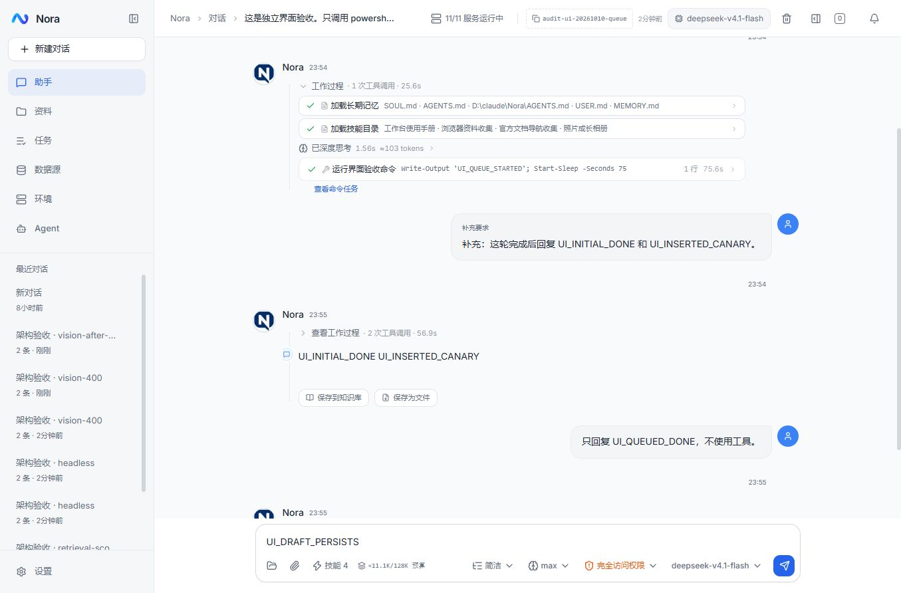

# Agent 架构修正设计 · 2026-10-10

对应同日审查报告 F01–F12。保留现有 Controller → Runner → Store、LangChain4j、工具执行器及 SSE 快照链路，不增加第二个运行引擎。

## 数据与职责

- **执行事实（F01/F02）**：最终保存失败时 Runner 保留最终证据，后台只重试幂等数据库提交。恢复前阻止该会话开始下一轮，绝不重新执行工具。远端写请求发送后出现无法确认的错误，统一通过现有 unknown 结果传播到模型、步骤和历史。
- **输入与会话（F03/F04/F05）**：正文和 TaskContext 是同一输入契约，编辑重发、插入及队列沿用它。会话持久保存项目目录，命令默认目录与项目规则使用同一绑定；临时 cwd 不改变绑定。已发送队列由服务端保存、领取，页面只展示和控制；草稿继续本地保存。删除、撤回和插入只能消费尚未领取的队列项。
- **当前工作状态（F06/F12）**：在完整工具轮边界复用现有语义压缩能力，保留目标、约束、已验证结果、未知操作、待办及原文路径。摘要替代对应旧轮次，未配对的工具不拆开。明确的知识库入口继续预检索，普通系统任务使用现有按需检索工具。
- **资源归属（F07/F08/F10）**：取消等待只退出等待；进程由所属轮次或显式 stop 停止。MCP 条目集中拥有连接、有效配置和进程清理，创建/替换/调用按服务器协调，初始化失败立即清理。浏览器采用有限数量的会话 owner，Playwright 句柄留在所属线程；截止时间必须使失效 owner 退出，不能仅返回 HTTP 超时后继续堆积操作。
- **结果完整性（F09/F11）**：MCP 保留 structuredContent、资源入口和嵌入内容，沿用现有脱敏/归档上限；坏图和模糊 400 不产生持久的模型能力否定结论。

## 改动范围与验收

变更必须贯通后端 DTO/持久化/入口/执行/恢复、前端 API/hook/交互以及原有调用方。新增数据库列和队列表使用项目既有迁移机制；不删除会话、步骤或检查点。旧本地已发送队列在首次同步时以稳定 ID 上传，确认后不再由页面调度。

先分别完成执行事实和资源生命周期，再完成会话/输入，最后处理长任务摘要与浏览器隔离。单元测试遵循项目的无断言冒烟约定；行为正确性通过真实服务 E2E 检查，包括短暂保存失败、写后断连、跨轮等待取消、MCP 冷启动/失败清理/凭据轮换、离页排队、范围保留、长轮次摘要及跨浏览器会话响应。前端执行类型、Lint、冒烟及构建四项检查。

实现、本地验收与部署分阶段执行；2026-10-11 已部署 megumin，Git 提交仍独立。运行边界是当前单用户、单 Agent 实例，不引入多实例调度、远程执行集群或宿主机提权。

2026-10-11 补充：普通网页任务默认使用 `manage_browser` 的无头 Chromium。沿用服务端既有 `setHeadless(true)` 启动保证，在系统协议和工具说明中明确执行模式；实时画面与人工接管复用同一实例，不增加模式开关或第二套浏览器执行链路。

## 实施与验证记录

实施、本地验收和 megumin 部署已完成（2026-10-10 至 2026-10-11）。保留原有执行链路，新增会话项目绑定与服务端输入队列表；未新建运行引擎。迁移为 `V41__session_project_and_queue.sql`，本地与线上已应用，未删除已有会话或步骤。最终提交耐久日志与新增故障验收详见 [2026-10-11 后续记录](run-finalization-recovery-2026-10-11.md)。

| 发现 | 实际修正 | 本地验证 |
| --- | --- | --- |
| F01 最终保存失败 | 最终证据先写持久化日志再幂等提交；保存未恢复时禁止会话开始下一轮，后台及重启只重试提交，历史读取不受故障写事务影响 | Windows 与线上 Linux 的真实最终保存故障、强制重启及重复日志通过；完整结果恢复，实际命令只写入一次 |
| F02 远端写操作错误 | 请求已发出但无法确认结果时标记 `unknown`，不当作普通失败自动重放 | 官方 MCP SDK 工具真实落盘后抛 RPC 内部错误；真实 SQL 插入 / 容器重启成功后截断响应；步骤与历史显示未知，写入与重启没有重复 |
| F03 项目上下文 | 会话保存 `project_root`；命令默认目录、相对文件路径与项目规则使用同一绑定，提供聊天输入栏项目入口 | 同一会话从项目 A 切换到 B，真实命令目录与注入规则同步；临时 cwd 回到 A 不改变绑定 B |
| F04 输入队列 | 发送即服务端落盘，以稳定 ID 消费；页面只同步和控制队列，离页继续执行；插入与领取互斥 | 重复发送、重复插入均只执行一次；撤回回到草稿；删除不执行；真实浏览器排队后离页，服务器完成后自动发送下一项；刷新保留插入顺序、过程和草稿 |
| F05 TaskContext | 正文与完整任务上下文贯穿编辑、插入、排队和恢复；检索前由执行器固定用户选择的范围 | 队列保留成果要求、入口及数据选择；真实模型尝试更改 base/doc/source，实际工具参数仍为用户固定范围；真实 RAG 索引、向量与关键词检索只返回所选资料，越界无匹配 |
| F06 长任务状态 | 在完整工具轮边界复用语义压缩；保存覆盖运行/轮次、简短工作摘要及完整可读原文路径，保留近期工具配对 | 10 次依赖前序结果的真实命令连续完成，中途生成语义检查点；恢复下一轮没有工具配对错误或重复执行。归档清除了 SDK 私有对象的不可读序列化 |
| F07 命令等待归属 | 取消等待退出该等待；取消当前轮只停止该轮所属命令，停止其他命令必须显式指定执行 ID | 前一轮的 90 秒后台命令在后一轮取消 wait 后仍存活，随后显式停止成功 |
| F08 MCP 生命周期 | 单个 Slot 拥有有效配置、客户端、transport 与进程；同一服务器的连接/调用/刷新协调，失败立即清理 | 四个并发冷启动只产生一个真实 stdio 进程；凭据轮换替换连接并清理旧进程；握手失败清理仍存活的子进程 |
| F09 MCP 富结果 | 保留 structuredContent、嵌入文本/资源入口、资源链接与图片，继续脱敏；无法处理的二进制/音频如实说明 | 官方 SDK 返回的结构化、嵌入文本和资源链接均进入工具证据，测试凭据未泄漏；图片由真实模型读取 |
| F10 浏览器归属与资源 | 每个 owner 独占 Playwright 线程和进程，队列有界；40 秒截止时间清理所属进程，繁忙轮询读取缓存；最多两个活跃浏览器 owner | Windows 与 Linux 的真实慢下载均不阻塞另一会话；超时清理 Node/Chromium 后可重新打开；Linux 在 768 MiB、禁用 swap 下完成双会话取帧和超时恢复 |
| F11 图像能力判断 | 仅上游明确拒绝能力时才记忆能力结论；坏附件与模糊 400 不污染下一次请求，错误说明区分本次失败与模型能力 | 透明中继只对坏图片请求注入一次模糊 400，其余请求转发同一真实模型/渠道；当次跳过工具图片恢复，随后正常图片仍实际发往上游并正确读出数字 |
| F12 工具选择 | 普通系统任务取消固定 RAG 预检索，显式知识范围与资料入口保留预检索，按需检索工具仍可使用 | RAG 服务未启动时，普通项目/命令任务正常完成，没有固定预检索等待或失败；真实模型网页任务直接使用无头 `manage_browser`，没有另起桌面浏览器 |

### 队列与上下文验证

前端入队、插入、删除和撤回共用已有操作互斥，避免尚未确认的入队收据互相覆盖。入队请求的稳定 ID 先随草稿保存；失败可用原 ID 重试；成功只清除仍与发送内容相同的草稿。用户在请求期间新输入的内容、任务卡之外的未发送草稿和引用均保留。移除了旧的页面自动执行队列和压缩专用分支，队列复用服务端同一轮次执行器。

手动/自动压缩的真实模型回归通过 39 项检查，包括幂等请求、摘要无工具定义、最新要求保留、取消/失败及编辑后检查点失效。实时恢复通过 14 项检查：1000 行真实命令输出、超过 8000 个流事件、完整快照与过期游标恢复、增量接续、提问恢复和继续命令执行；历史结果没有重复保存。

### 浏览器测量

服务端沿用无头 Chromium；系统协议和工具说明明确执行模式。真实模型直接调用 `manage_browser` 读取测试网页标题，进程命令行实际含 `--headless`。查看画面和人工接管使用同一浏览器。

生产 Compose 的 Agent 容器继续限制 768 MiB；JVM `MaxRAMPercentage` 从 75 调为 25，为浏览器进程保留内存，2026-10-11 已在线应用。活跃 owner 上限为两个，超过上限立即拒绝。Linux 独立测试容器使用相同限制，并将 memory+swap 上限也设为 768 MiB，因此不能使用 swap；这一更严格的 swap 限制仅用于隔离测试，线上原有限制保留。

| 场景 | cgroup 原始内存 | 扣除可回收文件缓存的工作集 | 连续十次取帧最慢耗时 |
| --- | --- | --- | --- |
| 预热后空闲 | 434.4 MiB | 322.9 MiB | — |
| 一个 owner，500 行页面 | 597.0 MiB | 483.1 MiB | 39 ms |
| 两个 owner，各 500 行页面 | 761.3 MiB | 645.0 MiB | 37 ms |

测试中 `oom`、`oom_kill`、内存上限触发事件及 swap 使用均为零，慢下载和超时后重新打开也通过。原始峰值为 763.7 MiB，接近容器上限；这里分别展示原始值与工作集，不能把可回收缓存当作额外可用容量。大页面、视频及更高并发仍需单独测量。测试容器和专用数据库已清理，测试镜像缓存保留。

### 质量门与证据

- Agent 173 项冒烟测试通过，随同构建的 common 9 项、security 2 项也通过；RAG 61 项、Datasource 15 项和 Env 8 项通过，Maven package 成功。
- 前端类型检查、Lint、139 项冒烟测试及生产构建通过；追加快速重复发送路径的无断言冒烟后，类型与测试再次通过。
- 本地浏览器实测队列、插入顺序、撤回草稿、离页自动继续、刷新恢复、项目入口与历史工具过程。最新版刷新后保留 `UI_DRAFT_PERSISTS`，同时可展开原有工具过程。
- 真实服务脚本：`scripts/e2e-agent-architecture.py`、`scripts/e2e-browser-resources.py`、`scripts/e2e-chat-commands.py`、`scripts/e2e-live-turn.py`。仅使用独立验收会话、临时 provider 与官方 SDK 测试工具；未伪造成功模型回复。

验收结果在忽略目录 `logs/`，下列文件记录具体事件和测量：

| 验证 | 报告 |
| --- | --- |
| 保存故障、Windows 浏览器 | `audit-1791646832509499400.json` |
| MCP 进程归属、富结果、未知写结果 | `audit-1791647708704259100.json` |
| 同一运行语义检查点 | `audit-1791647242841408100.json` |
| 项目切换与固定检索范围 | `audit-1791648177100997200.json` |
| Windows 浏览器超时后全部所属进程清理与重开 | `audit-1791648395422136900.json` |
| 39 项压缩命令回归 | `chat-commands-e2e-1791648086757084100.json` |
| 14 项实时恢复回归 | `live-turn-e2e/live-recovery-1791648076336515900.json` |
| Linux 双 owner 资源与超时恢复，13 项通过 | `browser-resources-1791649022061615500.json` |
| 真实模型无头网页操作，两项通过 | `audit-1791677487929238800.json` |
| 模糊 400 恢复与后续实际识图，两项通过 | `audit-1791677380510882300.json` |
| 最终提交耐久日志与重启，9 项通过 | `audit-1791678968477784300.json` |
| 真实 SQL / 容器写后断连、RAG 检索范围，9 项通过 | `audit-1791679045876520300.json` |
| megumin Linux 部署后验收，10 项通过 | `release-agent-architecture-20261011/verification.json` |

### 边界与未验证项

- 最终提交负载已持久化并验证进程重启恢复；磁盘丢失、文件系统损坏和断电恢复没有覆盖。
- 当前为单 Agent 实例、单用户设计，没有验证多实例同时领取队列。
- SQL/容器服务写后断连和真实知识范围检索已验收；更广泛的知识检索相关性与效果评测不在本轮范围内。
- Playwright 1.63.0 与 MCP SDK 2.0.1 的进程句柄需要少量固定版本适配；升级 SDK 必须重新验证初始化失败、超时及全部所属进程清理。
- 已部署 megumin，保留服务器模型配置、密钥和既有会话，未中断用户运行任务；未提交或推送 GitHub。部署备份与验收记录见后续文档。
