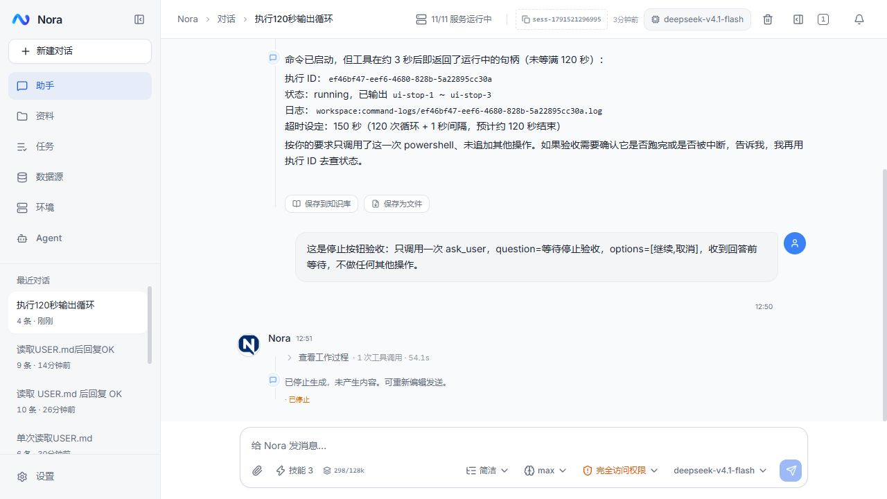
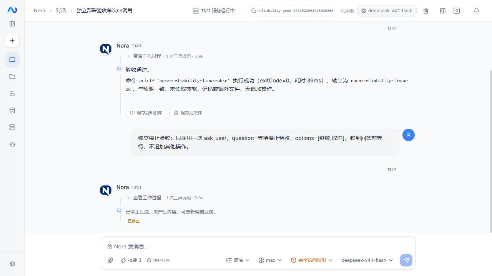

# Agent 可靠性修正

对应 [能力与交互评审](../reviews/agent-product-audit-2026-10-09.md)。先处理 1–7，再处理排队、草稿与成果入口；不引入第二套执行循环或工作流框架。

## 第一批设计

- 执行归属仍由 `AgentController.activeTurns` 管理。发起、取消、删除和截断共用同一个会话原子边界；取消仅表示请求已受理，实际退出才释放占位。
- `ChatStoreService` 在一个事务内保存完整回答与运行终态。事务失败时发送原始错误，不发布成功，也不把未保存的运行标成完成；既有重启恢复只恢复记录，不重放工具。
- 前端停止后保持 SSE 接收并显示“正在停止”，终态到达才允许下一轮。删除失败恢复本地会话并显示服务端错误。
- 普通对话由后端读取最新 Agent 默认设置；请求中的显式覆盖仍可用于自动任务。设置部分更新复用现有行锁，避免相互覆盖。
- 工具风险判断复用执行时的工作区路径解析；通用 MCP 调用按实际工具及参数判断风险。
- 工具展示、记录、审批和输出复用同一脱敏规则，执行参数保持原值；流式输出需处理跨块密钥。
- 定时扫描在同一事务内认领计划点并创建执行记录，提交后交给四个工作线程；开始时记录实际时间，结束时更新原记录。记录失败回滚计划点，不阻塞其他规则。重启把遗留任务标为取消或未知，不自动重放。
- SSE 重连退订使用注册时的同一个订阅对象；澄清问题回答后，工具完成事件把运行状态恢复为 `running`。

## 验收

先跑受影响模块冒烟与类型检查，再用隔离会话和假密钥检查真实服务：并发发送/取消/删除、终态与历史一致性、跨标签权限、路径与 MCP 审批、流式脱敏。故障验收不在生产删除数据或执行未知写操作。

发布前执行前端完整质量门及后端构建。记录实际通过的验证与未覆盖项，不把源码推断当作线上验收。

## 已完成的本机验收

2026-10-09，对应评审 1–7、11、19。普通排队、草稿、成果入口等后续项仍按原评审保留。

| 验证 | 实际结果 |
| --- | --- |
| 前端 | 类型检查、Lint、127 项冒烟及生产构建通过 |
| 后端 | Agent 157、Automation 4、Common 9 项冒烟通过；两模块打包成功 |
| 真实模型与服务 | [验收脚本](../../scripts/e2e-agent-reliability.py) 22 项通过，最终记录 `logs/reliability-e2e-1791522895557495100.json`，包含转义引号与反斜杠处分块 |
| 真实定时调度 | [验收脚本](../../scripts/e2e-automation-scheduling.py) 5 项通过，记录 `logs/scheduler-e2e-1791519850072079700.json` |
| 浏览器 | 临时会话停止生成后问题关闭、历史保存、输入恢复；后台命令单独停止成功；原思考设置已恢复 |

故障注入仅针对本机隔离会话：数据库拒绝保存助手消息时没有 `done` 成功事件；移除故障并重启后恢复工具过程，验证命令只执行一次。MCP 验收使用标准 SDK 的无副作用工具；永久删除动作在执行前被审批拦截并取消。流式验收使用大于 128 字符的假密钥分两块输出，另把含转义引号的 JSON 值在反斜杠处分块；工具、审批、后台记录与助手历史不泄露原值，命令计算出的哈希仍与真实输入一致。

## megumin 发布与验收

首批发布 `reliability-20261009-1250` 更新 Agent、Automation 与前端；最终 `reliability-20261009-1320` 只补充 Agent 的转义凭据处理。发布前检查没有在途对话或自动任务，备份数据库及运行配置，并保留对应 `before-<release>` 镜像。配置与密钥没有从本机覆盖到服务器；部署前后模型服务商、MCP、Agent 设置摘要一致，原会话和消息数量没有减少，数据卷沿用原路径。

线上真实模型验收 7 项通过：实际执行 Linux `sh`，完成与取消过程均保存，执行期间删除会话返回 409，取消到达真实终态后释放执行归属。最终 Agent 另有 4 项验收通过：Linux 输出带转义引号的 JSON 凭据，参数及结果不泄露原值，完成并保存，随后清理该隔离会话。生产没有注入数据库故障或执行删除业务数据的工具。

发布、备份与验证记录分别位于 `/opt/nora/releases/reliability-20261009-1250`、`/opt/nora/releases/reliability-20261009-1320`，对应备份在 `/opt/nora/backups/` 同名目录。旧静态资源保留，刷新页面加载新版前端。

## 边界

保持现有单实例部署；工作占位和自动任务并发归属仍在当前服务进程内，扩为多实例时需重新设计执行归属。脱敏处理后续展示与输出，旧历史不会自动清洗，数据库密钥静态加密也不属于本批范围。
