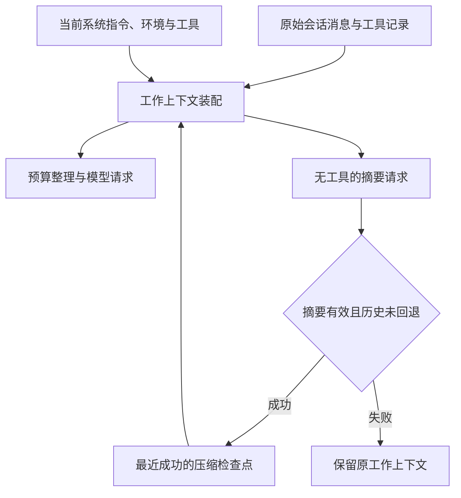
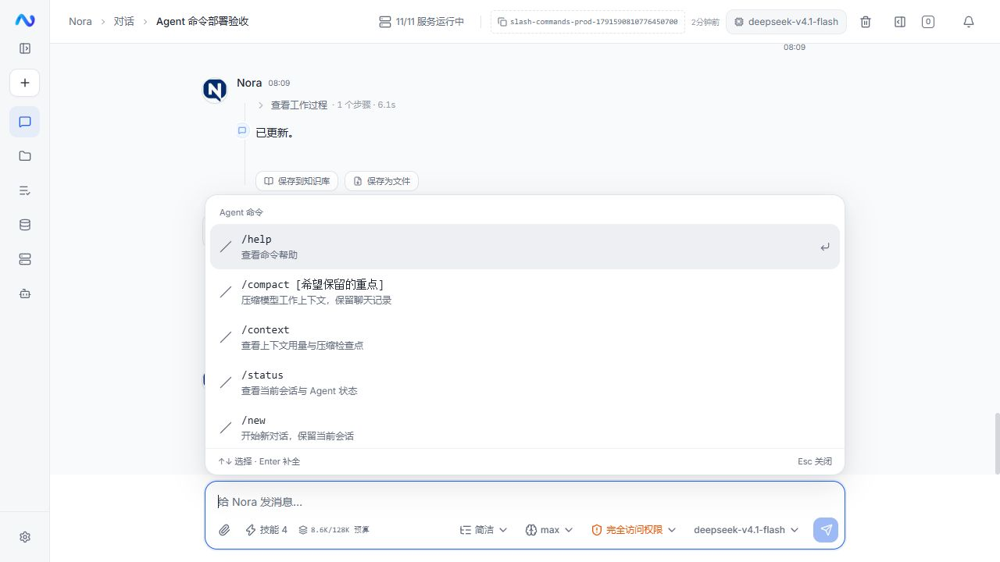
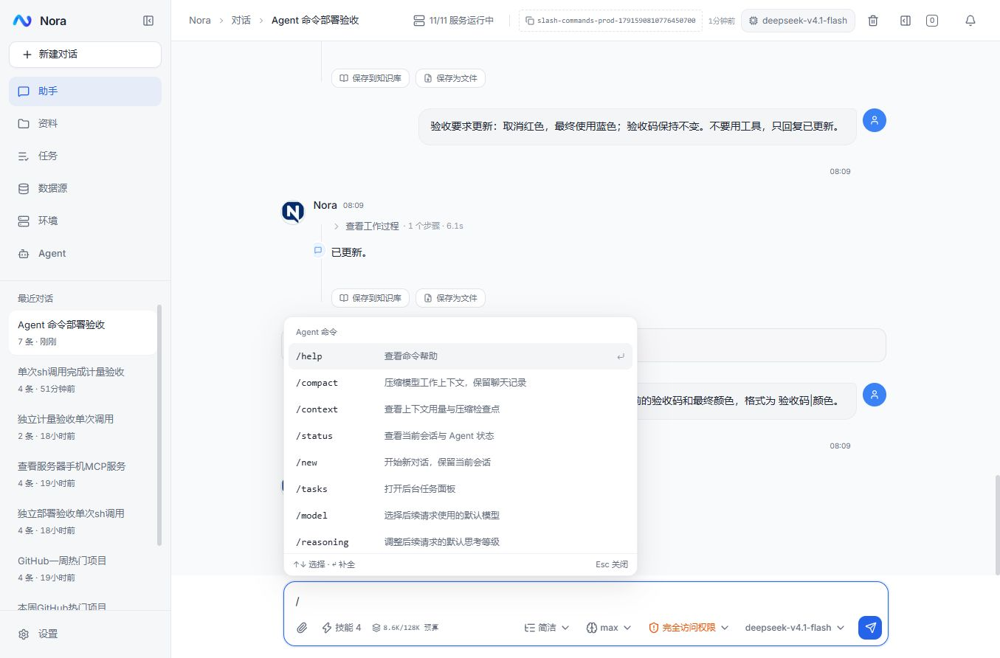

# Agent 斜杠命令与持久化上下文压缩

设计日期：2026-10-09。状态：已实现，2026-10-10 已部署到 megumin，本机与线上验收通过。

## 结论

Nora 应补充 Agent 控制命令。斜杠是快捷入口；实际操作由客户端或服务端直接执行，不靠模型解释命令字符串。技能与 MCP 引用继续保留，但在菜单中与控制命令分组。

第一批做 `/help`、`/compact`、`/context`、`/status`、`/new`、`/tasks`。模型、思考等级、权限的入口复用现有控件。最重要的前置工作是持久化压缩后的工作上下文：不能只给现有请求内裁剪方法加一个按钮。

不建立插件式命令框架，不增加另一套消息队列、模型客户端或任务调度系统。

## 官方资料说明了什么

以下是官方公开文档的行为说明，不是对闭源实现细节的推测。

- Codex 的斜杠入口用于操作模型、权限、会话和上下文；CLI 可以将命令排到当前轮结束后再解析执行。它并不要求每个命令都成为一次模型对话。[Codex 命令](https://learn.chatgpt.com/docs/developer-commands?surface=cli)
- Claude Code 的 `/compact [instructions]` 可以指定摘要重点；`/context` 展示上下文占用；`/clear` 开始新会话，旧会话仍可恢复。这三项是不同的操作。[Claude Code 命令](https://code.claude.com/docs/en/commands)
- Claude Code 压缩后会恢复项目规则、记忆和运行中任务的信息。这说明压缩需要重新装配运行上下文，不能只总结聊天文字。[压缩后保留什么](https://code.claude.com/docs/en/context-window#what-survives-compaction)
- OpenCode V2 将生成的摘要和近期上下文保存为检查点；后续请求从检查点继续，原会话消息仍然保留。其手动压缩在安全边界执行，失败不会阻断后续输入。[OpenCode V2 压缩](https://dev.opencode.ai/v2/docs/compaction/)
- OpenCode ACP 仅把已知名称解析为命令，其他以 `/` 开头的文本仍然作为普通提示。这可以避免将路径误判为命令。[OpenCode ACP 命令](https://opencode.ai/v2/docs/cli/acp/#commands)
- OpenAI 的 `/responses/compact` 是特定协议能力，返回的压缩窗口用于后续 Responses 请求。Nora 当前以 LangChain4j 接入多种协议，不能把这个端点当作所有模型都支持的通用接口。[OpenAI 压缩 API](https://developers.openai.com/api/docs/guides/compaction)

建议采用上述职责划分和持久化原则，不照搬全部命令或具体阈值。

## Nora 当前完整链路

本次知识图谱工具不可用，以下结论由源码直接核对。

| 环节 | 当前行为 | 影响 |
| --- | --- | --- |
| `ChatInputArea.tsx` | `detectMention` 识别 `@`、`#`、`/`；`/` 候选只有技能和 MCP 服务器 | 没有内置 Agent 命令；候选最多 8 项，不能让技能挤掉控制命令 |
| `ChatInputArea.tsx` | `selectMention` 移除匹配文本并添加引用 chip | 选择技能是添加上下文引用，不是执行控制操作 |
| `useChat.ts` | `sendMessage` 先拼接引用，运行中将输入放入普通提示队列 | 直接输入 `/compact` 目前会成为普通用户消息，甚至被排队发送给模型 |
| `useChat.ts` | `clear()` 只清空本地消息和队列 | 不能拿它实现会话重置；服务端仍有原历史，刷新或下一轮还会读回 |
| `AgentController.java` | `activeTurns` 保证单会话单轮次；取消、插入、编辑历史已有独立端点 | 压缩应接入同一个会话互斥边界，不能另起并发模型操作 |
| `ChatContextAssembler.java` | `buildMessages` 每轮读取历史重新装配；`compactForRound` 修改本轮 `List<WireMessage>` | 当前归档和摘录并不构成持久化的工作上下文 |
| `ChatOrchestrationService.java` | 下一次模型请求前处理补充要求、后台结果、预算整理 | 是自动整理的既有入口；手动压缩不应通过伪造用户要求进入循环 |
| `ContextUsageDto`、`useContextMeter` | 记录最近请求完整输入、缓存、输出；执行期间估算更新 | `/context` 应复用这些数据，不能重新累加整段聊天计费量 |
| `BackgroundTasksPanel`、`useSideWorkspace` | 已有后台命令列表、输出和停止能力 | `/tasks` 直接打开现有侧面面板 |
| `useCommandPalette`、`CommandPalette` | 是全局页面、文件等搜索，当前不包含会话历史索引 | 不能直接宣称已有 `/resume` 选择器，需另行接入会话列表 |

原有压缩主要归档工具正文、早期助手/工具往返和回收旧图。本次补上语义任务摘要与持久化检查点，与原有预算整理共用装配链路。此前的问题记录见 [上下文计量审计](context-meter-2026-10-09.md)。

## 第一批命令与边界

| 命令 | 用户看到的行为 | 运行中行为 | 是否请求模型 |
| --- | --- | --- | --- |
| `/help` | 显示可用命令、说明、参数和当前是否可用 | 立即显示 | 否 |
| `/context` | 查看当前上下文、最近请求实测、估算来源、预算和最近压缩 | 立即显示，随现有计量更新 | 否 |
| `/status` | 查看会话、最近请求模型标识、后续默认模型/渠道、权限、运行状态和排队数量 | 立即显示 | 否 |
| `/compact [重点]` | 生成工作摘要，保留近期过程与原始历史入口 | 第一版进入既有队列，当前轮结束后执行 | 是，摘要生成禁用工具 |
| `/new` | 新建或复用空白草稿，保留原会话及其队列 | 切换会话，原任务继续运行 | 否 |
| `/tasks` | 打开本会话后台命令面板 | 立即打开 | 否 |

设置快捷入口一起接入：

| 命令 | 最小实现 |
| --- | --- |
| `/model` | 打开现有模型选择控件，不另写模型表单 |
| `/reasoning` | 打开现有思考等级控件 |
| `/permissions` | 打开现有权限选择控件 |
| `/mcp` | 打开 Agent 的连接与工具管理 |

当前运行使用启动时解析的模型和行为设置。菜单应明确显示修改的作用范围；沿用现有全局设置时标为“全局默认，后续轮次使用”，不能显示成“仅当前会话”或声称已经改变正在执行的请求。

取消继续复用输入框的停止按钮；第一批不新增含义容易混淆的 `/stop`。后台命令仍由 `/tasks` 中的单项停止按钮控制，避免把停止回答和终止后台进程混为一谈。

不先增加 `/plan`、`/undo`、`/fork`、`/clear`：Plan 需要服务端真正限制写操作；撤销需要定义是否回滚文件和外部操作；分叉需要定义工作区、后台任务和检查点归属。`/new` 已覆盖安全的新会话需求。不能用提示词假装这些运行时能力已经存在。

## 输入框交互

1. 输入框开头输入 `/`，显示“Agent 命令”和“技能与工具”两个分组。命令显示英文名称、中文用途、参数占位和执行方式；支持按中文用途搜索。候选区域滚动，不将所有类别共用前 8 个名额。
2. 保留现有键盘习惯：上下键选择，Enter/Tab 补全，Esc 关闭；选择条目只补全，不立即执行。再次发送才执行，避免误触切会话。中文输入法组合期间不处理选择/发送键。
3. 只有消息开头、名称完整匹配且边界正确时才识别控制命令；参数取名称后的剩余文本，不设计 shell 式参数语言。普通正文中的 `/` 继续作为引用入口。
4. `/tmp/report.md`、URL、代码块以及未知命令名称保持普通文本。已知命令参数不合法时给出用法并保留输入，不自动交给模型“猜着执行”。
5. `/compact`、`/context` 等控制命令在拼接附件引用和进入普通消息队列之前分流。不能调用 `formatChatRefs` 后再判断命令，也不能把控制命令插入当前模型上下文。
6. 普通消息队列不变。仅给现有队列条目加明确的 `prompt` / `compact` 类型；旧缓存缺少类型按 `prompt` 读取。待执行压缩同样可删除、撤回编辑；正在压缩时只提供取消，不假装还能撤回已经发出的模型请求。
7. `/compact` 排队时显示“当前轮结束后压缩”；按现有队列顺序执行，不越过前面的用户输入，也不静默合并不同重点。请求重传使用原 ID，服务端幂等处理。任务失败后沿用现有暂停队列规则。
8. 控制操作不消费待发送附件。`/new` 切换前保存原会话的待发送引用和草稿；需要补齐当前未保存输入草稿的部分，不靠清空本地消息切会话。
9. 压缩在时间线上使用系统事件：“正在压缩 → 已压缩/失败/取消”，可展开摘要、前后估算和原文入口。不要伪造一条 AI 成功回答。其他只读命令用短面板展示，关闭后焦点回到输入框。
10. 菜单使用现有主题和基础组件，带列表选中状态、键盘焦点和可访问标签；实测窄屏、侧面面板展开和深色模式。

## `/compact` 的最小正确实现

### 历史记录与模型工作上下文分开



原始 `chat_message` / `agent_step` 是聊天展示、审计与回读数据，压缩不删除或改写它们。新检查点保存被覆盖的历史边界、摘要、原文入口和生成信息。后续模型上下文为：

```text
当前系统指令和运行环境
+ 最新成功检查点中的历史摘要
+ 检查点边界之后的完整消息与工具往返
+ 本次新要求和实际注入资料
```

初版只保留每会话最新有效检查点，不引入检查点树或新的会话分支模型。原历史始终可回读；再次压缩时更新已有摘要和新增历史，不能反复将全部原历史塞回摘要请求。

摘要记录当前目标、有效约束和偏好、用户撤销/修改过的要求、已完成且已验证的事实、进行中的任务及其真实 ID、结果未知的操作、成果路径与下一步。明确标记为历史资料，不能提升为新的系统指令。系统规则、权限、工具定义和当前环境由原有装配链路重新提供。

生成摘要复用 `UpstreamLlmClient` / LangChain4j 与当前渠道；不写新的 HTTP 客户端，不默认换另一个模型，不修改用户思考或输出额度。摘要请求不提供工具，不执行总结里的历史命令。内容为空、上游错误、输入不能容纳或取消时不替换检查点。

### 第一版选择任务结束后的安全边界

手动压缩第一版只在会话空闲时由服务端受理执行；运行中的 `/compact` 先留在已有队列。这样覆盖的是已经持久化的完整历史，检查点可以使用稳定的消息边界。

服务端复用同一个单会话互斥门，防止“发送普通消息”和“压缩”并发。压缩受理后按现有流式运行生命周期展示进度、用量、失败、取消和恢复；操作记录应有明确的压缩类型，不为了复用 `startRun` 而伪造用户问题。只在摘要成功并完成边界校验后事务性发布新检查点。

这比另加一套可抢占指令队列简单，也避免在工具结果尚未返回时改写上下文。如果以后需要“当前工具批次结束、下一次模型请求前立刻手动压缩”，再在现有请求边界消费同一个压缩请求；届时必须先定义轮内步骤游标，不能把未持久化的内存过程错误标为已覆盖。

### 自动和手动共用核心，不强行持久化每次裁剪

手动压缩强制尝试生成摘要，不受 83% 触发线限制。自动流程继续先做现有便宜的图片回收和工具归档；需要语义压缩时调用同一个摘要/检查点实现。

自动流程第一版只将已经持久化的完整历史前缀做检查点，正在执行的本轮保持完整，不用不稳定的内存索引表示持久化边界。一次超长任务没有可压缩的完整前缀时，仍可能无法释放足够空间；如实返回结果。轮内检查点另行设计，不用特判掩盖。

`compactForRound(force=true)` 当前还承担上游超限恢复并采用不同目标，不能把手动压缩直接映射成这个布尔参数。手动是用户操作，超限恢复是错误处理，入口分开，底层整理和摘要能力复用。

### 编辑、重启、取消和计量

- 编辑重发会调用 `truncateFrom`；初版在同一事务中使现有检查点失效，重新从未删除的历史装配。宁可重新整理，也不能让已撤销的要求和结果继续藏在摘要里。
- 删除会话同时处理检查点。无检查点的旧会话走现有装配路径，不批量迁移或改写旧消息。
- 刷新和重启后读取已经发布的检查点；未完成的压缩不发布、不自动重放原任务。原会话后台命令仍归原会话所有。
- 原记录归档先成功，摘要和边界校验后再提交检查点；失败保留原上下文。模型调用期间不能长时间持有数据库事务或会话监视器锁。
- 压缩前后数值对比同一套请求装配口径。成功后立即推送新的估算，标 `≈`，保存到服务端；后续真正的回答请求再用上游完整输入实测替换。摘要调用的计费用量单独记录，不能被当成压缩后会话占用。
- `/context` 分开展示“最近实际请求”和“下一请求估算”，不把两者混成一个精确值。工具、系统、历史等拆分是估算，不能伪装成上游提供的逐项计数；未知模型容量继续显示“整理预算”。

## 影响范围与建议契约

以下是本次已触达的实施范围。

| 部分 | 必须触达的现有代码 | 最小调整 |
| --- | --- | --- |
| 菜单与键盘 | `ChatInputArea` | 提取独立命令菜单，保留引用选择行为；修正提示文案和分组 |
| 发送与队列 | `useChat`、`useChatSessions`、`ChatMessageQueue`、`types/index.ts` | 发送前分流，队列增加压缩条目；恢复/撤回不丢类型或参数 |
| 已有操作 | `useAgentSettings`、`useModelProviders`、`useSideWorkspace` | 复用设置和面板动作，标明作用范围 |
| 服务端入口 | `AgentController`、`ChatTurnRunner`、`TurnStreamRegistry` | 共享互斥与运行生命周期，压缩不进入正常用户提示链路 |
| 压缩与装配 | `ChatContextAssembler`、`ChatOrchestrationService`、`ChatStoreService` | 读取成功检查点、生成摘要、发布边界、编辑失效 |
| 计量与恢复 | `ContextUsageDto`、`agentApi`、`chatApi`、`useContextMeter` | 区分压缩调用 usage 与整理后的工作上下文，刷新不恢复旧计量 |
| 数据与文档 | Flyway、Agent/Web 规约与 E2E | 保存检查点/操作类型，旧记录兼容，验证端到端 |

客户端一份很小的静态命令目录同时驱动候选菜单和精确名称解析。内置名称保留；技能同名仍可从“技能”组选择成引用，不能覆盖控制命令。目录不存业务状态，不提供自定义执行脚本或插件注册机制。

服务端只为缺失能力补端点：`POST /api/chat/sessions/{id}/compact` 接收 UUID 请求 ID、模型/渠道和可选重点（最多 4000 字符），使用既有 SSE 协议；`GET /api/chat/sessions/{id}/context` 返回最新检查点、当前工作上下文快照和最近上游实测快照。其他命令直接复用已有动作。服务端校验会话归属、参数长度、互斥和幂等，不仅依赖前端检查。

## 验收与实施顺序

1. 先补检查点、装配、编辑失效和压缩后的计量；验证下一轮与重启后确实继续使用摘要，而不是重新装回全部历史。
2. 接入无工具的手动摘要与现有运行生命周期；验证上游失败、空摘要、取消、保存失败均不损坏原上下文；相同请求 ID 不重复计费执行。
3. 补命令目录、菜单和发送前分流，复用已有队列、设置和面板；再接自动语义摘要，避免两种压缩实现长期分叉。
4. 用真实模型和真实服务验收：`/context`、`/status` 不增加模型请求；压缩前后 token 口径一致；下一条要求记得有效约束和撤销；原文仍可回读。
5. 浏览器验收输入法、键盘、未知 `/` 文本、技能同名、附件保留、运行中排队/撤回、切会话、刷新恢复、窄屏和深色模式。单测仅作项目约定的冒烟。

## 实施与本机验收

- Flyway V40 增加 `chat_run.kind` 与每会话唯一的 `chat_context_checkpoint`。成功摘要、压缩事件与运行终态在同一事务提交；原始消息不改写，编辑回退和删除会话会使检查点失效。
- `ChatContextCompactor` 只生成候选；正常回答与手动压缩共用 LangChain4j 模型客户端、上下文装配和预算。压缩操作不注册工具，不新增用户消息；操作的请求、事件和持久化消息共用稳定标识。
- 自动整理先执行现有工具归档和图片回收，仍超过 83% 时摘要已完成的历史前缀。本轮消息和新插入要求保留；手动压缩不受触发阈值限制。
- `scripts/e2e-chat-commands.py` 的 37 项验收通过，成功响应来自真实模型：有效要求与撤销、下一轮使用摘要、同口径计量、原文回读、重复提交、400 原始错误、取消、共享互斥、编辑失效、自动阈值摘要。失败和延迟由透传中继注入，不伪造成功响应。
- 浏览器验证了菜单分组、键盘补全、帮助/状态/上下文面板、设置入口、后台任务面板、压缩排队与撤回、停止后暂停、压缩中刷新恢复、草稿和引用保留。质量门通过：161 项后端冒烟、130 项前端冒烟、类型检查、Lint 与生产构建。

摘要是有损转换，原始证据入口保留。第一版不实现轮内持久化检查点；单次任务自身过大、没有可压缩的完整历史时仍可能触及上游窗口。

## megumin 部署与线上验收（2026-10-10）

- 更新 `agent-service` 与 `nora-web`，应用 Flyway V40；线上 JAR 校验和与本机已验收产物一致，两个容器健康。发布记录保存在 `logs/slash-command-release/deployment.json`。
- 发布前新建 `/opt/nora/backups/slash-20261010-0805`，保留数据库、原 `.env` 与 Compose；上次中断的备份也保留。模型设置、MCP 配置的摘要一致，发布前后仍为 41 个会话、144 条消息，没有减少历史。
- `logs/slash-command-release/verify.py` 对真实线上服务和真实模型完成 24 项检查：成功检查点、上下文减少、摘要计费分离、原文归档、刷新恢复、相同请求 ID 重传、下一轮最新要求、运行期间计量与上游实测一致。
- 验收工作上下文同口径估算由 11,430 降至 7,631 tokens。后续回答仍输出正确验收码与最新蓝色要求；成功检查点继续保留。验收会话为 [Agent 命令部署验收](https://nora.rainaki.top:13001/chat?session=slash-commands-prod-1791590810776450700)。
- 线上浏览器验证菜单分组、`/help`、`/context`、`/permissions` 与 `/mcp`。权限入口明确为后续请求生效，MCP 进入现有 Agent 连接管理页；只读命令没有增加模型运行。连接自动化曾超时，拆分操作后完成上述验证。
- 实际重启后的真实模型验证已在本机完成，记录见 `logs/slash-command-release/local-restart-verification.json`；本次未为验收再次重启线上服务，也未注入生产保存失败。物理中文输入法未实测，组合输入保护沿用现有逻辑。



## 输入框上方浮层调整（2026-10-10）

按用户提供的 Codex 交互参考，候选和命令详情都属于聊天输入区。用 Radix Popover 锚定完整输入框，浮层宽度跟随输入框，显示在上沿，内容内部滚动；通过 Portal 避免侧栏和容器裁剪，不加页面遮罩或阻断聊天。

`ChatInputArea` 负责锚点、打开/关闭与现有键盘选择；`ChatMentionMenu` 保留命令与引用分组。`/help` 复用候选列表，可选择命令；`ChatCommandPanel` 仅展示 `/context`、`/status` 的内容，不再负责模态窗。`ChatConversation` 继续只传递会话数据与动作，命令解析、队列和服务端压缩不变。

保留输入焦点、上下键、Enter/Tab 补全和 Escape 关闭；点击聊天区可关闭浮层，输入框内部操作不误关。验证桌面、侧面面板、窄屏与键盘选择，不新增自定义浮层定位或另一套弹窗状态。

### 浮层验收与前端更新

- 菜单采用名称、说明两行布局，`/compact` 显示可选重点参数；候选和详情内部滚动，隐藏滚动条。复用现有主题颜色、输入框和命令行为。
- 本机浏览器验证了键盘选择到最后一项、补全、帮助菜单、上下文详情、Escape 与关闭后的输入焦点。桌面输入框与菜单均为 820px 宽；工作区分栏后均为 308px；390px 窄屏下均为 358px，间距约 8px，无页面横向溢出。深色模式已实测，随后恢复原浅色设置。
- 类型检查、Lint、28 个文件的 131 项冒烟测试与生产构建通过，入口包 gzip 124.40KB。物理中文输入法未实测，组合输入保护沿用现有逻辑。
- 发布 `slash-ui-20261010-0844`，只更新 `nora-web`。备份位于 `/opt/nora/backups/slash-ui-20261010-0844`；发布前后仍为 42 个会话、151 条消息，模型、MCP 与设置摘要一致。发布记录见 `logs/slash-ui-release/deployment.json`。
- 线上入口文件校验和与本机构建一致，Agent 镜像不变、Agent 和前端健康。浏览器刷新后实际加载新版；原浏览器缓存的旧入口需要刷新才能更新。
- 线上 `/help` 复用候选列表，`/context` 在输入框上方展开。详情与输入框均为 820px 宽，底部距输入框 8px，焦点保留，页面无横向溢出。验收会话仍为 3 次回答、1 次压缩、0 个活动运行，只读命令没有新增模型请求。验证记录见 `logs/slash-ui-release/verification.json` 与 `browser-verification.json`，上方截图已更新为新版浮层。

### 紧凑菜单调整（2026-10-10）

用户反馈上一版等宽、两行候选形成大块空白。候选菜单改为输入框左侧锚定、最大 480px 宽；窄屏和分栏继续限制在输入框宽度内。每行 36px，命令名称与说明同一行，去掉命令前重复的斜杠图标，参数格式保留在提示里。列表与底部键盘提示压缩留白，选中项用轻背景、小圆角。

仅调整 `ChatMentionMenu` 的展示与 `ChatInputArea` 的浮层宽度，复用已有 Radix 定位、主题、键盘和命令数据；详情也限制为 480px 宽。不增加菜单状态、命令实现或新的交互分支。影响范围为所有引用候选、帮助及上下文/状态详情，需验证桌面、分栏、窄屏、深色与键盘滚动。

- 四项前端检查通过，仍为 131 项冒烟测试，入口 gzip 124.40KB。本机实测桌面浮层 480px、分栏 308px、390px 窄屏 358px；均在输入框上方左对齐，无横向溢出。最后一个 MCP 候选可用键盘滚到可见区域；Tab 补全 `/compact ` 后焦点保持。帮助、上下文详情和深色模式也已验证。
- `slash-menu-20261010-0902` 仅更新前端并保留回退镜像与备份。容器健康，线上入口校验和与本机构建一致，Agent 镜像不变；验收会话模型运行仍为 3 次回答、1 次压缩、0 个活动运行。记录见 `logs/slash-menu-release/deployment.json` 与 `verification.json`。
- 已刷新用户当前的线上验收会话，确认新版紧凑菜单实际显示；截图如下。本次未重复验收模型执行逻辑，物理中文输入法保护沿用已有实现。


