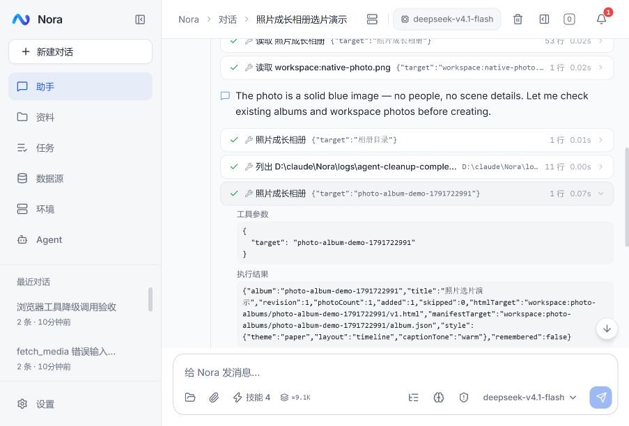

# 后端精简与验证（2026-10-11）

Nora 已收敛为运行在宿主系统上的单用户智能体：一个 Spring Boot 应用，领域服务直接调用，内置工具使用 LangChain4j 契约与执行器，模型循环保留 SDK 原始类型，前端发送与恢复使用同一事件状态链路。本轮完成源码、调用方、测试及维护文档更新；未部署 megumin 或推送 Git。

## 规模与范围

统计包含注释和空行，只统计生产 Java；文件移动不算删除，不把测试、SQL、配置或文档混入减量。

| 指标 | 微服务改造前 | 单服务及统一装配后 | 本轮完成后 |
|---|---:|---:|---:|
| 生产 Java 文件 | 172 | 154 | 158 |
| 生产 Java 行数 | 36,286 | 31,852 | 30,899 |
| 后端应用进程 | 8 | 1 | 1 |
| Maven 模块 | 13 | 1 | 1 |
| 平台运行依赖 | PostgreSQL、Redis、Nacos、Kafka | PostgreSQL | PostgreSQL |

累计净减 **5,387 行（14.8%）**；本轮再净减 **953 行**。新增少量请求类型与 SDK 适配入口，用于删除分散的工具 schema、参数解析和模型消息转换。测试 Java 为 53 文件、5,354 行；前端 src 为 257 个 TS/TSX 文件、27,858 行，较本轮基线净减 98 行。

## 一个应用与明确的领域职责

入口为 [NoraApplication](../../nora-api/src/main/java/com/nora/NoraApplication.java)。`com.nora` 下保留 agent/file/rag/datasource/env/automation/notification 领域包；Controller 与 Agent 工具共用业务 service，不请求自己的 HTTP 控制器。

删除 Spring Cloud/Alibaba、Nacos、Gateway、Kafka 及平台 Redis 接入，删除八套独立启动与重复配置、十个内部 HTTP 客户端及响应解包模型。通知直接写 PostgreSQL；审批使用会话绑定的一次性票据、120 秒超时和取消拒绝。外部 Redis 数据源仍使用 Lettuce，属于用户连接的系统。嵌入缓存使用已有 Caffeine，32 MiB 权重上限、七天有效期，键包含端点/模型/维度/文本摘要，向量进出复制。

[EnvironmentService](../../nora-api/src/main/java/com/nora/env/service/EnvironmentService.java) 统一状态、日志和控制。纳管源名称来自实际注册表，容器操作控制注册的 containerName；FILE 日志不支持启停。运行平台决定注册 PowerShell 或 sh 工具，Playwright 默认无头。

[FileLifecycleService](../../nora-api/src/main/java/com/nora/file/service/FileLifecycleService.java) 在同一事务中变更文件与知识文档，磁盘清理放在提交后；新操作不产生跨服务 outbox。[LegacyRagSyncRecovery](../../nora-api/src/main/java/com/nora/file/service/LegacyRagSyncRecovery.java) 只在升级启动时处理旧 pending_rag_sync，保留版本防护，失败阻止启动。RAG 异步索引、失败状态和范围限制继续保留。

七个 schema 与各自 Flyway 历史保留。既有 85 个迁移逐字节一致，不改 checksum、不删除用户历史或凭据。旧失败反思表保留数据，但删除无实际价值的固定写入、读取及 system 注入。SQL/Redis 支持读写；自动 SQL 规则必须明确指定类型与 connectionId，不猜文本或第一个连接。

## 工具由实际方法定义

[AnnotatedTools](../../nora-api/src/main/java/com/nora/agent/service/AnnotatedTools.java) 从实际 `@Tool` 方法生成全部内置工具的 `ToolSpecification`，使用 SDK `AiServiceTool` 和 `DefaultToolExecutor` 绑定与执行。固定领域 Bean 由 Spring 构造器注入；MCP 消费服务器提供的 schema，发现结果变化后才更新工具声明。

简单方法使用 `@P`；复杂请求使用 [ToolInputs](../../nora-api/src/main/java/com/nora/agent/service/ToolInputs.java) 的 record，注册时展平为原有顶层参数。执行时按照实际方法签名交给 SDK 绑定，不保留第二套手写 schema 或 action 分发入口。会话、步骤、输出回调和无人值守标志使用 SDK 调用上下文传递，不进入用户参数。

绑定入口校验 JSON 对象、必填字段、未知顶层字段和实际类型，禁止标量及小数隐式转换。动作范围、路径、数量、revision 等业务条件由领域方法校验。文件中心 id 为字符串，批量用逗号分隔；任一 ID 无效时整批拒绝，操作前完成校验。MCP arguments/headers/env 使用对象，不接受 JSON 字符串套 JSON。

统一审批、并发、循环检测、脱敏和归档仍在原执行链。保留原始结果的 truncated/unknown/partial、文件变更与后台进程信息；参数错误明确回填，取消与执行异常传播至 Run，不由 SDK 错误文本吞掉。无人值守拒绝 CRITICAL；HIGH 只在 FULL 允许；ASK 拒绝所有工具。

## 模型循环保留 SDK 类型

[WireMessage](../../nora-api/src/main/java/com/nora/agent/service/WireMessage.java) 只携带 SDK `ChatMessage` 与轮次位置；上下文、压缩、编排和 [UpstreamLlmClient](../../nora-api/src/main/java/com/nora/agent/service/UpstreamLlmClient.java) 直接消费原始消息、内容、工具请求及声明。JSON 仅出现在存储、HTTP 和前端事件边界。

图像、推理签名及模型属性随 SDK 消息保留；不可变消息加入图片后必须替换当前消息，避免首轮附件丢失。工具调用校验完整参数、名称、调用 ID 与重复 ID，原有 Anthropic/Responses 的渠道兼容只保留在实际 HTTP 边界。

标题生成明确把用户原话当作命名素材，避免旁路模型执行其中的任务；超长或无效标题保留原占位，不截出一段拒绝执行的回答。

## Run、取消与恢复

[ChatRunService](../../nora-api/src/main/java/com/nora/agent/service/ChatRunService.java) 唯一负责会话占用、排队、启动、取消与句柄。聊天、压缩、自动任务和环境诊断共用此链；自动任务消费已保存的 Result，不解析内部 SSE。删除无会话的一次性 Agent 入口与旧跨服务回调。

[ChatTurnRunner](../../nora-api/src/main/java/com/nora/agent/service/ChatTurnRunner.java) 聚合过程，经 [ChatRunFinalizer](../../nora-api/src/main/java/com/nora/agent/service/ChatRunFinalizer.java) 先写恢复日志、事务保存回答/过程/Run 状态，再发布 `done`。保存失败保留待恢复结果并重试提交，不自动重放工具。

取消中断模型和工具、取消挂起提问与审批，实际线程退出前仍占用会话。真实验收发现线程中断会让 FileChannel 日志写入抛出 ClosedByInterruptException；统一提交入口现在暂时清除中断并在保存后恢复，保证取消也保存终态。提问取消传播 CancellationException，超时才返回未回答，不将停止误记为超时。

## 前端只保留一条流状态链

[chatApi](../../nora-web/src/lib/api/chatApi.ts) 统一 POST SSE 与恢复 EventSource 的 `ChatStreamEvent` 解码与载荷校验；API 层不维护消息状态。[useChat](../../nora-web/src/hooks/useChat.ts) 唯一持有 reducer 与 50ms 文字缓冲，控制及终态事件先刷新缓冲。业务错误等到 done 收敛，传输断线沿游标自动恢复；恢复快照不自动打开历史文件。

首次或过期游标恢复使用完整快照，后续续传增量。历史工具、推理、进度、上下文与提问保持同一顺序，避免两套发送/恢复逻辑的状态偏差和每个 delta 重渲染。

## 验证

- 最新 Maven `verify` 与 Spotless 通过：52 套、295 个无断言冒烟用例，覆盖 SDK 参数、默认值、枚举、取消及中断下终态提交。前端 typecheck、Lint、Knip、32 文件/141 个冒烟用例和生产构建通过。
- [真实 HTTP 验收](../../scripts/e2e-standards.py) 10 组通过：状态码、Provider 脱敏、SQL/Redis 读写、DDL、批处理、截断、文件回收下载、技能和调度条件。
- [单服务真实模型验收](../../scripts/e2e-single-app.py) 覆盖 SQL、文件引用/查看器、环境/MCP、历史重载、互斥、排队撤回/插入/自动派发、取消后新轮次及自动任务通知。`annotated` 额外核验默认 50 行日志、自建容器审批/拒绝/启停、unknown 结果与 truncated；`builtins` 核验工作区编辑、技能 CRUD、混合无效文件 ID 无副作用，以及真实待回答提问取消后 Run 持久化为 cancelled。
- [凭据与 MCP](../../scripts/e2e-env-vars.py) 使用官方 Python MCP SDK 的真实 HTTP 服务，经模型 manage_mcp 注册并调用嵌套对象参数；变量引用、脱敏、含引号/反斜杠值、审批拒绝与清理通过。
- [图像验收](../../scripts/e2e-chat-images.py) 验证真实 Anthropic 图片请求的首轮、历史、工具读取和插入；[相册验收](../../scripts/e2e-photo-album-agent.py) 实际读取蓝色 PNG、创建相册及 open_file 交付通过，未限定媒体范围的请求被拒绝且未下载。
- [浏览器工具验收](../../scripts/e2e-browser-agent.py) 的 plan-guard 模式验证真实模型不能改写冻结计划、降低验收条件。
- [实时恢复验收](../../scripts/e2e-live-turn.py) 使用真实 1,200 行命令、推理及提问：首次/过期快照、增量恢复、浏览器回答、最终落库和服务重启后的工作过程保留通过。[客户端实测](../../scripts/e2e-live-turn-client.mjs) 回放实际 17,095 个事件，只提交 62 次状态更新，文本、步骤、提问、上下文及恢复终态一致。
- 单服务合并时另已核验文件/知识事务回滚与清理、旧 pending_rag_sync 恢复、旧库副本历史/配置保留、非 root Linux 镜像、无头 Chromium、Nginx 与 Docker DNS。后续改动验证 jar；未重新构建此镜像。

实测记录及实施前快照保存在被忽略的 `logs/agent-cleanup-complete-20261011/`；前几阶段证据位于 `logs/backend-simplification-20261011/`、`logs/backend-single-app-20261011/`、`logs/tool-unification-20261011/`。不提交凭据或私有验收数据。

本轮临时数据库、后端/前端验收进程、测试容器和浏览器标签已清理；原 nora 数据库及既有基础设施保留。

## 请求组装性能

对相同的 242 条消息、17 个工具声明及 207,123 字节输入，提取本轮基线的原始组装方法与当前实际方法，预热 500 次、各测 2,000 次。结果见本地 `message-assembly-performance.json`。

| 单次请求组装 | 改造前 | 改造后 |
|---|---:|---:|
| P50 | 298.4 µs | 1.7 µs |
| P95 | 537.7 µs | 2.1 µs |
| 平均线程分配 | 492,578 B | 3,640 B |

测量只覆盖请求对象组装，不包含模型思考、网络、分词或浏览器渲染，不代表端到端响应快了同等倍数。

## 运维与限制

构建使用一个 Dockerfile 和一个后端产物；维护入口为 `nora.sh` / `scripts/backend.ps1`，按完整 jar 路径识别进程。Compose 沿用原项目、PostgreSQL 和业务卷。当前说明见 [后端 README](../../nora-api/README.md)、[维护约束](../../nora-api/CLAUDE.md) 和 [部署与升级](../deployment.md)；architecture-v2 等早期设计仅作档案。

保留有实际入口的照片相册、网页采集、媒体、文件、知识库和自动任务；未重写浏览器/媒体引擎或 RAG 算法，未做长期负载与多实例测试。Run、审批、浏览器所有权和终态恢复日志按单实例运行。生产升级需备份并计划停机，新旧应用不能同时调度同一数据库。
