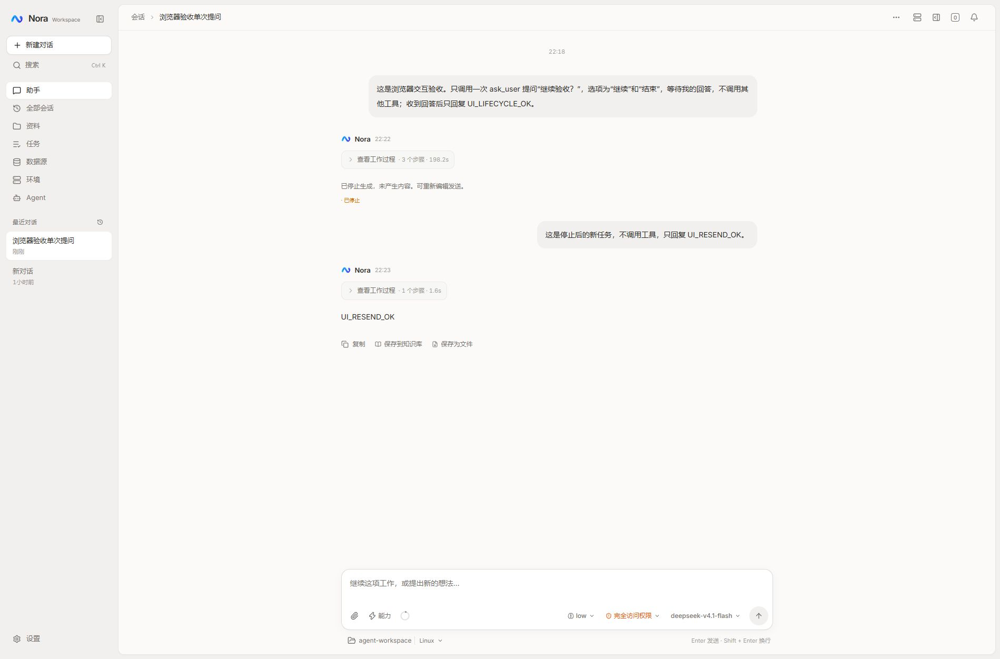

# 发送、停止与恢复链路验收 · 2026-10-13

## 范围与最小方案

沿用 useChat → AgentAPI → ChatRunService → 运行事件流与持久化历史。服务端负责执行与终态，前端连接的断开不能取消任务；取消必须走 cancel 接口。只修复发送入口、恢复探测和取消受理的时序，不增加执行引擎或数据库状态。

真实服务复现三个问题：

1. React 更新输入框前连续调用发送，第二次使用旧闭包中的输入，额外排队同一任务。发送入口改读当前草稿，并在派发前同步消费、保存草稿。
2. POST 流断开且恢复查询失败后，没有重试触发，网络恢复后仍停在失败状态。恢复探测失败后延迟重试，联网事件立即触发；切页释放旧 POST 连接，服务端继续执行。
3. 发送后立即停止，cancel 先于 POST 到达时返回 false，被当成已受理。前端检查受理结果，只在原发送仍进行时重试取消，等待服务端终态。

影响入口：聊天输入区、快捷命令转交的普通输入、首页自动发送、任务卡和重试复用的 runTurn、切页后的恢复流。后端 HTTP 契约与存储不变。保留用户原有草稿、会话与队列；验收仅创建独立 lifecycle-e2e 会话。

## 验证

`scripts/e2e-chat-lifecycle.mjs` 在 Node/JSDOM 中挂载实际 React hook，直连真实 HTTPS 与原生 EventSource。真实模型调用 ask_user，验收快速连点、主动断开 POST、临时断网、联网恢复、清空内存后重新挂载、重复停止、停止终态持久化、停止后重发以及延迟发送请求的取消竞态。没有模拟模型或接口响应；结束后取消并软删除测试会话。

脚本完整通过。类型检查、Lint、41 个文件 158 项冒烟、生产构建均通过；本次没有后端代码或数据库迁移。

线上浏览器另行完成：输入框发送 → 真实 ask_user 等待 → 刷新恢复 → 切换到原有草稿再返回 → 停止 → 输入并发送新任务。刷新、切页没有重新发起任务；停止后提问卡关闭、按钮恢复发送；新任务返回 `UI_RESEND_OK`。服务端核对只有两条用户消息，两个 assistant 终态分别为 cancelled 和 completed。独立测试会话已删除，页面返回用户原有草稿。

限制：断网和请求交错通过客户端传输故障注入完成，未关闭用户电脑网络；浏览器快速连点不用于毫秒级时序断言，时序检查由真实 hook / HTTPS 回归覆盖。未覆盖长时间离线、跨设备并发或服务端重启，本次仅验收单页连接和任务生命周期。

## 发布

megumin 前端已发布 `ghcr.io/yizhiakuya/nora/nora-web:20261013-chat-lifecycle`，镜像摘要 `sha256:49425b70e9a5c53cbd71c5ccb845f987d03443504c76f35cd88e762a7aaebfc8`，入口资源 `index-BmN_8aBW.js`。镜像推送 GHCR，并使用 SHA256 校验归档传输、载入；仅重建 nora-web。

API 保持 `20261013-session-delete`，容器 ID 不变。两个容器健康。服务器 Compose 的 web 镜像固定为本次标签，API 继续使用原 NORA_TAG。原 Compose、运行环境和镜像标识已备份至 `/opt/nora/backups/20261013-chat-lifecycle`，本次不修改数据库或用户配置。
