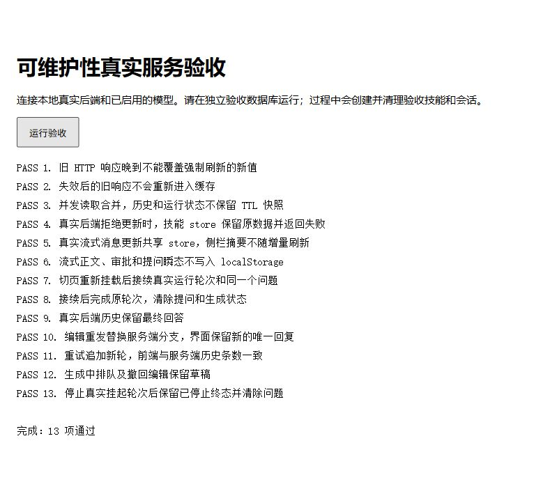
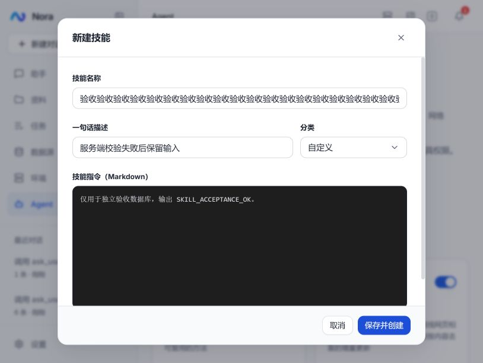

# Nora 代码量、质量与可维护性优化实施记录

日期：2026-10-12  
依据：[优化评估与九项建议](code-maintainability-review-2026-10-11.md)  
状态：九项建议已落实，常规质量门与本次选定的真实链路验收通过

正式环境已部署，版本、备份及上线验收见[部署记录](deployment-2026-10-12.md)。

## 1. 实施结果

本轮优先删除重复状态、重复执行路径和重复参数转换，保留已有服务、SDK 工具绑定、聊天 reducer 与文本缓冲。没有新增生产依赖或通用框架，也没有为了缩小文件而机械拆分大类。

| 生产源码口径 | 实施前 | 实施后 | 净变化 |
|---|---:|---:|---:|
| 前端 TS/TSX | 25,565 | 25,413 | -152 |
| 后端 Java | 30,899 | 30,827 | -72 |
| 合计 | 56,464 | 56,240 | **-224** |

行数包含空行与注释，排除单测、E2E 页面、脚本、生成物和数据库迁移。比较基准是本轮实施前的工作区快照，已有的单应用迁移及其他未提交修改不计入本轮收益。新增验收代码单独保留，不能将生产源码减少描述成整个仓库净减少。

| 主要文件 | 实施前 → 实施后 |
|---|---:|
| `agentApi.ts` | 562 → 504 |
| `useChat.ts` | 729 → 689 |
| `useChatSessions.ts` | 333 → 304 |
| `useSkills.ts` | 168 → 147 |
| `requestCache.ts` | 182 → 166 |
| `AgentWorkspaceService.java` | 1,312 → 1,297 |
| `McpManagementTools.java` | 391 → 368 |
| `TerminalService.java` | 736 → 719 |
| `McpServerService.java` | 929 → 915 |

技能弹窗增加了等待及失败状态处理，局部行数上升；步骤发射器仍保持原有职责，没有以拆文件替代设计收敛。

## 2. 九项改动及职责边界

### 1）普通与通配符文件操作共用执行链

[AgentWorkspaceService.java](../../nora-api/src/main/java/com/nora/agent/service/AgentWorkspaceService.java) 将通配符限制在源列表展开阶段。两种入口统一生成源目标对，全部预检后再执行：受保护路径、工作区根目录、目标已存在、源目标包含关系及符号链接解析后的实际路径均在共享链路检查。

删除通配符专用复制/移动执行分支和成功后额外统计目录的扫描。发生运行期 I/O 异常时报告已完成项数，避免把部分成功说成全部成功。成功摘要中的项数指源列表条目数。

### 2）缓存以当前请求身份控制回填

[requestCache.ts](../../nora-web/src/lib/api/requestCache.ts) 删除独立版本表；同一个 key 只有当前在途 Promise 可以写缓存及清理在途槽位。强制刷新或失效后，旧请求仍返回给原调用者，但失去回填资格。TTL、并发合并、资源失效及观测计数保留。

### 3）技能写操作等待服务端结果

[useSkills.ts](../../nora-web/src/hooks/useSkills.ts) 的新增、修改和删除返回 Promise，成功后采用服务端结果更新列表。删除临时 ID、乐观写入和失败后的补偿拉取。

[技能表单](../../nora-web/src/components/skills/SkillFormModal.tsx) 和[详情弹窗](../../nora-web/src/components/skills/SkillDetailModal.tsx) 在提交期间禁用重复操作；成功才关闭及提示，失败保留输入并展示错误。低频配置写入不再维护两份暂时不一致的数据。

### 4）聊天消息由会话 store 单独持有

[useChatSessions.ts](../../nora-web/src/hooks/useChatSessions.ts) 的 `messagesBySession` 持有页面内存消息，`sessions` 仅保存会话元数据、草稿及队列。[useChat.ts](../../nora-web/src/hooks/useChat.ts) 直接订阅、更新当前会话消息，负责连接和交互生命周期。

删除 Hook 的完整消息副本、500ms 回写、回声识别和本地写入版本表。流式增量只更新消息映射；条数或生成状态变化时才更新侧栏摘要。持久化输出不包含正文，并跳过相同内容的 localStorage 写入。旧版存储迁移及配额错误提示保留。

活动 Hook 统一处理历史加载与 live-turn 接续，列表同步完成后再恢复，避免多个恢复入口互相覆盖。历史请求以起始消息数组身份拒绝迟到结果，终态用服务端历史收敛。保留既有 reducer、文本缓冲、停止与排队流程。

### 5）聊天 JSON 请求复用统一客户端

[agentApi.ts](../../nora-web/src/lib/api/agentApi.ts) 的会话列表、历史、删除、截断、审批、提问、live-turn 和运行记录复用 `requestJson`，共享鉴权、超时、错误正文及信封解析。SSE 沿用专用传输。

会话列表在外层控制强制刷新；历史只合并并发请求，不保存 TTL 副本。`/chat/sessions/` 下运行状态及队列读取不进入通用 TTL 缓存，防止把运行中的快照当成最新结果。

### 6）工具执行直接使用类型化参数

[FileWorkspaceTools.java](../../nora-api/src/main/java/com/nora/agent/service/FileWorkspaceTools.java) 和 [McpManagementTools.java](../../nora-api/src/main/java/com/nora/agent/service/McpManagementTools.java) 直接读取 SDK 绑定的 record，删除 record → JsonNode → 字段读取。MCP headers/env 使用字符串映射，远端动态 arguments 仍在协议边界序列化。

[ToolStepEmitter.java](../../nora-api/src/main/java/com/nora/agent/service/ToolStepEmitter.java) 的参数投影携带已解析 JSON，审批复用该结果，保留原有风险判断、未知字段检查与脱敏。MCP 执行动作复用统一归一化函数，避免 `setPolicy` 大小写映射分歧。

### 7）必需依赖采用单一构造器装配

`TerminalService`、`ChatStoreService`、`McpServerService` 的必需依赖通过构造器明确提供，移除测试专用构造重载、可选字段注入及相应 null 分支。测试通过共享 fixture 显式提供依赖，不再要求生产代码适配缺少依赖的测试对象。

真实应用启动、终端命令、审批及工具执行验收覆盖了本轮装配变更。

### 8）固定真实验收入口

新增 [scripts/acceptance.py](../../scripts/acceptance.py)，复用原脚本提供 `standards`、`core`、`builtins`、`annotated`、`live` 五套入口。模型套件要求显式 Provider 与模型；live 自动构建当前客户端、回放本次真实事件，临时编译产物自动清理。

CI 的标准验收使用该入口。新增浏览器回归页，存储迁移页改用参数指定真实历史，去掉开发者本地会话依赖。运行前置条件、隔离数据要求及命令见 [acceptance.md](acceptance.md)。

### 9）目录数量和大小一次遍历

`AgentWorkspaceService` 使用一次 `walkFileTree` 同时累计文件数与大小，复用遍历提供的属性；达到 100,000 个条目上限或读取失败时设置 `incomplete`。条目上限同时计入文件与目录。

前端工作区列表、文件工具摘要及内置目录提示都传递、展示“统计不完整”，不将部分结果显示为精确总量。没有引入目录统计缓存或后台索引。

## 3. 验证结果

遵循仓库约定：单测仅执行路径作冒烟，业务结果使用真实 HTTP、文件系统、模型及浏览器检查。

| 检查 | 本轮结果 |
|---|---|
| `pnpm typecheck`、`pnpm lint`、`pnpm deadcode` | 通过 |
| `pnpm test` | 32 个文件、142 个用例通过 |
| `pnpm build` | 通过；原有静态与动态导入混用提示仍存在 |
| `mvn verify -q` | 296 个用例通过，0 失败、0 错误、0 跳过；格式检查通过 |
| 最后补充内置目录提示后 `mvn spotless:check -DskipTests package -q` | 通过 |
| `standards` | 10 组通过，覆盖 HTTP 契约、脱敏、数据源、调度与文件等 |
| `core` | 5 组通过，覆盖工具、资源、排队、取消及自动任务 |
| `builtins` | 5 组通过，含普通/通配符复制移动、目标冲突预检及自包含拒绝 |
| `annotated` | 4 组通过，含真实容器命令、日志上限、审批拒绝/批准/取消 |
| `live` | 真实长输出、快照、游标接续、提问、终态与客户端回放通过 |
| 浏览器可维护性回归页 | 13 项通过 |
| 浏览器存储迁移及配额错误页 | 8 项通过 |
| 技能表单交互 | 超长名称真实 HTTP 400 时保留弹窗和输入；修正后成功关闭 |

真实模型为已配置 Provider 7 的 `deepseek-v4.1-flash`。应用使用独立验收数据库、文件目录和复制到运行目录的 jar，构建期间不覆盖运行中的 target jar。数据源验收另外使用唯一命名的临时数据并清理。容器专项使用独立验收容器，结束后删除。

长输出报告记录 **17,652 个真实事件，合并为 63 次状态更新**；合并后的结果与逐事件回放一致。这是现有文本缓冲在调整后的正确性证据，不代表本轮相对旧版本的性能提升。没有进行整体延迟或目录耗时基准对比；前端入口 gzip 约 124 KB，也不宣称包体缩小。

浏览器回归覆盖强制刷新竞态、失效与并发合并、技能失败、侧栏更新范围、正文不落 localStorage、切页接续、提问终态、服务端历史、编辑重发、重试、队列撤回草稿和停止。

## 4. 运行证据与剩余边界

本机实施前快照与行数明细位于被忽略的 `logs/maintainability-20261011/`；长输出事件报告位于 `logs/live-turn-e2e/acceptance-1791735516384877600.json`。这些运行材料可能包含任务内容，不提交仓库。文档、可重复运行的验收入口和截图保留。

验收结束后已停止本轮启动的前后端进程、删除独立验收数据库及临时容器；保留用户原有服务和数据库。

- 批量文件操作先预检，但不是文件系统事务。预检后发生权限变化、设备故障或并发修改，仍可能部分完成；已完成项会报告，不承诺自动回滚。
- 本轮未执行跨进程制造的中途 I/O 故障、十万条目极限及权限拒绝目录的故障注入；目录统计耗时收益尚未量化。
- 浏览器检查覆盖本轮指定链路，不等同于全部页面、浏览器引擎或全仓安全审计。MCP 真实外部服务器及不同厂商模型的全量兼容性未重新遍历。
- 新验收数据库需要已有基础设施提供 `vector`、`pg_trgm` 扩展。本轮在隔离库补齐后运行，未将数据库环境准备问题混入这次维护性重构。

后续新增功能应沿用这些职责边界：共享文件执行链、单一消息所有者、统一 JSON 客户端和类型化工具参数。修改相关链路时从固定验收入口选择对应套件，不再增加平行实现或补偿同步层。
