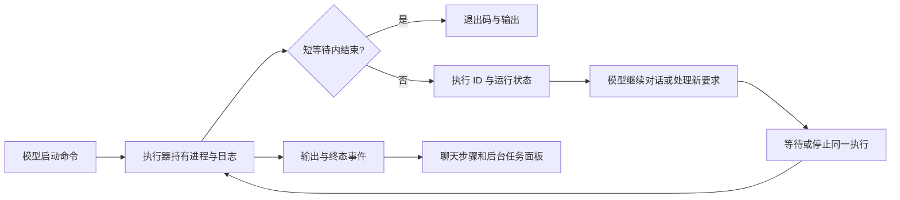

# 命令工具调研与 Nora 设计方案

2026-10-08。范围：命令执行、后台运行、输出、取消和聊天衔接。完成官方资料调研、源码核对和真实进程复现后，已实施下述方案并部署到 megumin。

结论：需要把“工具调用暂时返回”和“命令进程结束”分开。后台任务应该是持有执行 ID、状态和日志的真实进程，模型可以继续沟通，再观察、等待或停止同一个进程。把同步方法搬到线程里，编排层仍等待结果，解决不了这个问题。

## Harness 的实际做法

| 来源 | 等待或超时 | 输出与后台机制 |
|---|---|---|
| Claude Code 官方工具文档 | 前台默认 2 分钟，默认上限 10 分钟，可配置；到限可转后台。后台期限按交互/无人值守场景区分 | 独立后台任务、输出文件、任务管理；详情见 [官方工具文档](https://code.claude.com/docs/en/tools-reference#timeout-and-output-limits) 和 [后台交互](https://code.claude.com/docs/en/interactive-mode#background-bash-commands) |
| OpenCode v1.18.35 的现有 shell 路径 | 默认 120 秒；退出、取消、超时分别处理，终止时提供 3 秒强杀宽限 | 增量更新预览，超出内联预算后写文件，继续保存后续内容。[固定版本源码](https://github.com/anomalyco/opencode/blob/53d1eabb61e21162157817bf677da0a4ad3332e3/packages/opencode/src/tool/shell.ts#L347) |
| Gemini CLI | 默认 300 秒无输出超时，收到事件会重置；这不是总执行时长 | 后台进程与会话关联；实时预览保留新尾部，支持 PTY。[官方设置](https://geminicli.com/docs/reference/configuration/)、[shell 文档](https://geminicli.com/docs/tools/shell/)、[固定源码](https://github.com/google-gemini/gemini-cli/blob/44d764ee579610bf73c43107f5e0422cd92588b9/packages/core/src/tools/shell.ts#L589) |
| 本次 Codex 环境暴露的 exec_command / write_stdin | 默认初次等待 10 秒；未结束可返回 session_id，之后继续等待同一进程 | 短等待、执行会话、分段输出是独立概念。该值来自本次工具定义，不能推断所有 Codex 版本的进程期限 |

OpenCode 同版本的新 core/bash 路径另有 120 秒默认、600 秒上限，但源码明确标记实时进度和后台任务仍待补齐。不能把它与现有 shell 路径混为一谈，也不能把某个 harness 所有实现当成已经完善的标准。[core 源码](https://github.com/anomalyco/opencode/blob/53d1eabb61e21162157817bf677da0a4ad3332e3/packages/core/src/tool/bash.ts#L62)

OpenAI 的本地 shell 指南要求执行端报告超时并保留部分输出、非零退出内容；示例默认值属于示例执行器，不能据此推断 Codex 的统一默认值。[官方指南](https://developers.openai.com/api/docs/guides/tools-shell#handling-common-errors)

工具说明要明确单位、有效值、输出截断后的回读办法，验收要查看真实调用轨迹、错误和重复调用。增加参数数量本身不会提高工具质量。[Anthropic 工具工程文章](https://www.anthropic.com/engineering/writing-tools-for-agents)

## 改动前 Nora 的证据

现有链路：`ChatToolsSpec` 定义当前平台的 `sh` / `powershell` → `ToolStepEmitter` 并发编排与审批 → `ChatToolExecutor.execRunCommand` → `TerminalService.run` → 同 ID 的 step/SSE → `applyChatStreamEvent` → `ToolStepRow.LiveOutput`。本轮知识图谱工具不可用，调用及数据流通过限定源码检索核对。

1. **前台一直等待命令终态。** 默认 60 秒、最大 300 秒；模型传 360 秒时被静默压到 300。独立读线程、工具并发已经存在，但每轮仍 `future.get()` 等结果，长命令期间没有执行 ID 可供模型继续处理。因此排队插入的新要求也要等到下一次模型请求边界。
2. **超过 200,000 字节丢弃所有新输出。** 仍排空管道，所以不是管道写满，但预览触发依赖 `buffer.size()` 增长，达到上限后预览停止。所谓尾部 4K 实际是最早 200KB 的尾部，最终错误和成功标记可能一起丢失。后续归档无法补回已经丢掉的内容。
3. **超时检查受展示回调阻塞。** 读取线程独立，但超时检查和 `progress.accept()` 在同一个调用线程；同步 SSE 推送耗时会延后检查。
4. **异常路径没有统一资源清理。** 输出回调抛运行时异常时，方法直接退出，没有 finally 终止进程。现有进程树终止是尽力清理；不能仅凭父进程结束推断所有后代与输出流都已结束。
5. **普通字节流读取已经存在。** 不带换行的输出能到达回调，stdin 也会立即关闭。前端收到 step 就替换同 ID 内容，仓库里的两层 nginx 均关闭了缓冲；本轮没有对整条公网 SSE 链路进行延迟测量，不能据此断言网络没有延迟。

真实 Windows 进程诊断，复用已编译的 TerminalService：

| 场景 | 结果 |
|---|---|
| 输出 FIRST，无换行，2 秒后输出 SECOND | 首次预览约 500ms，第二次约 2693ms，两段均捕获 |
| 先输出 220KB，2 秒后输出 LATE_MARKER | 仅一次预览，标记在最终结果中也不存在 |
| 20 秒睡眠，timeout=2 | 约 2241ms 超时并终止 |
| stdin 读取 | 约 514ms 收到 EOF 并结束 |
| 输出回调抛异常 | 方法退出后子进程仍存活；诊断程序随后清理该进程 |
| 输出消费者阻塞 4 秒，timeout=2 | 约 5002ms 才超时 |

诊断记录：`logs/command-design-probe-20261008.txt`；隔离诊断脚本：`logs/probe-terminal-design.py`，未调用真实模型、未修改业务服务。

### sess-1791423883663 的两张截图

Node 下载命令请求 timeout=360，curl 自身还配置了 `--max-time 300`。保存记录显示约 300037ms 后以 curl exit 28 结束，工具没有报告自身 timedOut。截图的长等待由实际下载超时解释，不能称为已证实的无限运行。`curl -s` 关闭进度显示，只有开始标记也符合该命令的行为。

Python 首次安装用了 `timeout 240 ... 2>&1 | tail -5`，约 240031ms 后 shell exit 0。POSIX 管道通常返回最后一段的状态；再加后续 `ls ... || true`，安装失败可以被脚本掩盖。`tail -5` 通常等 EOF 才输出最后五行。工具如实报告 shell 0，并不证明 Python 安装成功。之后代理安装记录才明确输出 Installed，约 8.43 秒完成。

因此本次截图还暴露了 Agent 的命令编写问题：安装、下载、构建需保留退出码并验收产物，避免用 `tail` 把运行过程和失败状态一起藏掉。工具应保留原始退出信息，不根据日志文本猜测业务成功。脱敏后的命令元数据记录在 `logs/command-design-production-20261008.json`。

## 最小执行协议

保留自动按 OS 注册的 `sh` / `powershell`，让它们负责启动命令。增加一个通用的执行管理入口，负责 `wait` 和 `stop`；`wait` 的等待时长为 0 就是查询。启动、等待和停止都使用同一个执行 ID，不能通过“再执行原命令”查询进度。

- **yield：本次工具愿意等多久。** 默认 3 秒；短命令直接返回结果，长命令返回 `running + executionId`，进程继续运行。明确请求后台运行时立即返回。
- **timeout：进程总寿命。** 独立于 yield，后台运行仍有期限。默认 30 分钟，允许显式覆盖并在 Agent 设置中配置。参数单位沿用现有秒数，无效值明确拒绝，不静默截断。
- **idle：距最后实际输出的时间。** 先用于界面提示和判断是否需要用户关注，不默认凭沉默强杀。下载、编译和 `tail` 都可能长时间沉默；反过来，循环打印也不证明工作有进展。

这些是本轮已实施的 Nora 默认值，不是其他 harness 的统一标准。它们只作用于 OS 子进程，模型推理及上游请求策略不受影响。

返回数据包含：`executionId`、`status`、`elapsedMs`、实际 `timeoutSeconds`、最新输出、累计字符数、日志路径；终态再带真实退出码或终止原因。状态为 running / completed / failed / timed_out / cancelled / unknown。工具已返回但状态 running，不得被渲染或总结为“任务完成”。

## 职责与生命周期

TerminalService 持有执行注册表、进程、输出收集和期限；沿用 Java ProcessBuilder、虚拟线程、标准并发工具。ChatToolExecutor 只解析与序列化，编排层管理审批和把结果回填给模型。界面只观察服务端状态，不持有进程或另算成功状态。

执行与 session/发起轮次绑定。正常结束一次模型回复不停止后台命令；用户停止当前轮次时停止该轮发起的执行，旧轮次仍运行的任务由单独停止按钮控制。关闭侧栏只关闭视图，删除已完成记录只清理历史。运行中的任务不能通过清除列表偷偷结束。

期限和取消由独立计时/信号触发，不依赖输出、SSE 或模型轮询。终止路径统一 finally 清理：先结束进程树，再排空/关闭输出、释放注册与并发额度。Linux 使用 setsid 进程组；Windows 使用原生 Job Object，并在加入任务对象后才放行用户脚本。两者均已实测子进程和父进程提前结束，容器启用 init 回收退出的子进程。

现有工具并发限制是每轮最多 4 个。后台执行需要改为对仍存活的进程计数，首版同样限 4 个；额度在进程结束时释放，不能因为工具返回 executionId 就释放。超出额度明确告知模型正在运行的执行，不增加无界任务队列。

复用既有步骤持久化、会话事件和工作区回读。服务关闭时终止受管命令；重启遗留记录标为中断或结果未知，不拿旧 PID 接管进程，不自动重放安装、删除等命令。需要跨服务重启常驻的程序交给已有容器/服务管理能力。

任务状态独立于轮次 SSE；同一会话的任务 API 更新原步骤和任务列表，历史加载批量读取执行快照。下一次模型请求前消费真实完成通知，不靠反复模型请求轮询。通知不可作为用户指令，也不自动授权新的副作用操作；不打断正在进行的另一轮请求。

## 输出应该怎么流动

字节读取持续排空，使用增量 UTF-8 解码；受管日志文件继续写入，内存只留有限预览，预览始终更新最新尾部。达到日志磁盘上限明确终止并报告原因，不能悄悄丢内容后声称完整。首版可使用单执行 64MiB 日志上限和既有 4K 预览，清理终态文件按现有工作区保留规则实施。

日志持续写入；展开的输出区域每 500ms 读取最新快照，任务元数据列表每秒刷新一次，慢请求不叠加。执行输出带累计字符数，最后一次读取等待 finishedAt 落定；开始/结束快照持久化，实时 tick 不写库。命令读取和期限检查都不依赖客户端请求，也不占用轮次 SSE 的锁。

界面显示运行耗时、距上次输出时间和实际期限；无输出时显示等待输出，而不是假称持续有新日志。查看旧日志时保持滚动位置，只在用户位于底部时跟随新输出；原 LiveOutput 也采用同样行为。共享请求缓存尊重 cache=no-store，避免轮询内容被缓存 30 秒。

管道模式先保留，默认 stdin 关闭。`curl -s`、`tail` 和程序自身 stdout 缓冲都不能靠 SSE 消除；命令应选用合适的进度/无缓冲参数。PTY 适合确实需要终端语义和输入的程序，但还需要标准终端组件、窗口尺寸、stdin 和取消管理，不作为修复当前输出丢失的前提。完整日志、实时预览及回填模型的内容都需贯通既有脱敏规则。

## 参考用户提供的 Claude Code 后台任务 UI

在现有统一右侧工作区添加“后台任务”标签，与浏览器、文件并列；聊天入口显示运行数，例如“后台任务 2”。复用 SideWorkspace / WorkspacePanel 的开关、宽度、全屏和窄屏交互。通用面板状态与文件内容状态分开，避免把命令执行数据塞入文件查看器状态。

列表上方为运行中，下方为已结束，显示数量。卡片包含任务标题、类型（sh/PowerShell）、状态和耗时；展开显示命令、cwd、最新日志或最终日志、退出码。运行项可停止；终态保留查看/复制/回读完整日志入口。关闭标签不停止任务，清除已结束历史不影响运行项。

聊天里的工具行显示“后台运行 · 查看”，点击定位到任务；后台运行时仍可输入新消息，长命令不占着整轮模型请求。已经手动展开的详情保持展开，结果到达时不抢焦点、不收起用户正在查看的内容。无需为了任务展示新建导航栏或复制另一套终端窗口。

先接入真实命令执行数据。任务卡片的公共展示字段可供已有后台 Agent 任务复用；本轮不新建子代理调度系统。

## 实施与验收顺序

先改执行层的所有异常出口、独立期限、持续日志与尾部预览；再接执行 ID、短等待和 wait/stop，打通模型继续沟通与完成通知；最后接统一侧栏。沿同一个服务逐步替换同步 run，不保留另一套命令执行器。

真实 Windows/Linux 验收至少覆盖：短命令、静默长命令、无换行及分块中文、220KB 后输出、非零退出与 POSIX 管道、进程树超时/取消、客户端断线/回连、消费者异常/阻塞、后台执行时发送与插入新要求、最终回复后任务继续、后端重启遗留状态。单测按项目约定仅冒烟；行为由真实服务及浏览器验证。

## 实施与验收记录

`scripts/e2e-command-processes.py` 对 Windows 与部署候选 Linux 镜像分别完成 17 项真实进程检查：无换行、分块 UTF-8、后续输出、非零退出、独立总超时、慢消费者、跨块脱敏、64MiB 上限、四个存活进程额度、取消、会话隔离及父进程提前退出后的子进程清理。

`scripts/e2e-command-executions.py` 在本机和 megumin 各完成 14 项真实模型/API 检查：后台返回后继续交流、同 ID 查询和停止、后续输出、历史状态、按轮次取消、总超时、清空列表保留日志。本机浏览器验证实时日志、停止、手动展开状态跨分组/标签保留，以及在文件标签页打开完整日志；截图为 `logs/command-tasks-20261008.jpg`。线上浏览器控制超时，未据此声明线上视觉验收通过。

前端类型检查、Lint、126 项冒烟和生产构建通过，后端 reactor 冒烟通过。本机强制终止 Agent JVM 的真实验收还确认：Job Object 清理命令子进程，running 快照恢复为 unknown，对话历史同步未知状态，不重放旧命令；记录为 `logs/command-restart-20261008.json`。强制退出可能丢失尚未刷新的日志尾段，不能把未知结果当成成功。

发布 `20261008-113331` 仅更新 Agent/Web，迁移至 V38；部署前校验无在途轮次并完成备份，原会话、模型及 MCP 配置校验一致，其余容器未重建。备份目录 `/opt/nora/backups/20261008-113331`，旧镜像标签 `before-20261008-113331`；生产模型验收记录为 `logs/command-e2e-1791430685420352079.json`。
