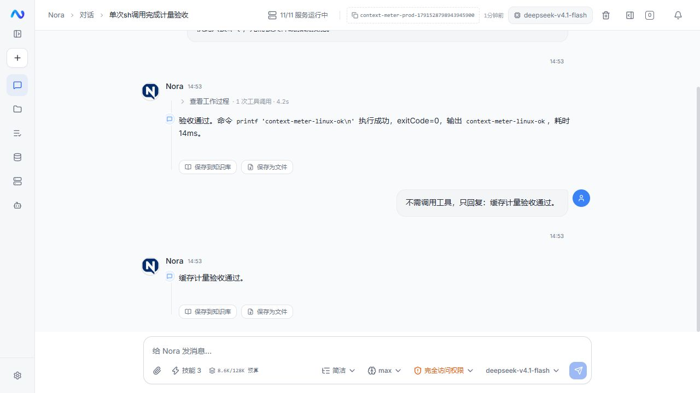

# Token 计量与上下文管理

## 完整链路审计（用户补充上游截图后）

链路为：渠道/模型设置 → 系统、技能、资料与历史装配 → 预算/整理 → LangChain4j 请求 → 上游 usage → 流事件/消息落库 → 前端计量、重连和历史恢复。

已确认的问题：

1. **P1 缓存输入丢失**：`AnthropicTokenUsage` 提供普通输入、缓存写入、缓存读取，Nora 只复制父类 input/output/total。完整输入应是三项之和；OpenAI 的 cached_tokens 已是 input 的子集，不能重复加。截图最后请求约为 564 + 155.5K，并非 564。旧校准日志因此产生错误的比值，图片成本说明也引用了这个错误口径。
2. **P1 实测不参与预算**：字符估算只是启发式，而且旧 SDK 思考没有计入。只打印校准日志、最后保存估算，无法使压缩决策接近真实输入。每个运行使用独立的预算校准，不使用共享可变统计。
3. **P1 容量与策略混淆**：生产模型 settings={}。留空显示“自动”，服务端却固定使用 128,000，前端又将其当模型容量。没有渠道容量证据时只能说“默认整理预算”，不能声称模型上限是 128K。
4. **P1 显示/持久化不完整**：只有 done 更新、只数气泡正文、用累计 usage 代替当前上下文都不成立。输入、当前输出、累计调用用量应分开；缓存命中不能降低上下文显示。失败、取消、刷新、重连都要恢复最近请求的同一份计量。
5. **P1 整理效果不足**：原实现重复缩短工具正文，却不处理大参数和 SDK 思考；触发与目标均使用 83%-输出预留，既不是界面说明的 83%，也没有压缩后的余量。普通输入在预算 83% 触发，降到 65%；溢出恢复目标 60%。这是输入整理策略，不设置模型生成 token 上限。
6. **P2 历史重建不保存整理后的工作集**：新用户轮次重建原始工具历史后再次整理。归档按内容哈希幂等写入，不会重复写入相同原文，但仍重复装配和估算。持久化整理检查点应与消息顺序、编辑回退、重启恢复共同设计；本轮不新增另一套历史存储。
7. **P2 机械摘录不是任务摘要**：归档与有限摘录可节约输入，但不能声称理解/归纳了任务。所有用户要求保留；其自身过大时应如实说明预算压力，不能静默删除限制。语义摘要需另行设计有效要求和事实证据的保留规则。

官方口径：[Anthropic 缓存用量](https://platform.claude.com/docs/en/build-with-claude/prompt-caching#tracking-cache-performance)、[上下文与推理](https://platform.claude.com/docs/en/build-with-claude/context-windows)。计量适配继续使用 LangChain4j；原生流起始 usage 通过现有 SDK 原始事件能力补充元数据，不重新实现内容、签名或工具调用解析。

## 问题与最小设计

`sess-1791523720691` 执行时底部显示 41/128k。原链路仅在 `done` 返回 `promptTokens/contextWindow`；执行中气泡正文为空，前端兜底只数正文，工具链及系统注入均未计入。该会话结束后落库值为 118,799/128,000。

- 计量基线是最近一次模型请求的完整输入。请求开始先发经过校准的估算；上游报告 usage 后立即替换为真实输入（包括缓存），结束时采用真实输出。输出用量含推理和工具参数，不再次相加；工具结果、后续插入要求另行计入。生成期间尚无上游计数的部分每秒估算，并明确 `≈`；累计调用量仅用于用量统计。
- 模型请求入口统一发送 `context_usage`，含完整输入、原始估算、模型/渠道标识、预算、容量是否配置、轮次、来源及可用的输出/缓存计数。普通请求、剥图/压缩后的重试使用同一入口。
- 控制器保留最新快照，运行增加可空的 `context_usage` JSON 字段，收到请求快照就落盘；失败、取消和服务重启后也可恢复。历史通过已有 run_id 关联，仅在该运行最后一段助手消息携带计量，不把计量伪装成工具过程。旧 prompt/context 字段继续可读，旧会话标为估算。事件总线保留一份最新计量事件，长思考淘汰普通回放事件后，新连接仍能恢复计量。
- 普通流与重连流共用消息合并逻辑；历史读取同一字段。删除以累计 `usage.totalTokens` 代替上下文占用的错误兜底。旧数据以正文、工具参数/结果及实际注入文本估算。
- SDK 在本轮请求中保留的思考文本计入请求估算；历史装配未携带的旧思考不累计。复用现有 SDK 消息，不另外构造协议实现。
- 该会话确实触发了 14 次微压缩，但旧工具参数、调用结构及 SDK 思考没有被裁剪。先压缩旧工具正文，仍超出预算时归档完整的早期助手/工具往返，留下回读路径和有限的真实过程摘录。用户要求、系统提示和最近完整工具批次不删；原文归档失败则保持原消息。历史与轮内使用同一整理链路，压缩结果是请求内返回值，清理共享的最近整理统计字段。
- 自动整理在请求之间执行：校准输入超过预算 83% 时向 65% 整理；溢出重试向 60% 整理。不会中断正在进行的思考，不限制上游默认输出。保护内容本身过大时如实报告；无法减少请求时不原样重试超限请求。
- K 格式沿用最多一位小数，1,100 → 1.1K。不增加数据库表、额外模型调用或每轮 token-count 请求。容量未配置时说明默认 128K 是整理预算。

## 影响与验证

影响请求装配、执行控制器、事件回放、前端流解析/恢复、聊天输入计量与格式化、相关冒烟测试。保留已有会话/配置；发布前检查没有执行中的用户任务。

验证真实模型多轮工具调用时结束前已有计量、后续请求更新、压缩和重试重算、取消/失败保存、重连与历史恢复、旧数据兜底及窄屏显示。单测只作冒烟，行为检查在 E2E 中执行。

## 实测结果与发布

- 当前中转在 `message_start.usage` 报告输入/输出为 0，直到 `message_delta.usage` 才返回普通输入、缓存及输出。因此正在生成的用量无法称为精确值，必须带 `≈`；结束后立即采用完整实测。上游未提供的旧缓存明细无法从旧 Nora 记录恢复。
- 本机真实 LangChain4j / Anthropic 请求通过 44 项 E2E，逐轮与透传中继采集的原始 usage 三项之和核对，包括真实缓存命中、SDK 思考随工具往返传送、归档后回读编码与只读限制、等待/取消时落库和新 SSE 恢复。长度错误只在本机中继明确注入，后续成功响应来自真实模型；恢复请求从估算 47,332 降至 37,249 tokens，没有原样重试。
- 当前前端模块回放同一份真实 SSE，9 次请求计量和 1,041 次生成增量通过；完成时输入+输出不重复添加推理/工具参数，历史刷新与流结束一致。
- 浏览器生成期间连续观测到 `≈19K → ≈19.8K → ≈26K`，完成后替换为实测 `19,499`。390×844 手机视图与深色模式显示通过，测试后恢复原主题和视口。
- 后端完整打包 160 项冒烟、前端类型检查/Lint/128 项冒烟/生产构建通过。前端保留既有 `useChatSessions` 动态/静态导入提示，无新增构建错误。
- 发布 `context-20261009-1450` 更新 megumin Agent/Web，Flyway V39 仅增加运行计量字段。发布前无执行中任务，数据库/环境/Compose 已备份到 `/opt/nora/backups/context-20261009-1450`，镜像保留 `before-context-20261009-1450`。模型、MCP、Agent 设置校验值及原 39 个会话、138 条消息发布前后一致，其余容器不重建，13 个容器健康。
- 线上 14 项真实模型/API 验收通过；JAR 校验与本机一致。验收会话 `context-meter-prod-1791528798943945900` 最后一次请求输入 8,574（含缓存读取 8,320）+输出 6，浏览器显示 `8.6K / 128K 预算`，可访问标签为 8,580，与刷新历史一致。

本机报告位于忽略目录 `logs/context-meter-e2e-1791528482524739100.json`、`logs/context-meter-trace-1791528482524739100.json`；发布报告在 `logs/context-token-release/`。原始 trace 含测试请求/注入内容，不作为公开文档提交。

后续已补充持久化检查点与语义任务摘要，见 [Agent 斜杠命令与持久化上下文压缩](agent-slash-commands-2026-10-09.md)。本报告以上记录的是该次计量修复的范围。当前单轮过程自身过大、没有完整历史可摘要时仍可能无法达到整理目标，会保留证据并返回上游错误。
