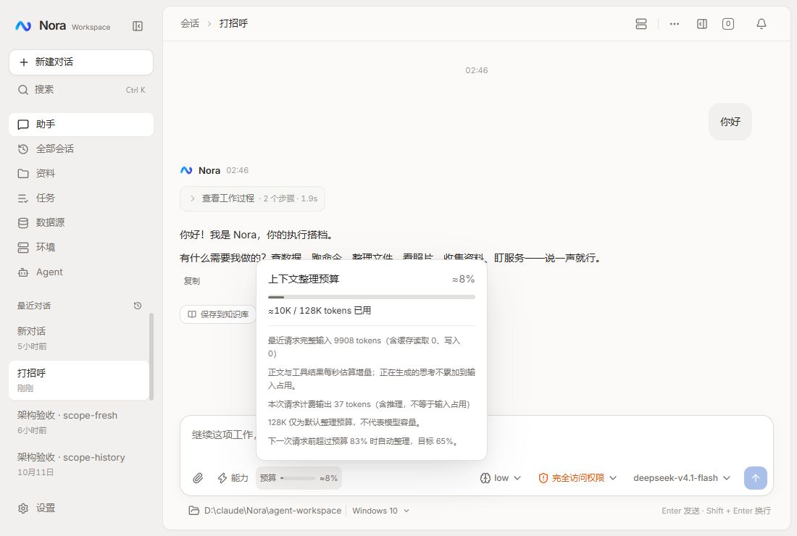

# 上下文预算指示器

将聊天输入工具栏的 token 数字替换为细进度条与占用百分比，普通状态中性、75% 起警告、90% 起危险色。桌面显示「上下文」或「预算」标签，窄屏保留进度条和百分比。真实零值不填充，超限条封顶但数字继续显示实际比例；估算保留 ≈。

数据流保持 ChatConversation → useContextMeter → ChatInputArea，不修改计量、模型配置或压缩阈值。展示独立为 ContextUsageMeter，使用原生 meter 表达容量占用、现有 Radix Popover 展示明细，支持点击、键盘和移动触摸。悬停 title 保留详细信息。模型窗口未配置时明确默认整理预算不是模型容量。

2026-10-13 追加设计：按用户要求，输入栏改为 20px 极简环形进度，移除常驻标签、横条和百分比；32px 点击区域复用公共 Button。SVG 圆环从顶部顺时针填充、占用限制在 0–100%，保留 meter 无障碍语义和高占用警示色；悬停/点击继续显示真实百分比与明细。弹出详情中的横向 meter 保留，不改用量数据链路。

圆环验收：typecheck、lint、147 项冒烟和 build 通过；production preview 确认图标 20px、点击区 32px、无常驻文字，点击详情与 Escape 关闭正常。已恢复 3001 dev。实拍：[环形用量指示器](context-ring-2026-10-13.jpg)。本次只改展示，未重新调用模型验证用量采集。

验证：前端质量门、真实已有会话与空会话、输入草稿的实时比例、明细开关与 Escape、窄屏布局。测试草稿清空，不发送模型请求。

## 验收结果

- typecheck、lint、build 通过；35 个测试文件、145 个冒烟用例通过。
- 正式构建 preview 验证：空会话为 0%，测试草稿使进度增加到 12.5%，清空后恢复；已有会话为 9,963 / 128,000 tokens（约 8%），浮层展示真实上游计数。
- 浅色、深色、390px 窄屏均实测；窄屏 scrollWidth = viewport = 390，点击可查看明细、Escape 可关闭。主题恢复「跟随系统」，视口恢复默认。
- 沿用既有计量与自动整理算法，未发送模型请求，未修改会话正文，未部署远程。构建保留既存混合导入提示。
- 图谱工具本轮不可用，按技能要求回退定向源码与引用检查。

