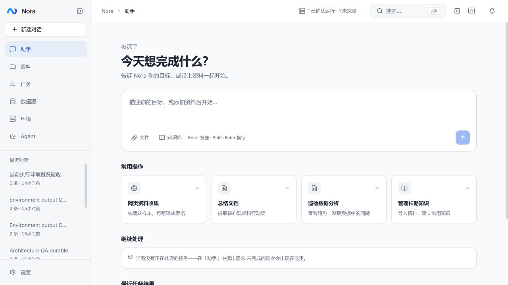

# Nora 部署记录：单应用与维护性优化

日期：2026-10-12（北京时间）  
目标：megumin，`192.168.0.109`  
入口：[Nora](https://nora.rainaki.top:13001/)  
状态：已部署，前后端健康，部署后 13 项真实服务检查及正式页面检查通过

## 1. 发布内容

部署本工作区已验证的单应用改造与[九项维护性优化](code-maintainability-implementation-2026-10-12.md)，不是仅部署 Git HEAD。镜像在本地构建，发布到既有 GHCR 仓库后由服务器拉取，版本固定为 `20261012-maintainability`，没有覆盖 `latest`。

| 镜像 | 注册表 digest |
|---|---|
| `ghcr.io/yizhiakuya/nora/nora-api:20261012-maintainability` | `sha256:3a88a6dad247dcd9754f5681d96e78d09d4da6ac23fcf35d1b440ec540aa776d` |
| `ghcr.io/yizhiakuya/nora/nora-web:20261012-maintainability` | `sha256:c0aa225f845a26bc5b41647c6e853b3a8e0c2b931b105b9b59e2f672c67da9c9` |

后端镜像使用此前通过 Maven 验证的 jar，安装匹配版本的 Chromium headless shell，Docker socket GID 按服务器实值 `999` 构建。前端镜像通过 pnpm 锁文件安装与 Vite 生产构建，主入口为 `index-BZ1-AYI9.js`。

## 2. 拓扑与配置

```text
HTTPS :13001 → 宿主 Nginx → 127.0.0.1:13002 nora-web → nora-api:18080 → 原 PostgreSQL
```

旧 gateway、agent、file、rag、datasource、env、automation、notification 八个后端停止后才启动新后端，避免重复调度及新旧服务并发写库。原 `nora-web` 容器更新为固定版本。

- 继续使用原数据库及 `nora_pgdata`、`nora_nora-data`、`nora_nora-workspace`、`nora_nora-logs` 卷。
- DB 用户/密码、访问令牌、代理、嵌入配置与原运行环境逐项比较一致；没有输出凭据。
- `.env` 设定固定 `NORA_TAG`，将原 `GATEWAY_PORT` 对应映射用于 `API_PORT`；WEB_PORT、HTTPS 配置及证书保持原值。
- 活动 Compose 仍位于 `/opt/nora/repo/nora-api/docker-compose.prod.yml`，运行配置为 `/opt/nora/.env`。
- 本次发布快照与验收结果位于 `/opt/nora/releases/20261012-maintainability/`。服务器旧源码目录不作为新的构建来源；后续继续从当前开发工作区构建发布镜像。
- 旧后端容器与镜像保留用于回退核对；Redis、Nacos、Kafka 及其数据卷也保留，没有顺带执行基础设施清理。

## 3. 备份与迁移

切换前确认没有活跃聊天、命令和自动任务，停止旧服务后完成一致性备份：

`/opt/nora/backups/20261012-maintainability/`

备份包括 PostgreSQL 自定义格式 dump、文件/工作区压缩包、原 `.env`、Compose、宿主 Nginx 配置、容器及镜像信息、核心行数、Provider 与应用设置摘要。目录限 root 访问。旧镜像另保留 `nora-rollback/<容器名>:20261012-maintainability` 标签。

数据库备份约 6 MB，文件与工作区压缩包约 303 MiB。`pg_restore --list` 与压缩包目录读取通过；又将 dump 完整恢复到独立临时数据库，核心行数与备份基线一致，随后删除临时库。

线上已执行的所有迁移校验和均与新 jar 一致。启动自动执行两条待处理迁移：

| 领域 | 迁移 | 影响 |
|---|---|---|
| agent | V42 | 更新内置工作台手册中的统一数据库工具指引 |
| env | V12 | 停用匹配旧内置规则的日志/容器源，添加统一应用日志源 |

没有删除领域 schema、业务表、历史数据或旧基础设施卷。

## 4. 部署验收

启动后、验收会话创建前核对：原有 **63 个会话、221 条消息、20 个文件、2 个 Provider** 的数量一致；Provider 和应用设置摘要一致。线上原本没有知识库文档、向量块或自动规则，本次没有据此声称完成存量知识库检索与调度验证。

部署后真实服务检查共 13 项通过：

1. 后端 `/actuator/health` 为 UP。
2. 前端提供已验证构建对应的入口文件。
3. 未携带原访问令牌的受保护 API 返回 401。
4. 七个业务域经前端代理正常响应。
5. 原有会话历史可读。
6. 原有文件预览元信息可读。
7. 统一应用日志源存在。
8. 非 root 后端用户可访问 Docker API。
9. 宿主 Nginx 配置检查通过。
10. HTTPS 入口及证书校验通过，没有绕过 TLS 校验。
11. 原配置的真实模型完成 SSE 对话。
12. 模型回复正确落入服务端历史。
13. 验收会话清理完成。

真实模型使用原已启用 Provider 的 `deepseek-v4.1-flash`，只要求返回验收标识，不调用系统工具。启动后日志 ERROR 数为 0。浏览器刷新正式 HTTPS 入口后，新版首页、原会话侧栏和导航正常显示。



详细服务检查保存在服务器发布目录的 `verification.json`，本机运行材料位于被忽略的 `logs/deploy-20261012/`。

## 5. 回退与验证边界

回退先停止新后端，核对数据库迁移和上线后的业务写入，再选择恢复范围。旧 Compose、运行配置、镜像和数据备份均已保留；不能仅启动旧容器就当作完成数据回退，更不能让旧后端与新后端同时运行。

本次未在生产环境重复完整 E2E、宿主重启或文件卷完整恢复演练。完整行为回归已在实施阶段的隔离环境完成；这次执行的是迁移兼容、备份恢复检查与部署后的真实冒烟验收。
