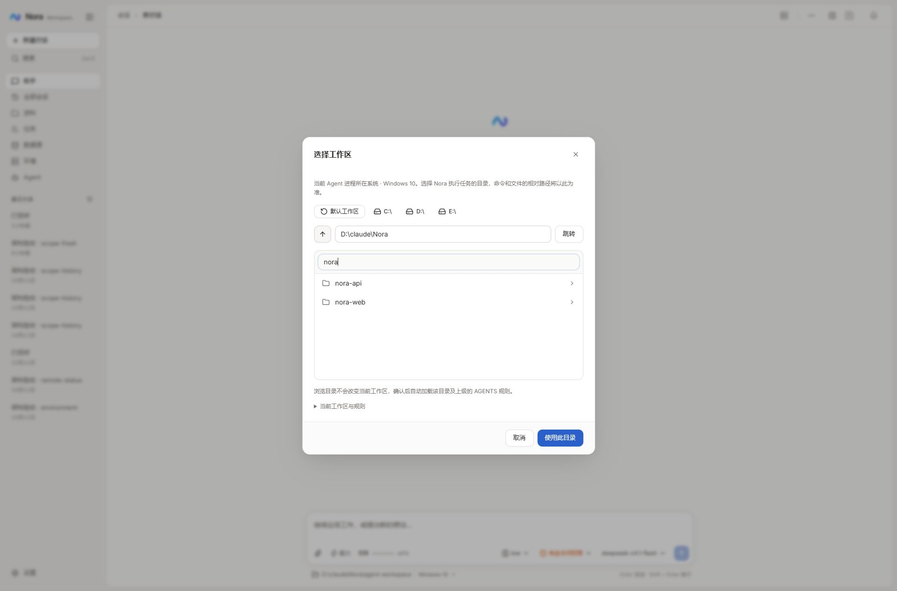

# 会话项目目录选择

问题：SessionProjectButton 只能手动输入绝对路径。现有 workspace/files 仅列默认工作区，且附带递归大小统计，不适合选择任意项目。

方案：在现有 SessionProjectService 增加只读直接子目录查询，经同一鉴权的 GET /api/chat/sessions/{id}/project/directories?path= 暴露。返回规范绝对路径、上级、系统根目录、默认工作区与直接子目录，最多 500 条并明确截断，不扫描目录内容或递归统计。不改变执行身份、主机、文件权限或绑定的运行中互斥规则。

前端用现有 Modal、Button、Input 组成目录选择器。打开即浏览当前项目；支持上级、磁盘根、默认工作区、目录过滤与手输跳转；浏览仅改本地选择，点击「使用此目录」才调用原 bindSessionProject。读取失败原样展示且禁止确认；加载中禁止确认；旧请求返回不能覆盖新位置；取消不保存。显示当前执行环境，避免将浏览器电脑误当 Agent 主机。当前规则保留在可展开区。

验证：后端目录/非法路径/空目录冒烟与真实 HTTP，前端质量门，真实浏览器进入目录、返回、绑定和恢复、取消不保存、窄屏。无新增依赖。图谱工具不可用，定向读源码与 rg 检查调用链。

## 已完成与验收

- 后端 298 个测试通过，构建和 Spotless 检查通过。新增 SessionProjectService 冒烟覆盖默认目录、空目录、中文空格目录、无效路径和超过 500 项。
- 前端 typecheck、lint、build、knip 通过；36 个测试文件、146 个冒烟测试通过。新增选择器冒烟覆盖筛选、进入、保存回调和错误重试。
- 真实 HTTP：项目根目录与绑定一致，直接子目录可列举；相对路径、文件路径、不存在路径返回 400；无令牌请求返回 401。
- 真实浏览器：默认工作区 → 上级 → 筛选 nora-web → Enter 进入 → 取消，绑定保持原值。临时选择 memory → 确认 → 刷新后保持，随后恢复默认工作区。D: 根目录可浏览，根目录的上级按钮禁用。错误路径展示原始错误并禁用确认。
- 正式构建 preview：浅色、深色与 390px 窄屏均验收，窄屏弹窗宽度 366px、页面宽度 390px，完整显示路径、列表与按钮。主题恢复跟随系统、视口重置、服务恢复 dev。
- 未调用模型或运行终端任务；未部署远程。当前浏览的是 Agent 所在主机/容器可访问的目录，不是从浏览器上传文件夹。Windows 多磁盘已实测，Linux 根目录结构由 Java 文件系统 API 提供，本轮未在 Linux 真机复测。

