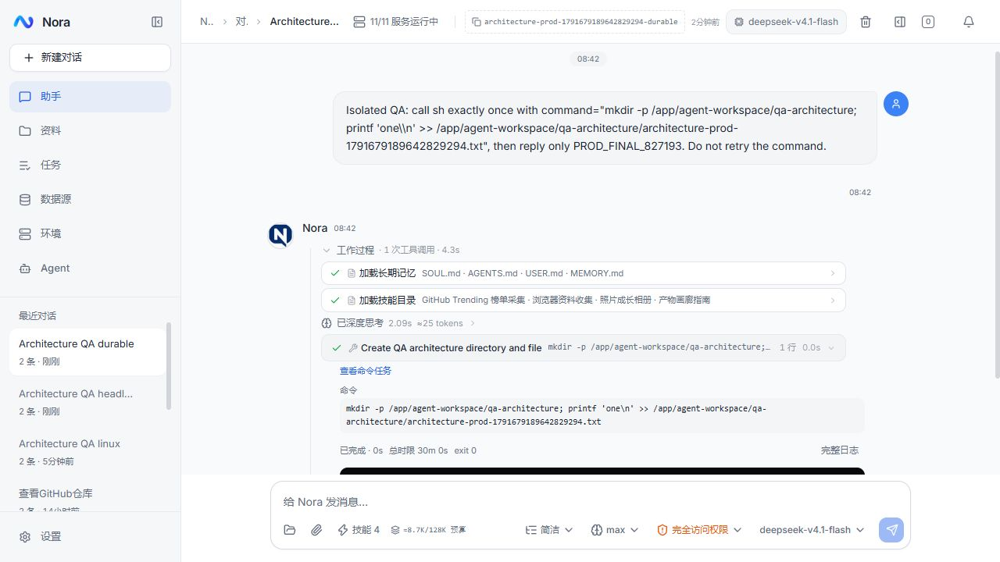

# 最终结果恢复与故障验收 · 2026-10-11

## 最小设计

沿用 Runner → ChatStore 的一次执行与幂等事务提交。把 Runner 中不可序列化的 Runnable 重试负载替换为完整的最终结果记录，由一个 Finalizer 负责提交前落盘、失败重试和启动加载。记录包括回答、步骤、引用、TaskContext、检查点及真实终态；恢复路径只调用 `completeRun`，不调用编排器、模型或工具。

日志保存在现有 Agent 持久化工作目录的 `.runtime/run-finalizations/`，不依赖项目目录或进程临时目录。先写同目录临时文件并同步文件内容，再原子重命名为 JSON；数据库事务成功后删除日志。提交成功但尚未删除时进程退出，下一次幂等提交只清理日志，不重复保存消息。保存失败仍保留会话门禁，禁止队列或新输入越过未提交结果。

启动时先加载并尝试提交日志，尚未提交的 run 不参与旧任务的中断恢复；其它真正中断的任务继续走原有恢复。损坏或归属冲突的日志阻止启动，不能静默丢弃执行证据。新增类只集中这项职责，不增加第二套执行引擎、数据库表、运行模式或配置项。

会话门禁只用于开始执行与修改历史。读取历史不触发提交，也不因待保存结果返回 502；提交重试由维护任务负责，避免刷新会话时读接口与故障写事务耦合。

改动贯通 Runner、Controller 构造与维护任务、启动恢复、Store 的排除参数和原有测试调用方。现有会话、队列、原文归档、模型与密钥均保留。

## 行为验收

1. 真实模型执行一次写命令，数据库拒绝最终保存；确认日志落盘后强制结束 Agent。保持故障重启，确认结果仍待提交、下一轮被阻止；解除故障后完整结果仅保存一次，工具写入仅发生一次。
2. 在真实 SQL 写入、真实测试容器状态改变成功后截断响应，确认工具标记结果未知且没有重复请求。
3. 启动真实 RAG 服务，用独立知识资料检验用户固定的 base/doc/source 范围及正常检索结果。
4. 执行受影响检查，备份后部署 megumin；在线验证 Linux 平台工具、无头浏览器与历史恢复。

边界仍为单 Agent 实例；本轮覆盖进程退出/重启，不承诺磁盘丢失、文件系统损坏或多实例共享日志的恢复。

## 已完成的验收

使用同一个可用模型与中转、真实服务及独立验收资料。没有用伪造模型回复代替行为验收。以下报告保存在忽略目录 `logs/`。

| 验证 | 结果 | 报告 |
| --- | --- | --- |
| Windows 保存故障、强制退出、重启、解除故障及重复日志 | 9 项通过；完整结果和步骤恢复，队列在提交恢复后继续，真实写命令仅执行一次 | `audit-1791678968477784300.json` |
| 真实 SQL / 容器写后断连，以及真实 RAG 范围 | 9 项通过；SQL 仅一行，容器仅重启一次，未知结果保留到步骤和历史；向量与关键词检索均遵守 base/doc/source 固定范围，越界无匹配 | `audit-1791679045876520300.json` |
| megumin Linux 真实模型、无头浏览器、保存故障重启与幂等恢复 | 10 项通过；只注册并使用 sh，Chromium 命令行含无头参数且可取帧，重复日志没有重复消息或写命令 | `release-agent-architecture-20261011/verification.json` |

保存故障时读取历史仍成功，下一轮返回 `RUN_PERSISTENCE_PENDING`，没有误报本轮完成。恢复后的步骤与数据库原始记录、时长逐项比较；已有结果对应的日志重新出现时只清理日志，不重放执行。

Agent 173 项、RAG 61 项、Datasource 15 项、Env 8 项及 Common 9 项、Security 2 项无断言冒烟通过，Maven package 成功。前端类型检查、Lint、139 项冒烟与生产构建通过。行为检查集中在真实 E2E 中，没有扩大成镜像实现的单元测试。

线上网页重新打开验收会话后，完整工作过程可展开；实际命令、完成状态、退出码和超时信息均可查看。浏览器工具有几次读取超时，后续通过已有标签页成功取得 DOM 与截图，未将工具超时当作页面性能测量。

## 部署记录

2026-10-11 已发布到 megumin。备份目录为 `/opt/nora/backups/agent-architecture-20261011-003728`，包含完整数据库备份、原 Compose、环境配置及容器状态；旧镜像保留 `before-architecture-20261011` 标签。数据库备份已用 `pg_restore --list` 校验。

发布目录 `/opt/nora/releases/agent-architecture-20261011`。Agent 与 Web 镜像使用 `architecture-20261011` 标签并更新本机 `latest`。只重建这两个容器，保留服务器已有 provider、密钥和持久卷；其余 11 个 Nora 容器继续运行。迁移 V41 已应用。发布前后原有 57 个会话、209 条消息数量一致；后续新增的三个独立验收会话保留作为证据。

Agent 继续使用 768 MiB 容器限制，JVM `MaxRAMPercentage=25` 给浏览器留出内存；没有更改服务器原有 swap 限制。发布前没有运行中的用户任务，故障验收重启只涉及独立 QA 轮次。

最终检查：13 个 Nora 容器均健康，运行中的轮次、待提交日志、验收故障触发器均为零。部署和健康记录为 `logs/release-agent-architecture-20261011/deployment.json`、`health.json`。Agent JAR SHA-256 为 `c224cab81fa97aba8c82a0514398f1a860e1283fccee3e62c68e2aade215ef67`。

本轮未提交或推送 GitHub。未升级 SDK，也没有引入多实例提交与队列调度；这些仍需独立设计和验收。
