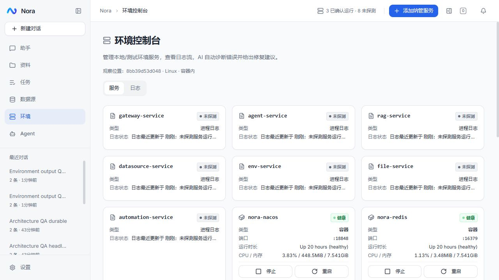

# 会话环境来源与命令文本边界 · 2026-10-11

## 故障证据

本机会话 `sess-1791592446888` 的“看下服务器状态”轮次耗时 256 秒，最终为 `partial / exception`。步骤中的思考耗时合计 240.1 秒，工具耗时合计 8.2 秒（并发调用的合计不是墙钟耗时）。实际 SSH 已确认 megumin 的容器健康，但模型把 Windows 上的纳管源与远端同名容器混在一起核实。

最后一次 PowerShell 执行包含 `wsl -l -v`。其重定向输出默认是 UTF-16LE，而其余脚本输出是 UTF-8，产生 84 个 NUL。流式步骤写入 PostgreSQL JSON 字段时被拒绝，导致没有最终回答。命令随后正常结束，并非命令挂住。

本机实测同一 `wsl --list --verbose`：默认输出有 84 个 NUL；设置 `WSL_UTF8=1` 后为正常 UTF-8，没有 NUL。FILE 健康判断的另一根因是把日志文件 mtime 当成服务存活探针，空闲服务因没有新日志被误报降级或离线。

## 最小设计

- 终端负责唯一的命令文本边界：Windows 子进程使用 UTF-8（含 WSL），所有平台的 NUL 转为可见的 `␀`，随后进入现有脱敏、实时预览、日志和命令持久化。数据库不增加清洗特判，也不重新执行旧命令。
- 环境服务为来源附加 observer（主机、平台、进程执行域），保留原有列表契约。FILE 只提供日志可用性与最近修改时间，其服务状态和健康度为 unknown；DOCKER/PROC 保留真实运行证据。
- Agent 工具与运行环境说明使用明确的来源和未探测数量，移除“所有系统诊断先查工作台”的引导。跨主机同名服务不能直接比较；已有目标的任务不因无关工作台日志状态扩大排查。
- 前端契约和环境状态展示贯通 unknown 与来源。旧会话的失败记录保留；用独立真实模型会话验证 WSL、含 NUL 的命令及步骤保存，用真实纳管文件验证新旧日志均不推断服务健康。

不改用户模型的思考档位，也不以增加提示词长度或降低模型能力掩盖工具契约问题。

## 验收与部署

- 后端冒烟：common 9、Agent 176、environment 8 项通过；新环境客户端使用真实 HTTP 边界，单测不加断言。前端类型检查、Lint、139 项冒烟和生产构建均通过。
- 本机真实模型验收 7 项通过，记录在 `logs/audit-1791681219803693500.json`：WSL 与显式 NUL 命令、中文、实时预览、完整日志、最终步骤持久化、新旧日志的 unknown 语义及观察主机贯通。
- 新会话查询 megumin 只使用其 SSH MCP，未混入本机 environment_status/PowerShell/日志，耗时约 31 秒。第一次 SSH 把 timeout 填成 60 毫秒而失败，随后自行改正；此验收证明来源选择正确，不代表工具调用零重试，也不保证模型每次同样快。
- 已发布 Agent、environment、web 三个镜像，版本 `output-20261011`。切换前确认运行中会话为 0，备份数据库并验证 dump 目录可读。备份位置 `/opt/nora/backups/session-environment-20261011-012707`，配置和模型密钥未改动。
- 切换前后 60 个会话、215 条消息保持一致；随后建立两个独立 QA 会话。线上实际模型验收 9 项通过，Linux sh 的中文和 NUL、完整日志、最终回答及历史步骤均可回读，13 个 Nora 容器均健康。报告在 `logs/release-session-environment-20261011/verification.json`。
- 浏览器确认本机显示 Windows 主机，线上显示 Linux 容器观察域。顶部和服务卡片分别显示“已确认运行”和“未探测”，不会把日志源视为停止的服务。

原会话仍有 4 条消息、29 个工作步骤，失败轮次 `afbec440` 保持 `partial / exception`。审计时曾从内存读到最后一条命令的 `exitCode=0`，但 NUL 导致持久快照未成功保存；服务重启后，该命令按既有恢复规则显示 unknown。没有伪造最终回复、改写旧轮次状态或自动重放命令。

