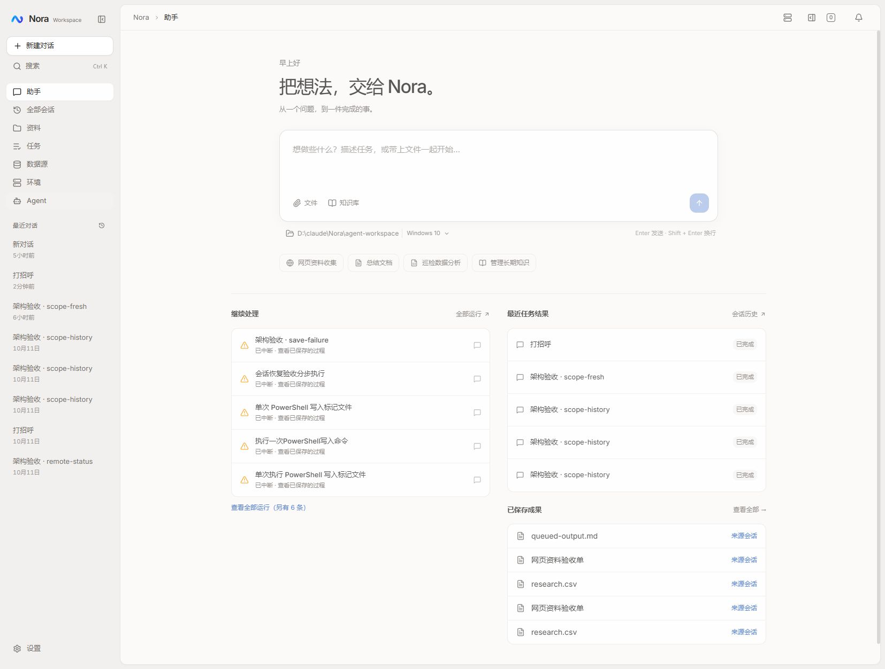
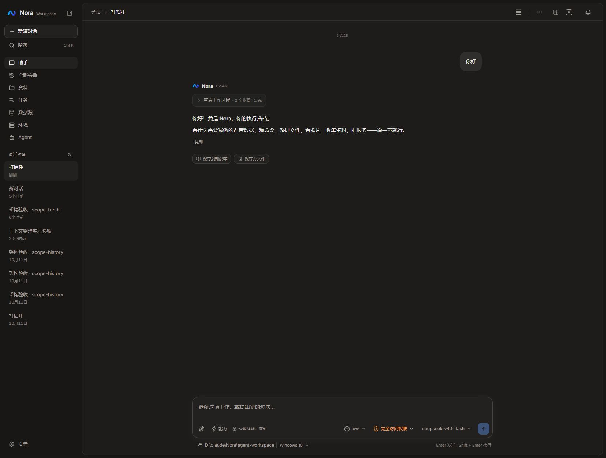
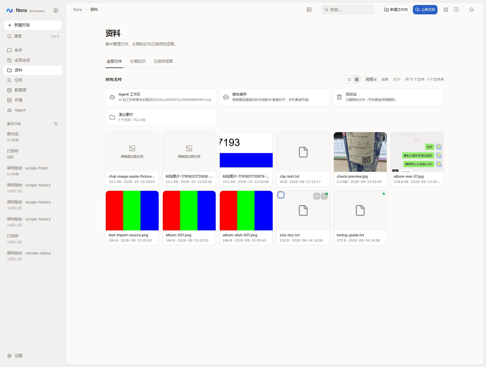
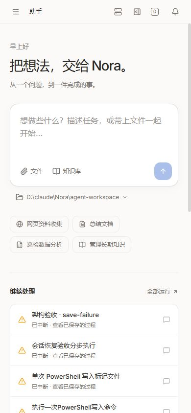

# Nora 界面与交互重设计

## 目标与取舍

用户选择「克制精致，类似成熟桌面工具」。保留现有任务流程与真实后端能力，本轮重新设计视觉系统、应用布局和操作呈现，不继续扩展 M2–M4 的运行协议。

当前问题：导航、数据与输入控件权重接近；首页大卡片与纵向堆叠造成内容拖长；会话头部暴露排障 ID 和重复模型信息；消息头像、时间、时间线重复装饰；主输入区配置过密且环境描述过长。

## 设计

- 全站暖灰底色、白色内容面、石墨文字，蓝色保留主要操作；深色同步采用中性灰。统一字号、边框、圆角、焦点与短促过渡，尊重减少动态效果设置。
- 侧栏为稳定工具架：品牌、主操作与全局搜索、紧凑导航、最近会话、底部设置。选中态采用清晰中性面与细节强调，搜索成为全局可发现操作。
- 主视图形成独立内容面，顶部只保留页面定位与相关操作；环境详细状态通过图标提示查看。会话 ID、复制、删除等低频动作收进标准 Radix 菜单，保留原处理逻辑。
- 首页以委托输入为视觉中心，常用入口变为轻量操作；持续工作和最近结果在宽屏并列，窄屏自然堆叠。工作记录用行分隔，待回答/批准保留语义强调。
- 会话强调内容阅读，弱化重复头像、时间和装饰时间线。输入区以文本、引用、发送为主，环境用单行路径胶囊，保留模型、权限和停止/排队行为与可访问名称。
- 资料、任务、环境、Agent 与设置通过公共 page/surface、表单、Tabs、弹窗获得一致布局节奏；工作区继续使用原侧面标签系统，调整视觉分隔和标签状态。

## 影响与数据流

仅前端与文档。延用 Sidebar → route → Header/SideWorkspace、ChatConversation → useChat → ChatInputArea、现有 store/API 和错误处理。公共原语影响全站，因此同时检查管理页、搜索、弹窗、资料预览、会话历史与窄屏布局。没有数据库迁移、权限默认值变化或数据删除。

结构查找按 codebase-memory 技能要求先检查工具可用性；本次工具不可用，使用定向源码读取与 rg 查引用。

## 验收

前端 typecheck、lint、knip、test、build 全部通过；测试为 34 个文件、144 个冒烟用例。新增 FileGrid 冒烟覆盖缩略图错误、选择和文件夹入口，无结果断言。

## 已落地范围

- 基础视觉：全局颜色、排版、间距、边框、焦点、按钮、Tabs 和弹窗；桌面侧栏与独立内容面、顶部工具条和侧面工作区统一。
- 首页：统一委托输入框、轻量快捷入口、宽屏双列工作记录；窄屏顺序堆叠。
- 会话：简化标题栏，低频操作归入菜单；消息阅读区弱化头像与时间线；输入框收拢为文本、附件、能力、模型与权限，推理摘要合并到能力菜单，环境详情仍可展开。
- 资料：文件夹改为紧凑入口；选择按钮与文件夹操作支持键盘；真实图片加载失败显示明确状态。知识库复用 Radix 标签键盘行为。
- 全局搜索：侧栏固定入口、简化会话摘要、补充键盘提示；设置分类和模型标签同步统一。

## 真实浏览器验收记录

使用本地后端真实数据，先开发模式检查，再对 `pnpm build` 的产物在 3001 端口运行 preview 验收。浏览器确认加载 `/assets/` 构建资源，完成后恢复开发服务。

| 场景 | 实际结果 |
|---|---|
| 首页浅色 / 深色 | 委托输入、快捷入口、继续处理、最近结果及已保存成果正常显示 |
| 已有会话 | 真实消息与工作过程正常展示；会话操作、能力菜单可展开和关闭；未发送新消息 |
| 全局搜索 | 搜索「打招呼」返回真实会话；Escape 关闭后焦点回到搜索入口 |
| 资料网格 | Space 选择 / 取消文件，`aria-pressed` 同步；两张现有失效图片显示「缩略图加载失败」 |
| 侧面工作区 | 打开 `e2e-doc.txt` 显示真实正文，标签可关闭，资料页保留 |
| 知识库 / 模型标签 | ArrowRight 切换内容与选中态，模型与权限配置未修改 |
| 任务弹窗 | 新建定期任务弹窗正常展示，Escape 关闭并返回触发按钮；未创建或运行任务 |
| 390px 窄屏 | 首页、会话、资料可使用；首页与会话无页面横向溢出，移动导航可打开并在导航后关闭 |

临时主题切换已恢复为「跟随系统」，临时视口覆盖已重置。没有添加运行时依赖、改动后端协议或迁移数据。构建仍有既存的 `useChatSessions` 静态/动态混合导入提示，不影响构建成功。

本轮未重新调用付费模型、运行自动任务或逐项执行删除、上传等写操作；这些处理逻辑沿用现有实现。本地资料中两张图片源已失效，本轮只完善错误呈现。未部署至远程环境。

## 效果截图

### 浅色首页

### 深色会话

### 资料网格

### 390px 首页

