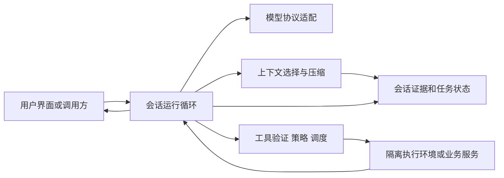

# 优秀的通用 Agent / Agent Harness：独立公开资料调研

调查日期：2026-10-07。研究对象：Codex、Claude Code / Claude Agent SDK、OpenCode、Pi，以及 Aider 的一种不同上下文设计。本文没有读取或比较任何本地产品源码、会话、日志或历史报告，也不针对某个现有项目提出补丁。

## 1. 主要结论

一个优秀的通用 harness，首先应当是一个可以控制、解释、恢复的执行循环：模型根据当前证据选择动作，运行时验证并执行工具，把真实结果送回模型，直到满足终止条件。它的基本价值来自工具与环境契约、状态保存、权限边界和结果验证；复杂的代理组织结构属于按需增加的能力。

本次资料支持五个较稳妥的设计判断：

1. **从一个循环、一个会话所有者、少量清楚的工具开始。** Codex、OpenCode、Pi 的公开源码以及 Claude SDK 的公开契约都能找到“模型输出 → 工具执行 → 结果回填”的核心循环。它们的差异主要在循环周围的状态、调度和产品接口，而不在是否拥有一个宏大的规划框架。参见 [Codex 循环源码](https://github.com/openai/codex/blob/5a3140176e668a2f72f3c098490eb7f7052d9d85/codex-rs/core/src/session/turn.rs)、[OpenCode 循环源码](https://github.com/anomalyco/opencode/blob/ecc4916b5a9608c30e6dd58a67f2137b594407ca/packages/opencode/src/session/prompt.ts)、[Pi 循环源码](https://github.com/badlogic/pi-mono/blob/eb326d265ae0b88489a6d10319307780df827cdf/packages/agent/src/agent-loop.ts)、[Claude SDK 循环文档](https://code.claude.com/docs/en/agent-sdk/agent-loop)。

2. **工具接口的清楚程度，比工具数量更有证据支持。** “只有 shell”可以是有效基线，但不能据此断言专门工具都多余。SWE-agent 的同模型实验表明，更适合模型的搜索、编辑和观察接口能够改善结果；Pi 作者的极简设计则说明，庞大的默认工具集并非必要。两者共同支持的是“保留有可测价值的工具”，而不是固定一个通用最优数量。参见 [SWE-agent 论文 v3](https://arxiv.org/html/2405.15793v3)、[Pi 作者文章](https://mariozechner.at/posts/2025-11-30-pi-coding-agent/)。

3. **并发是一种执行能力，不能充当依赖分析、权限检查或事务。** 从可信的工具元数据决定哪些动作可以共享执行窗口，其余动作保守执行，往往比让模型生成任意 DAG 更容易做对。Codex 的共享/独占门与 Claude SDK 的只读/修改分类是不同策略：Codex 的 exec_command 明确支持并发，Claude SDK 文档将 Bash 列为顺序执行。参见 [Codex 调度源码](https://github.com/openai/codex/blob/5a3140176e668a2f72f3c098490eb7f7052d9d85/codex-rs/core/src/tools/parallel.rs#L141)、[exec_command 定义](https://github.com/openai/codex/blob/5a3140176e668a2f72f3c098490eb7f7052d9d85/codex-rs/core/src/tools/handlers/unified_exec/exec_command.rs#L142)、[Claude SDK 并发契约](https://code.claude.com/docs/en/agent-sdk/agent-loop#parallel-tool-execution)。

4. **会话记录、模型当前上下文、任务进度应分开保存。** 摘要可以变，会话证据应可追溯；任务跨窗口延续需要可验证的工作状态，不能只依赖摘要中的“已经完成”。Pi 的会话树和 Anthropic 的长任务、托管运行时文章从不同层面展示了这种分离。参见 [Pi 会话源码](https://github.com/badlogic/pi-mono/blob/eb326d265ae0b88489a6d10319307780df827cdf/packages/coding-agent/src/core/session-manager.ts)、[长任务交接实验](https://www.anthropic.com/engineering/effective-harnesses-for-long-running-agents)、[Session / Harness / Sandbox 分离](https://www.anthropic.com/engineering/managed-agents)。

5. **完成判断需要业务证据，新增复杂机制需要对照评测。** 没有更多工具调用只是一次运行的结束信号，不能替代交付验收。Anthropic 也在模型升级后删除了原先有用的重置、sprint 等结构；这说明 harness 需要随模型重新评测。参见 [Agent 评测文章](https://www.anthropic.com/engineering/demystifying-evals-for-ai-agents)、[2026 年长任务 harness 实验](https://www.anthropic.com/engineering/harness-design-long-running-apps)。

这些是对多种设计的综合判断。本文没有做统一环境下的跨 harness 性能实验，因此不提供“哪一家总体最好”的排名。

## 2. 证据如何理解

正文使用以下标记，避免把不同性质的证据混在一起：

| 标记 | 含义 | 能支持什么 |
| --- | --- | --- |
| **[源码]** | 固定 commit 的公开实现，实际读取了相关文件 | 该版本如何实现某个机制 |
| **[契约]** | 调查日读取的厂商官方文档 | 对外承诺的接口和行为；不能推知未公开内部结构 |
| **[实验]** | 论文或作者公布的任务、对照或迭代结果 | 对应模型、任务和预算中的观察；外推需要谨慎 |
| **[观点]** | 原作者工程经验或取舍 | 一种有背景的设计判断，不等于独立实验 |
| **[建议]** | 本文综合推导的参考设计 | 有理由的起点，应在自己的任务集上验证 |

公开源码的存在不证明设计提高了成功率；多个产品采用相似机制，也不构成独立随机实验。厂商文章中的实验、同一家模型产生的自评和其他模型评分，不应被合并算作多份独立验证。

本次检索使用 agent-reach 的 Exa 搜索与 GitHub CLI 路由；OpenAI 部分先检索并读取 official OpenAI documentation。Jina Reader 连接超时后，正文资料改用网页读取工具与 GitHub 公开 API。未安装、升级或修改任何工具。

## 3. 各 harness 真正不同的地方

| 系统 | 可验证的设计重心 | 主要价值 | 取舍与适用边界 |
| --- | --- | --- | --- |
| **Codex** | [源码] Rust 执行循环、工具运行时、取消与上下文续接；[契约] app-server 暴露 thread、turn、item 生命周期及审批 | 适合把成熟运行时接到自己的产品界面，宿主可以接收进度并控制生命周期 | 产品协议与策略面较丰富；集成时应固定版本和生成对应 schema。不能只把它当作一次文本 API 调用 |
| **Claude Code / Agent SDK** | [契约] SDK 运行原生 Claude Code 二进制，复用工具、循环与上下文管理 | 较快获得完整 coding agent 能力，减少自行实现运行时的工作 | 本文对产品运行时的内部机制只依据公开契约；可核验的是 SDK 接口和公开文档。用户的授权逻辑须适应其既有权限顺序 |
| **OpenCode** | [源码] provider、工具和会话处理分离；[契约] HTTP 服务、OpenAPI、SSE，TUI 也是服务客户端 | 多客户端与程序化控制自然；可检查并修改运行时源码 | provider 兼容性带来额外分支。统一外部接口仍需处理停止原因、工具结果和各平台差异 |
| **Pi** | [源码] 可嵌入循环、事件、工具前后钩子、steering / follow-up 队列；JSONL 会话树 | 核心控制流易检查，便于定制上下文与界面 | “小内核”意味着宿主承担更多策略。核心的并发能力不能直接当作业务动作安全性保证 |
| **Aider** | [契约] 用 token 预算内的仓库符号图提供上下文 | 给 coding 任务一个主动提供结构摘要的不同选择 | repo map 是领域上下文优化，不能直接推广成所有通用 agent 必须有的图谱服务 |

此表的事实依据分别来自 [Codex app-server](https://learn.chatgpt.com/docs/app-server)、[Claude SDK 循环](https://code.claude.com/docs/en/agent-sdk/agent-loop)、[Claude SDK 权限](https://code.claude.com/docs/en/agent-sdk/permissions)、[OpenCode 服务](https://opencode.ai/docs/server/)、[OpenCode 固定版本源码](https://github.com/anomalyco/opencode/tree/ecc4916b5a9608c30e6dd58a67f2137b594407ca)、[Pi 固定版本源码](https://github.com/badlogic/pi-mono/tree/eb326d265ae0b88489a6d10319307780df827cdf)、[Aider repo map](https://aider.chat/docs/repomap.html)。表中的适用判断为 [建议]。

一个容易误用的术语是 **turn**。Codex app-server 的 turn 对应一次用户发起的运行，里面可以有多轮模型/工具交互；Claude SDK 的 maxTurns 计数针对工具往返；Pi 内核事件中的 turn 又围绕单次模型输出及工具结果。接入多个运行时时，应该明确映射“用户运行、模型步骤、工具调用”，不要直接共用一个叫 turns 的计数器。依据：[Codex 生命周期](https://learn.chatgpt.com/docs/app-server)、[Claude 的 turn 定义](https://code.claude.com/docs/en/agent-sdk/agent-loop#turns-and-messages)、[Pi runLoop](https://github.com/badlogic/pi-mono/blob/eb326d265ae0b88489a6d10319307780df827cdf/packages/agent/src/agent-loop.ts#L163)。

## 4. 八项核心设计

### 4.1 模型—工具执行循环与终止判断

**[源码]** Codex 在 run_turn 中结合模型是否需要后续动作和待处理用户输入决定继续；OpenCode 会同时检查 finish 标记与实际工具调用，防止 provider 返回 stop 但仍有工具调用时过早退出；Pi 则显式处理工具调用、steering 与 follow-up。Pi 还对因输出长度截断的工具调用返回失败结果，避免执行可能不完整的参数。依据：[Codex](https://github.com/openai/codex/blob/5a3140176e668a2f72f3c098490eb7f7052d9d85/codex-rs/core/src/session/turn.rs#L547)、[OpenCode](https://github.com/anomalyco/opencode/blob/ecc4916b5a9608c30e6dd58a67f2137b594407ca/packages/opencode/src/session/prompt.ts#L1103)、[Pi](https://github.com/badlogic/pi-mono/blob/eb326d265ae0b88489a6d10319307780df827cdf/packages/agent/src/agent-loop.ts#L245)。

**[建议]** 保持一条可读的循环，先验证并记录完整模型响应，再执行完整且合法的工具调用，随后回填结果。区分三层判断：

- **协议结束**：模型没有更多工具工作，当前调用已经结算，没有待处理输入。
- **运行状态**：正常结束、错误、取消、等待输入/批准、预算耗尽。
- **任务验收**：用户要求的产物或外部状态确实存在，必要的行为验证已完成。

不要把所有结束路径压成一个 success。预算耗尽应保存进度并明确停止原因；正常文本收尾也可能对应“需要用户补资料”，而非目标完成。是否继续修复，应由明确的验收失败和剩余预算驱动。

对于步骤已经确定的工作，用确定性程序串联这些步骤即可。让模型决定未知的下一步，是 agent 循环有价值的地方；不必把所有业务流程都改成模型规划。

### 4.2 并发、依赖与副作用

可核验的三个不同取舍：

- **[源码] Codex 框架默认**：ToolExecutor 的 supports_parallel_tool_calls 默认返回 false；调度器根据具体工具覆盖后的能力声明决定取得共享或独占的 RwLock。这里的共享门表示“允许并发”，不能据此推断所有持有共享门的工具都是只读。[默认定义](https://github.com/openai/codex/blob/5a3140176e668a2f72f3c098490eb7f7052d9d85/codex-rs/tools/src/tool_executor.rs#L122)、[调度代码](https://github.com/openai/codex/blob/5a3140176e668a2f72f3c098490eb7f7052d9d85/codex-rs/core/src/tools/parallel.rs#L200)。
- **[源码] Codex 具体 shell 工具**：在本报告固定的 SHA 中，add_shell_tools 将 shell 执行入口注册为 ExecCommandHandler；UnifiedExec 开启时使用可续接版本，否则使用 one_shot 版本。两者共享的 handler 都显式将 supports_parallel_tool_calls 返回 true，因此 exec_command 是框架保守默认之外的并发工具。此声明没有对 cmd 的读写语义做分支，不能自动证明两条任意 shell 命令互相独立。[shell 注册](https://github.com/openai/codex/blob/5a3140176e668a2f72f3c098490eb7f7052d9d85/codex-rs/core/src/tools/spec_plan.rs#L1150)、[工具名称与能力](https://github.com/openai/codex/blob/5a3140176e668a2f72f3c098490eb7f7052d9d85/codex-rs/core/src/tools/handlers/unified_exec/exec_command.rs#L112)。这里描述的是该公开版本的 exec_command 入口，不把旧版本可能出现的 shell / shell_command 名称视为同一实现。
- **[契约] Claude SDK**：文档把 Read、Glob、Grep 和只读 MCP 工具列为可并发，把 Edit、Write、Bash 列为顺序执行；自定义工具默认顺序执行，可通过 readOnlyHint 注解开放并发。Bash 的公开契约与上述 Codex exec_command 的能力声明不同。[并发文档](https://code.claude.com/docs/en/agent-sdk/agent-loop#parallel-tool-execution)。本文不声称知道其内部锁实现。
- **[源码] Pi 内核**：Agent 默认支持 parallel；配置为 sequential，或当前批次包含声明 sequential 的工具时，整个批次走顺序路径。并行批次的结果按调用顺序整理。[默认配置](https://github.com/badlogic/pi-mono/blob/eb326d265ae0b88489a6d10319307780df827cdf/packages/agent/src/agent.ts#L253)、[批次选择](https://github.com/badlogic/pi-mono/blob/eb326d265ae0b88489a6d10319307780df827cdf/packages/agent/src/agent-loop.ts#L508)。这是内核能力描述，不代表所有 Pi 宿主或 CLI 配置相同。

**[建议]** 最小可用策略是：每个会话只有一个循环所有者；每个共享执行环境设置共享读/独占修改门。独立、可信标注的读取可以并发，未知 shell 或修改动作保守走独占路径。只锁写动作而允许读取同时穿过写入，仍可能让模型观察到半更新状态。这是本文面向通用未知工具的保守参考策略，不是对 Codex 现有 shell 调度策略的复述；只有任务评测证明收益且资源冲突受控时，再允许具体修改工具并发。

动作 B 依赖 A 的结果时，最容易做对的是等 A 返回后再调用 B。仅仅把两次调用放进同一批次，不会自动产生依赖。确需编排时，可用普通异步代码明确顺序。

这套门只处理本地执行冲突，不处理远端数据库一致性、跨机器写入或业务幂等。对外部记录应使用版本条件、服务端约束或事务。工具服务器的“只读”注解是调度信息；不可信服务器不能凭一个注解取得新的权限。

保守门的代价是无关修改也会等待。只有等待时间已经成为瓶颈，才增加按文件、账号或资源键的锁与更精细的调度。

### 4.3 工具与环境感知

**[实验]** SWE-agent 论文 v3 在 SWE-bench Lite 的同一 GPT-4 Turbo 设置下，报告专用 ACI 的解决率为 18%，有示范的 shell-only 为 11%；编辑接口及 lint 反馈的消融也显示差异。这是 2024 年模型和软件修复任务中的证据，不能证明 2026 年每个模型都需要同样工具。[论文实验与消融](https://arxiv.org/html/2405.15793v3#S4)。

**[观点]** Pi 作者 2025-11-30 的文章选择 read、bash、edit、write 四个基础工具，并主动省去多种编排功能。它说明一套有效的极简设计可以存在，但文章中的旧功能清单不能当作 2026-10-07 的完整产品现状。[作者文章](https://mariozechner.at/posts/2025-11-30-pi-coding-agent/)。

**[建议]** 通用 harness 应提供少量职责清楚的能力：查找信息、读取指定资源、产生可审阅产物，以及执行获授权的动作。具体领域有稳定业务 API 时，优先暴露“查订单、生成草稿、提交退款”之类受约束动作；coding 场景才自然需要 shell 与文件编辑。

每个工具至少要说明输入、输出、失败语义和副作用。参数完成后做 schema 验证；不存在的工具、过期资源、参数错误应返回可修复错误。结果应包含真实状态与必要依据，例如 exit code、资源版本、截断标志和完整产物位置。为了节省上下文隐藏全部 stderr 或只给“成功”会破坏反馈。

环境信息应来自宿主事实：操作系统、shell、工作根、可用运行时、权限范围、网络能力、当前资源版本。持久进程另有进程 ID、结束状态和输出读取接口。模型不应根据上一次会话猜环境是否仍然相同。

这里需要一个稳定的工具边界，而不需要预先构造几十层插件抽象。工具很多时才增加按需发现；工具描述、例子与默认参数应通过真实调用失败来改进。

### 4.4 上下文、记忆、压缩与延续

**[观点]** Anthropic 的上下文文章建议按需读取、高信息密度输入、压缩和外部笔记，并明确指出实时探索也有延迟代价；**[契约]** Aider 提供仓库符号 map，以图排序选择 token 预算内的相关部分。二者是不同方向：一个让 agent 主动找，一个先提供结构导航；可以混用，无法据此宣布某一方向普遍最优。[上下文工程](https://www.anthropic.com/engineering/effective-context-engineering-for-ai-agents)、[Aider repo map](https://aider.chat/docs/repomap.html)。

**[源码]** OpenCode 在 compaction 模块中单独处理旧工具输出裁剪与会话总结；Pi 的 SessionManager 用 id / parentId 保存 JSONL 会话树，再为当前分支构建压缩感知的模型视图。依据：[OpenCode 裁剪](https://github.com/anomalyco/opencode/blob/ecc4916b5a9608c30e6dd58a67f2137b594407ca/packages/opencode/src/session/compaction.ts#L271)、[Pi 会话投影](https://github.com/badlogic/pi-mono/blob/eb326d265ae0b88489a6d10319307780df827cdf/packages/coding-agent/src/core/session-manager.ts#L476)。

**[建议]** 保存三个不同对象：

| 对象 | 保存内容 | 使用方式 |
| --- | --- | --- |
| 会话证据 | 用户输入、模型返回、工具参数/结果、审批与终止事件 | 审计、恢复、重新读取 |
| 当前上下文 | 固定约束、任务状态、近期完整交互、摘要、按需引用 | 发给模型的可重建视图 |
| 工作笔记 | 已验证进度、未解决问题、产物位置、下一个动作 | 跨窗口/跨运行交接 |

压缩优先移出冗长旧输出，保留可回读的产物；再总结完整的历史区段，保留近期交互。不要打断工具调用与工具结果的配对，也不要仅靠摘要保留用户约束和未结算动作。

摘要是有损视图，不能成为唯一记录。笔记里的“通过”应关联验证证据；学习出的偏好、工具发现和任务进度要标记来源与适用范围，环境改变后重新确认。

provider 返回的续接字段、公开 reasoning block 或签名信息，需按原协议保留；不能假设转换成普通文本就能无损跨模型迁移。Pi 作者也将跨 provider 交接定位为 best effort。[Pi 的 provider 取舍](https://mariozechner.at/posts/2025-11-30-pi-coding-agent/)。

先用资源引用、普通检索和简短结构笔记。只有可测的检索漏召回或规模问题，才值得添加向量库、知识图谱或自动记忆整理。

### 4.5 流式事件、进度与用户交互

**[契约]** Codex app-server 把 turn 与 item 的 started/completed、文本 delta、工具进度、审批请求分开，turn/completed 的状态还可能是 failed 或 interrupted；OpenCode 则使用 HTTP 操作与 SSE 事件。**[源码]** Codex 在完整 OutputItemDone 上进入工具处理，不把尚未完成的参数 delta 当成可执行调用。[Codex 协议](https://learn.chatgpt.com/docs/app-server)、[OpenCode 服务](https://opencode.ai/docs/server/)、[Codex 流处理](https://github.com/openai/codex/blob/5a3140176e668a2f72f3c098490eb7f7052d9d85/codex-rs/core/src/session/turn.rs#L2678)。

**[建议]** UI 是状态的观察者与输入端，循环继续推进不依赖 UI 是否连接。至少区分：模型生成中、工具已请求、等待审批、工具正在运行、工具结果、等待用户、运行结束。文本增量用于显示，终态与完整结果用于结算。

所有事件关联 session、run、step、call ID；持久事件有顺序号。重新连接先拿当前快照，再追赶可用事件。若只有临时 SSE 而没有完整重放能力，客户端应明确重新同步，而不是假装没有丢事件。

用户应能在运行中追加更正，也能明确取消。两者语义不同：更正进入输入队列，在安全边界被吸收；取消停止新的工作并传播取消信号。排队的用户消息不能因为当前模型准备收尾就悄悄遗失。

显示部分参数可改善体验；执行必须等待完整参数并经过验证。提前启动已完成、独立的工具调用，可以是延迟优化；对参数前缀进行副作用执行，不应成为默认机制。

### 4.6 错误、重试、取消、审批与幂等

**[源码]** OpenCode 把 context overflow 排除出普通重试，使用有限次数、指数退避、抖动和 Retry-After 信息处理可重试 API 失败；清理阶段也将未结算工具标记为 interrupted error。Codex 调度代码则区分等待准入时的取消与需要完成收尾的运行时。依据：[OpenCode 重试](https://github.com/anomalyco/opencode/blob/ecc4916b5a9608c30e6dd58a67f2137b594407ca/packages/opencode/src/session/retry.ts)、[OpenCode 清理](https://github.com/anomalyco/opencode/blob/ecc4916b5a9608c30e6dd58a67f2137b594407ca/packages/opencode/src/session/processor.ts#L553)、[Codex 取消处理](https://github.com/openai/codex/blob/5a3140176e668a2f72f3c098490eb7f7052d9d85/codex-rs/core/src/tools/parallel.rs#L259)。

**[建议]** 错误处理要按失败性质分开：

| 失败 | 最小合理处理 |
| --- | --- |
| 参数错误、资源不存在、业务拒绝 | 工具结果回填，由模型修改动作；不自动重复同一无效调用 |
| 暂时限流、模型连接失败 | 在总预算内有限退避，尊重服务端等待信息 |
| 上下文溢出 | 修复上下文或压缩，不能对相同巨大请求不停重试 |
| 用户取消 | 停止准入、传播信号、结算部分结果；保留恢复信息 |
| 外部修改已经发出，但响应丢失 | 标记结果不确定，按 operation ID 查询实际状态 |
| 审批被拒 | 记录拒绝与范围，尝试合法替代或结束；不能改个工具名绕过 |

对于具有副作用的操作，调用 ID 和操作 ID 应分开：每次 attempt 可以变，业务 operation ID 在重试时保持稳定。真正避免重复退款、发送、发布，通常需要外部服务支持幂等键、条件更新或可查询的操作状态。

会话日志能证明“发送过请求”，不能独自保证“外部只执行了一次”。崩溃发生在外部提交和本地记账之间时，结果可能未知；恢复需要对账，而不只是从最后一条文本继续。本文不声称所调研的所有 harness 已普遍提供端到端 exactly-once。

审批应绑定具体工具、完整参数、目标资源和权限范围。等待期间如果参数或资源版本改变，应重新验证；超时不能当作同意。策略检查应在副作用边界统一执行，避免不同工具入口绕过。

**[契约]** Claude SDK 的 canUseTool 并不拦截所有调用：先前规则或权限模式自动批准的调用会跳过该回调。需要每次检查的宿主约束不能仅放在它里面。这个事实展示了“审批回调存在”与“策略在所有入口执行”之间的区别。[权限顺序与回调边界](https://code.claude.com/docs/en/agent-sdk/permissions)。

取消也不等于回滚。进程、远端 API 和已提交写入的取消能力不同，工具契约应说明其边界。对已经完成的动作保留结果，对无法确认的动作保留不确定状态。

成本记录应区分已结算用量与估算；已经在途的调用可能在预算门限触发后继续结算。预算限制需要控制新工作准入，不能被解释为精确账单保证或动作回滚。

### 4.7 长任务可靠性

**[实验/观点]** Anthropic 2025-11-26 的长任务实验通过初始化提示与后续工作提示、需求清单、进度文件、git 状态和端到端验证改善跨窗口工作。文章脚注明确，这里的两种“agent”主要是初始提示不同，系统提示、工具和 harness 相同；不要求两个并发代理。[原文与脚注](https://www.anthropic.com/engineering/effective-harnesses-for-long-running-agents)。

**[实验/观点]** 2026-03-24 的后续文章显示，换模型后可移除上下文重置和 sprint 结构，评审在任务超出生成器独立能力时仍有价值。它展示了针对特定应用开发任务的迭代，不足以证明每个通用任务都需要三代理结构。[模型升级后的删减](https://www.anthropic.com/engineering/harness-design-long-running-apps)。

**[建议]** 长任务的最小交接产物包括：目标与验收条件、已验证完成项、未解决问题、当前产物/资源版本、最后可靠检查点、接下来可执行的动作。任务状态应可在进程外重建，外部副作用应可对账。

启动或恢复时先做轻量现实检查，再继续工作。例如确认服务是否还活着、文件/记录版本是否改变、上次产物是否真的存在。定期产出可验收的小成果，避免长时间只更新计划。

停止依据应覆盖：验收已满足、缺少必要输入、政策拒绝、预算用尽、重复失败没有新证据。不能靠无限“继续”提示获得可靠性。

**[观点]** Anthropic 2026-04-08 的托管设计将 session、harness、sandbox 分开，允许各自被替换，并把凭据留在隔离环境之外。这支持恢复与安全边界的价值，但不要求一个本地个人 agent 从第一天拆成微服务。[托管架构文章](https://www.anthropic.com/engineering/managed-agents)。

### 4.8 评测与可观测性

**[观点]** Anthropic 的评测文章强调区分 transcript 和 outcome：agent 说已经订票，不等于数据库里存在预约；评测的是模型和 harness 共同形成的系统。文中也区分至少一次成功的 pass@k 与连续多次都成功的 pass^k。[评测定义与可靠性](https://www.anthropic.com/engineering/demystifying-evals-for-ai-agents)。

**[建议]** 最先建立一小组真实任务及可验证终态；在真实工具和隔离环境里执行，检查实际产物、记录和用户流程。不要只校验模型文本，也不要规定只能走一条工具路径。

| 维度 | 建议测量 |
| --- | --- |
| 结果 | 任务完成率、关键行为验证、遗漏需求、错误副作用 |
| 可靠性 | 重复运行一致性、重连/恢复成功、取消结算、审批遵守、重复提交 |
| 成本与延迟 | 总成本、首个有用反馈时间、总耗时、工具等待、重复读取、摘要成本 |
| 上下文 | 压缩后丢失约束、重新查证次数、检索相关性、上下文占用 |
| 用户体验 | 是否及时响应更正、进度是否对应真实动作、终态是否准确 |
| 运行质量 | 参数错误、限流、重试、卡住/重复调用、输出截断、未知操作状态 |

把 session/run/step/call/operation ID、版本、预算、工具等待与执行时间记入结构化 trace。日志记录可观察的事实与公开输出，不需要假设能读取模型真正的内部推理。涉及敏感资料时，记录访问受控的引用与必要脱敏内容。

比较设计时固定模型版本、任务、工具、权限、环境和预算，一次只改变一项；多次重复，保存每次结果与失败分类。小样本差异应报告不确定性，不能靠一两次演示宣布普遍优势。

有客观终态时先用客观检查；主观评价再用明确 rubric、盲评和人工校准。另开一个使用同类模型的评审会话可以减少上下文中的自我肯定，但不能自动消除共有偏差，更不能被称为独立验证。

## 5. 不依赖具体项目的最小参考架构

以下是 [建议]，不是声称任何一家恰好如此实现。它将职责分开，但单进程中的几段函数与一个存储文件/数据库就可以承载，无需先拆服务。



### 5.1 最小职责

| 部分 | 必须负责 | 暂不承担 |
| --- | --- | --- |
| 会话循环 | 一个运行所有者、输入队列、预算、终态、结果回填 | 自主生成复杂工作流 |
| 模型适配 | 流解析、完整消息/工具调用、停止原因、usage、续接元数据 | 把 provider 差异假装成完全一样 |
| 上下文处理 | 固定约束、近期完整交互、摘要、按需引用 | 默认读取整个知识库 |
| 工具边界 | 参数验证、授权、副作用分类、超时/取消、真实结果 | 用文字承诺替代执行边界 |
| 会话存储 | 证据、运行状态、待处理审批、操作意图和结果 | 存下全文就宣称有长期可靠记忆 |

单用户本地研究原型可以先用 JSONL；需要并发写入、外部动作恢复或事务更新时，SQLite 是直接的起点。状态不能仅留在可丢弃的执行环境里。

### 5.2 最小运行顺序

以下是控制流说明，不是未经实现验证的生产代码：

```text
接收并记录用户输入
→ 取得会话运行所有权，恢复待结算操作
→ 构建本轮上下文和可信工具目录
→ 调用模型；流式显示，保存完整响应
→ 若有完整工具调用：验证参数、决定授权、记录操作意图
→ 在审批通过后重新验证，按共享/独占规则执行并结算
→ 回填真实结果，吸收用户更正，检查取消与预算，再次调用模型
→ 没有后续工具工作时：完成必要验收，记录准确终态及产物
```

流式执行完整工具调用可以后加；最初等待一轮响应完整再执行，有利于减少中断、排序和恢复的边界情况。

### 5.3 最少的数据契约

- **运行记录**：session ID、run ID、模型/工具/策略版本、目标、当前状态、停止原因、预算。
- **工具目录**：名称、清楚描述、输入 schema、副作用类别、执行环境、超时与取消语义。
- **工具操作**：call ID、operation ID、完整参数、审批决策、attempt、执行状态、结果或不确定状态。
- **事件**：顺序号、关联 ID、事件类型、时间、必要数据/产物引用。
- **交接摘要**：约束、可靠进度、未解决项、证据位置、下一步。

外部修改工具按需要增加幂等键与 expected version；读取工具不必为此增添一套事务框架。只读元数据由可信实现声明，未知工具保守处理。

初版事件可以只有：输入已接受、模型开始/结束、工具请求/审批/开始/结果、摘要边界、运行结束。文本 delta 是展示事件；完整结果和终态才是恢复依据。

## 6. 分阶段能力路线

阶段按风险和实际瓶颈推进，不按“先进程度”推进。输入验证、权限、数据保护和准确终态从第一阶段就必须存在。

| 阶段 | 增加的能力 | 验收依据 |
| --- | --- | --- |
| **A：基线可用** | 单循环、少量真实工具、明确环境、顺序执行、基本流显示、预算与取消、会话记录、必要授权 | 一组代表任务能在真实环境完成；错误和取消不伪装成成功；无授权外的副作用 |
| **B：交互与效率** | 完整工具调用的独立只读并发、用户更正队列、细分进度、输出截断与产物回读 | 成功率不回退；耗时减少；更正被及时吸收；读取不跨过冲突写入 |
| **C：跨窗口与恢复** | 上下文裁剪/总结、任务交接产物、重连同步、崩溃恢复与操作对账 | 压缩/重启后约束与任务状态正确；外部提交响应丢失时不会重复执行 |
| **D：规模与专项能力** | 按需工具发现、领域检索、资源级调度、远端隔离环境、经过评测的子代理/评审 | 针对已测瓶颈获得收益，成本、错误率与维护负担可接受 |

阶段 A 如果已包含付款、发信等不可重复的动作，其操作记账与幂等处理也必须在 A 完成，不能延后到 C。阶段 C 是加强通用恢复能力，不是推迟必要的数据保护。

长期运行多个任务时，可以加持久任务队列或现成工作流系统；只有确需跨进程持续调度、租约或定时唤醒时才引入。一个人用的单会话 agent 通常不需要这层基础设施。

## 7. 哪些复杂机制还没有足够证据应当默认加入

下表表示“未证明值得默认加入”，不表示它们无用。

| 机制 | 为什么不应直接默认 | 何时考虑 |
| --- | --- | --- |
| 固定 planner / executor / critic 团队 | 厂商应用实验具有任务和模型条件；评审自身可能共享偏差 | 独立任务、上下文隔离或验收盲区在对照评测中确有收益 |
| 每个动作先经过另一个 LLM 批准 | 增加延迟，模型审批仍非硬隔离 | 固定规则不足以覆盖的风险，且评审已校准、失败路径明确 |
| 动态 DAG 与推测执行 | 复杂恢复、依赖和副作用边界；简单循环可利用真实反馈再决策 | 高比例可并行独立工作已被测量，调度等待显著 |
| 自动向量记忆/全库图谱 | 带来检索、过期、污染与治理问题 | 普通搜索和引用确实漏召回；任务需要稳定结构查询 |
| 每次压缩都重启、固定 sprint | 后续模型可能不再需要，交接也有损耗 | 目标模型确有跨窗口失焦，且重置优于原地压缩 |
| 巨大系统提示与大量提醒 | 更多文本不自动形成更好的行为 | trace 指向具体误用，用最少说明与例子修复 |
| 全工具目录始终注入 | 模糊选择并占用上下文 | 工具确实很少；否则按需发现且测量选择效果 |
| 自动自改 harness / 记忆 / skill | 可能把单次错误、任务偶然性写成持久规则 | 有留出任务、版本审阅、回归评测和回滚证据 |
| 默认支持所有 provider 的所有能力 | 协议、费用、续接和停止行为差异真实存在 | 用户确有多 provider 需求，逐项声明并验证能力 |

最有效的简化是删除没有证明价值的编排，同时保留真实工具反馈、状态所有权、权限边界和验收。换模型后重新做逐项删减实验，比把旧 harness 的全部结构继续堆上去更可靠。

## 8. 资料与版本：15 个主要来源

源码日期是所固定 commit 的提交日期，并非每个文件最近修改日期；文档未标发布日期时按“调查日读取”处理。源码引用使用固定 SHA，避免 main 后续变化影响复核。

| 编号 | 直接来源 | 日期 / 版本 | 本文用途 |
| --- | --- | --- | --- |
| S01 | [OpenAI Codex 公开源码快照](https://github.com/openai/codex/tree/5a3140176e668a2f72f3c098490eb7f7052d9d85) | 2026-10-07；5a3140176e668a2f72f3c098490eb7f7052d9d85 | 循环、流处理、共享/独占调度、取消、shell 能力声明；重点读取 session/turn.rs、tools/parallel.rs、tools/router.rs、tools/spec_plan.rs、handlers/unified_exec/exec_command.rs、tools/src/tool_executor.rs |
| S02 | [OpenAI Codex app-server 官方文档](https://learn.chatgpt.com/docs/app-server) | 动态文档；2026-10-07 读取 | thread / turn / item、进度、steer、interrupt、审批与终态 |
| S03 | [Claude Agent SDK：How the agent loop works](https://code.claude.com/docs/en/agent-sdk/agent-loop) | 动态文档；2026-10-07 读取 | 原生运行时、循环、turn 语义、预算与工具并发公开契约 |
| S04 | [Claude Agent SDK：Configure permissions](https://code.claude.com/docs/en/agent-sdk/permissions) | 动态文档；2026-10-07 读取 | 权限顺序、规则与 canUseTool 的实际边界 |
| S05 | [OpenCode 公开源码快照](https://github.com/anomalyco/opencode/tree/ecc4916b5a9608c30e6dd58a67f2137b594407ca) | 2026-10-06；ecc4916b5a9608c30e6dd58a67f2137b594407ca | prompt、processor、compaction、retry、llm 的控制流与失败处理 |
| S06 | [OpenCode：Server](https://opencode.ai/docs/server/) | 页面标注更新 2026-10-06；2026-10-07 读取 | HTTP、OpenAPI 3.1、SSE、会话与异步接口 |
| S07 | [Pi mono 公开源码快照](https://github.com/badlogic/pi-mono/tree/eb326d265ae0b88489a6d10319307780df827cdf) | 2026-10-06；eb326d265ae0b88489a6d10319307780df827cdf | agent-loop、agent、types、session-manager；内核并发与会话树 |
| S08 | [Mario Zechner：What I learned building an opinionated and minimal coding agent](https://mariozechner.at/posts/2025-11-30-pi-coding-agent/) | 2025-11-30 | 极简工具、上下文透明度、provider 兼容取舍；作者经验 |
| S09 | [Aider：Repository map](https://aider.chat/docs/repomap.html) | 未标发布日期；2026-10-07 读取 | 符号结构上下文与图排序的不同方案 |
| S10 | [SWE-agent: Agent-Computer Interfaces Enable Automated Software Engineering](https://arxiv.org/html/2405.15793v3) | v3：2024-11-11；首次提交 2024-05-06 | 同模型基线和工具/观察接口消融；解释接口设计的实验证据 |
| S11 | [Anthropic：Effective context engineering for AI agents](https://www.anthropic.com/engineering/effective-context-engineering-for-ai-agents) | 2025-09-29 | 按需上下文、摘要、笔记、不同检索取舍 |
| S12 | [Anthropic：Effective harnesses for long-running agents](https://www.anthropic.com/engineering/effective-harnesses-for-long-running-agents) | 2025-11-26；Justin Young | 跨窗口交接、增量工作与 E2E 验证；特定 web app 实验 |
| S13 | [Anthropic：Harness design for long-running application development](https://www.anthropic.com/engineering/harness-design-long-running-apps) | 2026-03-24；Prithvi Rajasekaran | planner / generator / evaluator 实验，以及模型升级后的结构删减 |
| S14 | [Anthropic：Demystifying evals for AI agents](https://www.anthropic.com/engineering/demystifying-evals-for-ai-agents) | 2026-01-09 | outcome 与 transcript、能力/回归评测、重复运行可靠性 |
| S15 | [Anthropic：Scaling Managed Agents: Decoupling the brain from the hands](https://www.anthropic.com/engineering/managed-agents) | 2026-04-08；Lance Martin、Gabe Cemaj、Michael Cohen | session / harness / sandbox 分离、恢复与凭据边界 |

证据限度：三份公开源码证明其版本中的机制；官方文档说明公开产品契约；论文对较旧模型和特定 benchmark 做了实验；厂商工程文章与 Pi 作者文章提供有背景的经验。本文的最小架构和阶段路线是综合建议，尚未在一个统一任务集上实施或做跨产品基准测试。
