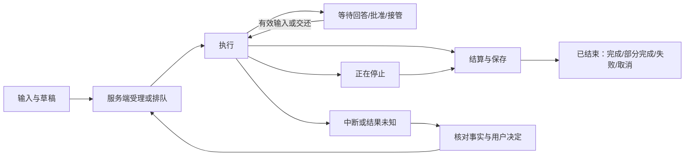
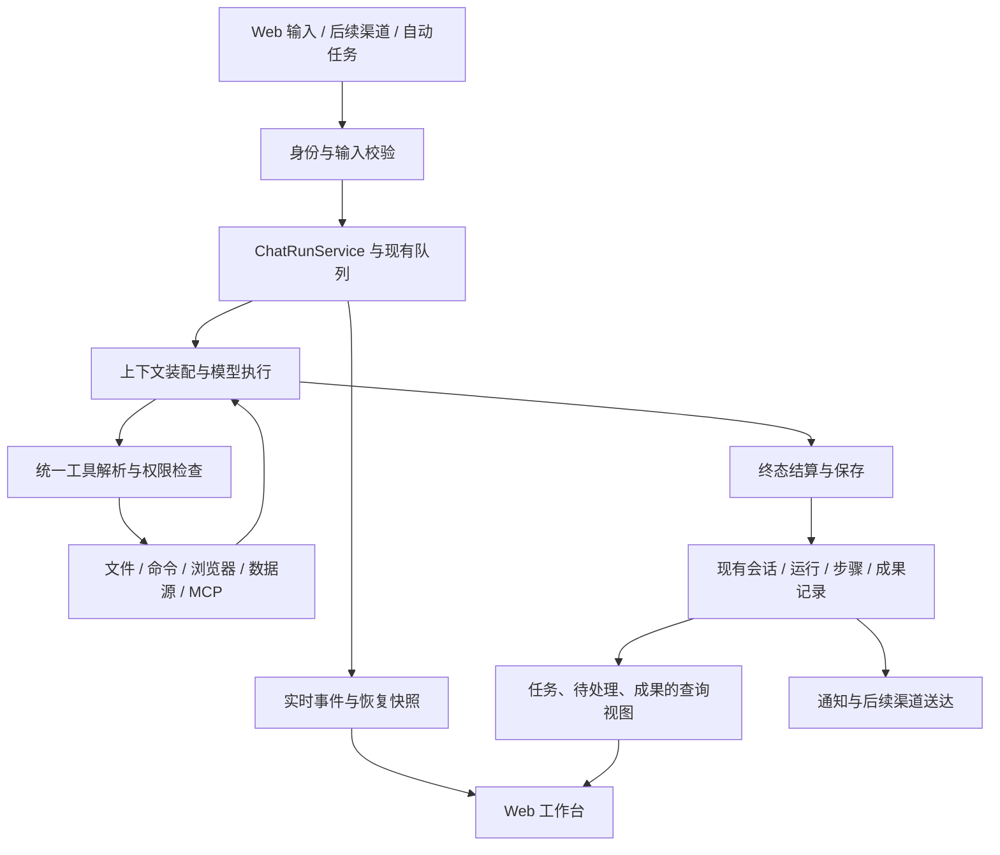

# Nora 通用 Agent 产品化研究与设计方案

日期：2026-10-12（北京时间）  
状态：M1 已于 2026-10-13 完成并本地验收；M2–M4 待推进，M5 按需求启动。详见[实施记录](../dev/general-agent-m1-2026-10-12.md)。  
定位：面向个人、开发者与高级用户的通用 Agent；以自然语言委托工作，可使用文件、终端、浏览器和外部工具持续执行并交付结果。

阅读建议：先读第 1 节决策摘要、第 4 节现状与缺口、第 6–7 节界面和交互、第 12 节实施路线；工程落点与验收见第 10、13 节。

## 1. 决策摘要

Nora 应以“用户委托的一件事”为产品中心，统一任务上下文、执行过程、用户介入和结果交付。开发、调研、文档、数据、网页及系统操作使用同一条主工作流；项目是组织长期工作的可选容器，Git 是代码任务中的专业能力。

建议的产品承诺：

> 告诉 Nora 你想完成什么。它会使用你授权的资料、环境和工具持续处理；你可以随时调整方向、检查过程和接管操作，并获得能够打开、核对和继续使用的结果。

本轮建议优先做五件事：

1. **统一任务入口和历史。** 任意任务可以直接开始；旧工作能搜索、定位和继续。
2. **把执行控制做成清晰的交互。** 区分排队、插入指令、等待回答、等待批准、接管、停止和恢复。
3. **把成果与证据接回任务。** 文件、网页、差异、外部操作结果和验证记录都有来源与入口。
4. **让上下文与权限可检查。** 当前使用的资料、规则、记忆、执行位置和访问边界有明确范围。
5. **让已验证的方法可以长期复用。** 技能、定期任务和后续通知沿用同一执行内核。

现有 React/Vite、Radix、Zustand、Spring Boot 单应用和 PostgreSQL 架构可以承载以上方向。优先完善已有对象和链路，不因“通用 Agent”之名重建平台。

首批落地建议为第 12 节的 M1：任务入口、历史检索、持续状态、待处理入口及已有成果聚合。随后做运行控制、验证交付和长期复用。

## 2. 研究范围与证据口径

### 2.1 已确认的用户需求

- 做通用 Agent，参考 Codex、Claude Code、OpenClaw 的工作方式。
- 优化范围包括 UI、UX、交互和能力完整度。
- 目标用户偏开发者和高级用户，但任务不限于写代码或运维。
- 本轮交付研究文档，不修改业务代码、不部署、不更改运行配置。

### 2.2 研究方法

外部研究采用官方文档，读取正文后提炼设计机制。引用代表文档声明，不代表本轮对三款产品进行了完整实测，也不构成性能排名。

Nora 核对基于当前工作区源码、设计与验收记录，以及已有的 2026-10-11/12 界面截图。工作区存在大量未提交变更，本文描述当前工作区，不能直接等同 Git HEAD 或每个部署实例。

本次研究环境没有可调用的 codebase-memory 图谱工具；已按技能要求检查工具可用性，随后使用定向源码阅读。没有获得索引覆盖报告，不能声称完成全仓穷尽审查。

研究期间浏览器控制两次连接超时；已有截图用于视觉判断，不能替代本轮交互实测。具体生产部署情况以[部署记录](../dev/deployment-2026-10-12.md)为参考。

全文区分三种结论：

| 标记 | 含义 |
|---|---|
| 当前实现 | 本轮或同一会话已阅读相关源码；仅证明所述实现存在 |
| 确认缺口 | 在指定入口或链路中找到明确差异，列出证据；不扩大成全系统缺失 |
| 设计建议 | 为目标产品提出的方案，需要实施与真实验收 |

旧评审中的安全、取消、队列、恢复问题不直接复述为当前漏洞；相关实现已有后续改造，必须重新复现才可作缺陷结论。

## 3. 官方产品研究：借鉴哪些机制

### 3.1 Codex：工作组织、持续执行和权限分层

**官方事实。** 当前官方项目文档区分项目内工作与无项目工作，并分别说明桌面、CLI、IDE 和 Web 的行为；长期工作文档强调目标、约束、完成条件及运行中调整。权限文档将沙箱可访问范围与动作批准分开。[O1][O2][O3]

**对 Nora 的启发。** 开始一个通用任务不应要求先创建仓库或项目；长任务需要可查看的目标及停止条件；“谁批准”与“能访问什么”需要分别表达。

**取舍。** 代码任务可采用目录、分支和差异视图，文档与调研任务不必显示这些字段。不要把所有任务都套进 Git 流程。

检索时，部分 `developers.openai.com/codex/...` 页面重定向至 `learn.chatgpt.com/docs/...`，正文含多个产品界面分支。本文只引用实际读取到的对应机制，不推断所有客户端、版本和账号具有完全相同功能。

### 3.2 Claude Code：执行循环、扩展职责和恢复边界

**官方事实。** 工作原理文档将循环描述为收集上下文、采取行动、验证结果，并允许用户中途调整；扩展文档分别定义指令、技能、MCP、hooks 与子代理的职责。[C1][C2]

记忆文档区分用户编写的长期指令和自动记忆，明确指令是上下文而非强制执行配置。检查点文档区分代码恢复与会话恢复，并指出 Bash 修改等操作不在其完整回退保证内。[C3][C4]

**对 Nora 的启发。** 简单任务可以直接回答，复杂任务才展开计划与验证；技能提供方法，工具提供操作能力；回退必须说明真实覆盖范围。

**取舍。** 不用每次先展示固定多阶段流程，不把“增加子代理数量”当作通用性指标，也不承诺撤销所有数据库、网页和命令副作用。

### 3.3 OpenClaw：持续助手、外部入口和长期状态

**官方事实。** Agent runtime 文档描述工作区、可编辑引导文件及会话存储；记忆文档区分用户偏好、长期事实与工作笔记。[L1][L2]

当前自动化文档将明确计划的工作与 heartbeat 监测区分，并说明两者共享调度基础。Control UI 文档描述浏览器控制界面与 Gateway 的连接、缓存及恢复行为。[L3][L4]

**对 Nora 的启发。** Agent 可以在用户离开界面后继续工作；触发、执行和结果送达应分别记录；长期记忆必须可检查；无变化时应保持安静。

**取舍。** 先完善 Nora 自己的 Web 工作台，再接一个确有需求的外部消息渠道。不同渠道复用同一执行机制，但不能共享未经验证的身份、权限或私有上下文。

### 3.4 综合设计判断

下面是本研究的推导，不是三款产品共同公布的架构：

| 产品问题 | Nora 应采用的原则 |
|---|---|
| 用户要先学会多少模块？ | 目标可以直接输入，相关能力在执行中按需出现 |
| 用户如何判断 Agent 在工作？ | 展示真实动作、等待原因、更新时间与可用控制 |
| 失败后如何继续？ | 保留已完成事实和结果，明确下一步及不可安全重放的操作 |
| 什么时候算完成？ | 依据用户目标和可检查证据；模型结束一轮不等于业务全部完成 |
| 如何越用越顺？ | 可纠正的记忆、可复用的技能、明确的重复任务 |

Microsoft HAX 的能力说明、纠错、解释与控制原则可作为交互评审辅助，但详细解释本身并不保证正确性；Nora 应同时给出结果证据与已知限制。[H1]

## 4. Nora 当前基础与确认缺口

### 4.1 已有基础，应优先复用

| 领域 | 当前实现与边界 | 源码证据 |
|---|---|---|
| 会话与执行 | 会话占用、启动、排队扫描、取消入口统一；流是执行的订阅方式之一 | [ChatRunService](../../nora-api/src/main/java/com/nora/agent/service/ChatRunService.java) |
| 服务端队列 | 排队记录持久化，支持领取、撤回和插入；前端缓存不代表执行所有权 | [ChatInputQueueService](../../nora-api/src/main/java/com/nora/agent/service/ChatInputQueueService.java) |
| 终态保存 | 本地结算日志与数据库补存；当前实现明确限定单 Agent 实例归属 | [ChatRunFinalizer](../../nora-api/src/main/java/com/nora/agent/service/ChatRunFinalizer.java) |
| 用户介入 | 提问、批准、排队插入和停止已有入口；不需要再造一套聊天控制 | [QuestionCard](../../nora-web/src/components/chat/QuestionCard.tsx)、[ChatMessageQueue](../../nora-web/src/components/chat/ChatMessageQueue.tsx) |
| 上下文 | 结构化资源引用、输出目标、来源、检索范围；引用不授予工具权限 | [TaskContext](../../nora-api/src/main/java/com/nora/agent/dto/TaskContext.java) |
| 可见性 | 可展示实际注入内容、截断、缺失和压缩记录 | [ContextStepRow](../../nora-web/src/components/chat/ContextStepRow.tsx) |
| 项目目录 | 会话绑定当前进程可见的真实目录；不改变进程权限或远程执行目标 | [SessionProjectService](../../nora-api/src/main/java/com/nora/agent/service/SessionProjectService.java) |
| 长期指令与记忆 | SOUL、AGENTS、USER、MEMORY 文件已有查看编辑入口 | [AgentMemorySettings](../../nora-web/src/components/agent/AgentMemorySettings.tsx) |
| 操作工作区 | 文件、网页及后台任务共用侧面标签面板 | [SideWorkspace](../../nora-web/src/components/layout/SideWorkspace.tsx) |
| 文件成果 | 已保存成果登记有来源会话与消息关联；目前登记类型为工作区文件、知识文档 | [SavedArtifactService](../../nora-api/src/main/java/com/nora/agent/service/SavedArtifactService.java) |
| 网页任务 | 已有样本确认、收集结果、质量信息、导出及验收状态 | [BrowserTaskService](../../nora-api/src/main/java/com/nora/agent/service/BrowserTaskService.java) |
| 专业能力 | 文件、知识库、数据源、环境、MCP、技能、模型管理均有既有入口 | [仓库说明](../../README.md)、[前端契约清单](../../nora-web/AGENTS.md) |

“已有”不是可靠性认证：表中存在的链路仍应进入第 13 节真实验收，不因源码有实现就宣布产品达标。

### 4.2 本轮确认的产品缺口

| ID | 事实 | 用户影响 | 最小方向与证据 |
|---|---|---|---|
| G01 | 侧栏最近会话固定取前 8 条 | 长期工作难找回 | 增加全部会话与检索；[Sidebar](../../nora-web/src/components/layout/Sidebar.tsx) |
| G02 | 快速查找资源跳模块首页，未索引会话，知识文档只取前 20 条且依赖已有 store 数据 | 搜到后仍需再找；未加载资源不在当前索引 | 做后端可分页检索与资源直达；[CommandPalette](../../nora-web/src/components/home/CommandPalette.tsx) |
| G03 | 首页最近结果只读自动任务记录，空态却说助手任务结果也会出现 | 对话成果与首页认知断开 | 汇集既有运行与成果，保留类型；[RecentResults](../../nora-web/src/components/home/RecentResults.tsx) |
| G04 | 运行列表只在挂载读取一次；与最近结果都将读取失败处理为空 | 状态陈旧，失败伪装成没有任务 | 活跃刷新、错误态、旧数据标记；[RunningTasks](../../nora-web/src/components/automations/RunningTasks.tsx) |
| G05 | 项目环境与目录藏在图标 tooltip/弹窗 | 执行位置不够直观 | 常驻简明环境信息、点击展开范围；[SessionProjectButton](../../nora-web/src/components/chat/SessionProjectButton.tsx) |
| G06 | 文件改动卡累计各步增删行，点击打开当前文件 | 难以判断本次最终净变化 | 固定比较基线与真实差异；[FileChangeCards](../../nora-web/src/components/chat/FileChangeCards.tsx) |
| G07 | 自动任务列表仅启停和立即执行；当前控制器没有规则更新接口 | 改日程/指令需重建，历史断裂 | 复用表单补齐编辑；[AutomationList](../../nora-web/src/components/automations/AutomationList.tsx)、[AutomationController](../../nora-api/src/main/java/com/nora/automation/controller/AutomationController.java) |
| G08 | 聊天输入区的模型/权限操作修改默认值 | 容易误解为只改当前任务 | 区分默认和会话覆盖，并标明生效时间；[ChatInputArea](../../nora-web/src/components/chat/ChatInputArea.tsx) |
| G09 | 提问 UI 统一提示超时后基于假设继续；服务端票据没有必答/可选分类，等待对象在内存 | 无法清晰表达“这个答案是继续执行的前提”，重启后不能假装原等待仍有效 | 增加必要性与恢复语义；[QuestionService](../../nora-api/src/main/java/com/nora/agent/service/QuestionService.java)、[QuestionCard](../../nora-web/src/components/chat/QuestionCard.tsx) |

G09 不等于已复现越权行为；它确认的是交互契约没有区分必要输入与可选偏好。实际模型在超时后的选择仍需实测。

## 5. 产品对象与信息架构

### 5.1 统一语言

| 概念 | 用户含义 | 建议映射 |
|---|---|---|
| 会话 | 围绕一件事持续沟通的空间，可以多次执行 | 继续使用 chat_session |
| 执行 | 一次收到指令后开始、等待、停止或结束的过程 | 继续使用 chat_run |
| 步骤 | 一次可检查的模型/工具过程记录 | 复用现有步骤记录 |
| 成果 | 用户可以打开、核对或继续使用的交付 | 既有文件、登记记录、操作结果引用 |
| 项目 | 可选的长期上下文集合，包含资料、规则、相关会话 | 先明确与现有 project_root 的区别，再按需要扩展 |
| 自动任务 | 按明确时间/事件重复触发的工作 | 复用规则与 execution_record |

UI 可以用“任务”表达用户正在委托的工作，但不要同时新增 Task、Job、Session、Run 四套竞争的执行状态。第一版用会话组织工作、用运行记录表达执行；长期目标只在确有连续多轮需求时增加目标元信息。

### 5.2 建议导航

```text
新建任务
搜索

待处理          审批、问题、接管、需要决定的中断
全部会话        最近、进行中、已归档；项目为可选筛选/分组
自动任务        规则、下次执行、运行历史
资料与成果      输入资料、交付文件、知识库

项目            可选长期组织；不要求先创建才能发起任务
常用入口        保留用户固定的数据源、环境等快捷入口

能力与设置      模型、工具连接、技能、指令/记忆、执行环境
```

这是目标信息架构。已有数据源、环境顶级入口曾按用户要求提升；迁移时保留原路由和可固定入口，不在首批中直接删除或强制藏入设置。

“待处理”与通知不同：前者是尚未解决的行动，后者是事件消息。读过通知不等于批准了动作；任务结束后过期的审批也不应继续占用待处理计数。

### 5.3 首页

新用户首页：一句定位说明、自然语言输入、可跳过的模型/环境检查，以及少量可编辑示例。示例覆盖调研、文件、网页、数据和系统操作，避免暗示能力仅限几个预设流程。

老用户首页：待处理 → 继续工作 → 最近成果，保留显眼的新任务入口；没有活跃任务时压缩空态。默认首页仍允许直接开始任务，不强制选择项目、技能或工具。

模型未配置时保留已写草稿，直达配置并能返回；外部连接未就绪时说明缺少哪项能力，不显示一个可以点击却不能兑现的入口。

## 6. UI 与工作区设计

### 6.1 主任务页线框

```text
┌──────────────┬────────────────────────────────┬─────────────────────┐
│ 新建 · 搜索  │ 任务标题              状态      │ 当前文件 / 网页 / 命令│
│ 待处理 2     │ 当前执行环境 · 可选项目          │                     │
│ 全部会话     ├────────────────────────────────┤ 标签及对应操作       │
│ 自动任务     │ 用户目标与附带资料               │                     │
│ 资料与成果   │ 当前进度：正在核对第 2 个来源      │ 预览 / 差异 / 日志   │
│              │ ▸ 已完成步骤                     │                     │
│ 最近会话     │ 可操作的问题或批准卡              │ 可引用选中内容       │
│ · 调研报告   │ 最终答复及成果卡                  │                     │
│ · 整理照片   ├────────────────────────────────┤                     │
│ · 修复脚本   │ 输入目标或补充要求……              │                     │
│              │ 附件 · 上下文  模型 · 权限  发送   │                     │
│ 能力与设置   │ 运行时：排队 / 插入指令 / 停止     │                     │
└──────────────┴────────────────────────────────┴─────────────────────┘
```

右侧面板按需打开，默认给对话和结果足够空间。复用 SideWorkspace 的收起、展开、宽度调整、文件及浏览器标签；不要另建独立浏览器布局。

### 6.2 视觉规则

- 继续使用现有主题变量、中性色和蓝色主操作，保留浅色/深色一致性。
- 主内容和关键控件以现有 13–14px 为基础；不低于 11px 的辅助字用于时间和次要计量。路径、错误、审批目标不因“技术内容”缩成难读小字。
- 对话正文与输入保持现有 820px 最大宽度；表格、日志、文件、差异可以使用检查面板宽度。用真实内容在 1440、1280、1024、768、390px 验证，不先设一套未经验证的新断点。
- 操作层级固定：当前主要动作、次要动作、更多菜单；危险动作有语义标识且不与普通操作抢默认焦点。
- 使用文字和图标共同表达状态，不只依赖颜色；加载、空、错误、过期、断线分别设计。
- 长列表保持搜索、筛选和清楚的行信息；需要比较的运行记录不全部做成高卡片。
- 新增组件复用现有 Radix、Modal、Select 等；不另造视觉体系或提前引入一套完整桌面 IDE。

### 6.3 渐进展示与键盘

常驻内容只承担“我在哪、它在做什么、我可以做什么”。完整参数、输出、上下文与计量保留展开入口；真实错误正文按项目规约完整展示，不翻译、截断或折叠，同一错误只出现一次。恢复按钮必须基于已知错误类型，不凭模型猜测。

已有 Cmd/Ctrl+K 与斜杠命令继续复用；搜索支持方向键和 Enter 直达资源，Escape 关闭并恢复焦点。输入法组字不触发发送，Shift+Enter 换行；浏览器接管或模态窗口中的 Escape 不应误触任务停止。

流式输出只在用户跟随底部时滚动；用户阅读历史时保留位置，以“有新进展”入口回到底部。完成后不抢用户正在操作的文件/网页标签。窄屏以单面板切换展示，保留返回任务入口、审批可达性及未提交草稿。

## 7. 核心交互契约

以下是目标行为，已有实现需要对照验证；并非宣称全部缺失。

### 7.1 开始任务

1. 用户输入目标，可附带文件、图片、网页、知识文档或工具资源。
2. 输入区简要显示当前模型、权限、执行环境；项目可选。
3. Agent 优先利用已经提供的信息，只有影响目标、范围、授权或结果的重要缺口才提问。
4. 简单问题直接处理；复杂任务展示短计划，随证据更新。计划不是每次开工必过的确认表单。
5. 服务端受理后出现执行状态；受理失败保留输入及附件。网络超时但受理结果未知时先查询请求结果，不自动再发一次写任务。

示例：“整理这些发票，按月份给我一张汇总表。”应直接围绕附件工作；只有币种、去重规则等会显著改变结果且无法合理确定时才提问，无须先让用户学习文件中心和技能设置。

### 7.2 运行中输入

| 用户动作 | 目标语义 | 用户能看到的反馈 |
|---|---|---|
| 发送补充消息 | 沿用现有默认排队行为，下一轮执行 | “已排队，当前执行结束后处理” |
| 插入当前执行 | 在下一个安全的模型请求边界加入；不宣称能撤回已发出的工具操作 | “等待插入”→“已应用到当前执行” |
| 撤回编辑 | 只允许尚未消费的队列项 | 内容和引用回到输入区，不重复执行 |
| 停止 | 请求取消当前运行，并按既定归属处理命令、问题和审批 | 先“正在停止”，服务端确认后“已停止” |
| 查看进度 | 直接查看已有执行事实 | 无须为了刷新状态再启动一轮模型调用 |

复用 ChatMessageQueue、服务端队列和现有插入时序。不得把每条运行中消息偷偷解释成“先停止，再重发”。若未来支持独立状态问答，应明确其不会改变主任务。

### 7.3 提问、审批和接管

三种需求共用待处理聚合，但保留不同含义：

| 类型 | 内容 | 超时/离线后的目标行为 |
|---|---|---|
| 可选偏好 | 格式、措辞等有合理默认值的选择 | 展示采用的假设，可继续独立工作 |
| 必要输入 | 目标账号、唯一操作对象、不可推断的范围 | 保留待处理事项；无答案不得执行依赖动作 |
| 操作批准 | 动作、目标、影响范围和有效期限 | 过期即失效；静默、时间流逝或模型文字不构成同意 |
| 人工接管 | 登录、页面操作或需要人处理的界面 | 显示控制权，用户交还后重新观察再继续 |

必要输入等待不应长期占用执行线程。设计上持久化等待原因及关联步骤，在明确的可恢复边界结束本次运行；答案到来后沿同一会话受理后续运行，并重新验证目标和权限。第一版不承诺把任意 Java 调用栈冻结后恢复。

当前 QuestionService 使用内存 future，不能仅修改文案就宣称支持跨重启的持久等待。应先补等待票据及有效性契约，再开放长时间等待。

审批结果保留简明可追溯记录；批准的是具体动作与范围。若计划、目标或权限已发生实质变化，旧票据不能继续授权。浏览器人工接管期间停止 Agent 写操作，交还时依据新观察执行。

### 7.4 停止、断线、中断与重试

| 情况 | 产品应表达什么 | 可提供的下一步 |
|---|---|---|
| 浏览器断线，服务端仍运行 | “连接中断，正在恢复状态”；保留最后事实及时间 | 重连、查看已保存过程 |
| 用户请求停止，后台尚未退出 | “正在停止”及仍在执行的对象 | 等待确认；必要时查看后台命令 |
| 服务重启，上一操作没有确认结果 | “执行已中断，部分操作结果未知” | 先核对实际状态，再决定继续 |
| 部分成果已保存，但任务未完成 | “部分完成”及可用成果 | 基于已有结果继续 |
| 结果结算尚未写入数据库 | “结果正在保存/恢复”，不能显示确认完成 | 等待结算；不自动重跑工具 |
| 外部请求超时但可能已经生效 | 保留请求/资源标识，显示结果未知 | 查询外部状态；只有确认可重试时重试 |

“恢复对话”“继续未完成目标”“重试一个步骤”“回退文件”是不同操作，按钮说明必须具体。重试创建新的执行记录并关联来源，不覆盖失败证据。

后台命令有自己的生命周期。停止对话时需说明哪些命令随轮次停止、哪些为用户明确要求持续运行的进程；这一语义应与 TerminalService 的真实实现一致。

### 7.5 执行状态与界面状态



这是产品流程示意，不是直接替换数据库枚举。第一步复用已有状态，通过已存在的待批准、问题、浏览器控制信息补充等待原因；只有确有持久语义缺口才扩展服务端状态。

“断线”属于订阅状态，“保存中”属于结算状态，“已读/归档”属于用户整理状态，不混成一套互相覆盖的执行状态。前端展示以后端事实为准，跨入口使用同一映射。

## 8. 上下文、记忆与权限

### 8.1 上下文范围

| 范围 | 内容 | 展示与控制 |
|---|---|---|
| 当前请求 | 本条要求、附件、选中内容、引用 | 发送前可增删，发送后可查看实际引用 |
| 当前会话 | 已确认要求、历史步骤、压缩摘要、剩余事项 | 查看摘要与原文；新约束覆盖旧约束时保留修正记录 |
| 可选项目 | 共用资料、规则、工作目录 | 显示项目与规则来源；退出项目不再默认带入 |
| 用户长期范围 | 沟通偏好、明确的长期事实 | 可查看、编辑、停用和删除 |
| 外部实时信息 | 网页、数据库、连接器结果 | 标明来源和获取时间，关键动作前重新核对 |

上下文面板应区分“可以使用”“已加载”“仅检索命中”“因预算截断”。目录选择不能冒充目录内所有文件已读；工具连接成功不能冒充该工具本轮已经使用。

已有 ContextStepRow 和 TaskContext 是优先复用点。保持实际注入正文可查，不另用一段模型生成的描述代替真实注入记录。

### 8.2 记忆产品化

第一版在已有 Markdown 文件与查看器上增加范围、更新时间和来源定位；自动记录的事实应可追溯到用户明确表达或可信执行结果。不要提前复制成一套与文件互相冲突的“记忆数据库”。

后续根据使用量增加条目级编辑、冲突标记、过时提示与删除同步。用户纠正事实后应更新对应有效记录，避免追加两条相互矛盾的长期事实。

临时任务进度留在会话或任务笔记；技能承载可复用方法；知识库承载可检索资料。三者不应都塞入 MEMORY.md。删除记忆应说明是否同时更新索引、摘要与派生缓存；已发给模型的旧上下文无法靠删文件追溯撤回。

网页或外部文档中的指令视为来源内容，不能自行升级成长期规则、权限或下一次自动任务的授权。

### 8.3 权限与执行环境

必须分别表达：

1. **执行位置：** 当前 Nora 服务进程/容器，或通过某个工具访问的远程目标。
2. **工作目录：** 相对路径解析位置与规则加载范围。
3. **访问边界：** 操作系统、容器、工具权限实际允许的文件、网络和凭据范围。
4. **审批策略：** 哪类动作需要用户或其他批准机制判断。

UI 显示“当前 Agent 容器”时，通过 SSH 工具操作远程主机的步骤仍要显示远程目标。项目绑定不等于沙箱；修改审批模式不等于切换执行主机。

模型、思考等级等可采用“全局默认 + 显式会话覆盖”。权限还必须服从服务端强制边界，不能仅按前端字段覆盖。每次执行记录实际生效快照；运行中变更明确是立即收紧还是后续请求生效，不能无提示提高权限。

批准卡应展示动作与准确目标，对删除、发布、发送、支付、改凭据等不可简单撤回的操作说明影响。明确授权的常规动作不要反复索要确认；未知结果也不能用“再批准一次”来掩盖。

## 9. 通用能力建设与取舍

| 能力 | Nora 的下一步 | 进入产品后的完成条件 |
|---|---|---|
| 文件与文档 | 上传、解析、引用、生成、预览和保存的统一交付；格式能力按实际需求扩展 | 生成文件真实存在，可打开，来源与版本可查；扫描件等不支持能力如实说明 |
| 搜索与调研 | 通过已有工具扩展检索，保留来源、访问时间和证据 | 结论可追溯；来源不可读时明确缺口，不能由搜索摘要冒充全文 |
| 浏览器操作 | 复用真实浏览器、样本确认与人工接管 | 用户知道控制权；操作前后的页面状态可核对 |
| 命令与代码 | 明确 cwd、主机、命令归属、退出状态及差异基线 | 对应结果能被验证，后台命令可追踪；不虚构交互终端支持 |
| 外部连接 | MCP/现有服务统一展示连接状态、可用工具和授权范围 | 连接失效有恢复路径；执行结果可回读；错误不伪装成功 |
| 技能 | 简短目录、正文按需读取、来源和启用范围可见 | 同一方法能在新任务复用；缺依赖可诊断；不自动授予更大权限 |
| 长期任务 | 在现有执行内核上加入显式目标、完成条件和预算约束 | 有进展才继续，无进展能停止并说明；不会无限循环或重复副作用 |
| 自动任务 | 补编辑、试运行、历史和异常处理；按需求增加一次性与事件触发 | 修改保留身份与历史；离开页面仍按约定执行 |
| 通知与外部渠道 | 先站内待处理/通知，再接一个有实际需求的渠道 | 身份与会话路由正确，发送失败独立记录，可静默且不重复通知 |
| 委派与并行 | 等独立子任务成为瓶颈后再加入父子执行关系 | 明确上下文、权限、预算、取消和结果收束，写入冲突可控 |

通用性的衡量是同一机制能处理不同任务。只有确实需要的专门能力才增加工具；不要为每个示例任务新建一个业务首页和一套执行状态。

### 9.1 成果与验证

将最终交付区分为四类，按需展示，不要求每次回答都有文件：

- **回答与研究结论：** 结论、依据、来源、待确认点。
- **文件与可视结果：** 文件、预览、下载、来源运行、更新时间。
- **资源修改：** 修改对象、比较基线、差异、验证方式、回退覆盖范围。
- **外部操作：** 目标系统、执行结果或回执、状态查询入口。

“模型已经回复”与“结果通过验证”分开。文件存在、CSV 列与行数、命令退出码、网页采集要求等可由程序检查；观点是否合理、设计是否满意等保留用户判断。

复用 saved_artifact、文件结果与已有浏览器验收证据，先做统一查询和展示；只有需要逐次结果历史时增加运行级成果关联，不把当前按路径登记的最新文件错误当成不可变版本档案。

真实差异须基于开始时选定的版本/快照；文件多次修改的行数累计不能叫最终净改动。回退前检查当前文件是否又被用户修改。外部发送、数据库写入、命令副作用分别定义可逆性，不承诺一个按钮全部撤销。

### 9.2 长期与主动工作

持续执行由明确目标驱动。完成条件应包含产物、范围及可检查的要求；预算可先支持时间或模型请求上限，再按实际计量能力补费用限制。用户可以修改目标、暂停后续推进或终止。

持续工作在安全边界推进，不用“每隔几秒发一次继续”拼凑。遇到持续无进展、重复相同错误或必要输入缺失时保留事实并转入需要处理状态。

主动监测必须有明确订阅：监测对象、频率/截止时间、触发通知的变化、执行权限和结果去向。默认只在有意义的变化、完成、失败或需要用户时通知，不把每次检查都变成一条聊天消息。

触发成功、执行成功、通知送达是三个结果。通知失败可以重试送达，不能因此重新执行整个业务任务。对外部事件使用稳定事件 ID 去重；自动运行遇到必要批准应等待或明确终止，不能默认为完全访问。

## 10. 技术落点与数据流

### 10.1 复用现有单应用



新增查询聚合可以是现有应用内的服务与端点，不必引入事件总线或新的任务微服务。前端 store 负责展示、草稿和订阅；服务端负责执行所有权、待处理有效性及终态事实。

### 10.2 按需扩展的最小契约

| 契约 | 需要承载的信息 | 落地原则 |
|---|---|---|
| 会话列表/搜索 | 稳定 ID、标题、更新时间、来源、最新运行摘要、游标 | 在现有会话查询上补分页和筛选；不一次拉全部历史到浏览器 |
| 待处理查询 | 会话/运行/动作 ID、类型、有效性、目标、截止时间、可用动作 | 聚合现有票据；必要等待持久化后才承诺跨重启恢复 |
| 运行详情 | 生效配置、状态、步骤、已知计量、结果、来源运行 | 复用 chat_run 与步骤；未知值保留未知 |
| 成果查询 | 类型、目标、来源、可用性、已有验证证据 | 复用现有登记与工具结果；同一路径最新内容与历史版本分清 |
| 自动任务更新 | 原规则 ID、可编辑配置、版本、下一次执行 | 保留历史；更新时校验当前版本与时区 |

这些是待实现字段需求，不是当前 API 已支持的声明。实现前按功能切片确定 DTO 和迁移，避免一次建立覆盖所有未来场景的大型 TaskContext。

### 10.3 一致性边界

- 同一服务端执行入口处理交互和自动任务，避免两个入口的权限、状态和结算规则分叉。
- 受理与重试使用稳定请求标识；相同标识与不同内容冲突时拒绝，不猜测用户意图。
- 实时事件只更新对应 session/run；恢复使用权威快照和已有游标机制，终态之后的陈旧事件不能把运行变回处理中。
- 归档是整理动作；删除、编辑历史和继续运行需复用已有活动会话协调，不能只移除前端记录。
- 多个任务共享文件时必须保留修改冲突检查。Git worktree 仅解决代码工作树隔离，不解决数据库和远程系统并发写入。
- 当前终态日志有单实例假设。多实例不是本轮前提；将来扩展前先解决会话执行归属、租约、队列领取和结算归属。

## 11. 跨领域用户旅程

| 场景 | 发起与上下文 | 中途交互 | 交付与继续 |
|---|---|---|---|
| 调研选型 | 输入问题、预算/约束，可加既有文档 | 发现关键约束缺失时提问；展示已读取来源 | 对比结论与来源，可继续要求更换权重 |
| 文件整理 | 拖入文件或指定可访问目录 | 展示分类/重命名样本；批量影响范围可检查 | 文件清单、失败项、可用的恢复依据 |
| 网页资料收集 | 自然语言目标，按需转成已有采集计划 | 样本确认、登录接管、补采 | 可预览 CSV、来源与质量检查 |
| 数据分析 | 引用连接及具体数据范围 | 查询前说明目标，写操作遵守权限 | 查询证据、图表或报告，能追溯实际查询 |
| 代码或系统维护 | 可选绑定目录，明确主机/容器 | 短计划、必要批准、命令与日志 | 差异或操作记录、真实验证结果、剩余问题 |
| 持续监测 | 用户明确对象、频率、有效期及通知条件 | 异常或需决策时出现待处理 | 有意义的变化提醒、执行历史，可编辑/停用 |

这些旅程用于检查同一工作区是否真正通用，不是要求为六类工作建立六套向导。专业表单只在能减少歧义或显著改善验收时出现。

## 12. 实施路线与验收出口

按可交付切片推进，不给未经估算的固定工期。每个里程碑先确认契约、受影响入口及旧数据迁移，再实施和真实验收。

| 阶段 | 交付内容 | 主要落点 | 验收出口 |
|---|---|---|---|
| M1 日常使用闭环 | 全部会话与搜索直达；活动状态持续更新；首页汇集实际运行与成果；环境可见；聚合当前有效待处理 | Sidebar、CommandPalette、RecentResults、RunningTasks、SessionProjectButton、现有查询服务 | 找回第 9 条及更早会话；搜到文件直接打开；页面不刷新也反映终态；错误不显示为空；普通对话成果可回到来源 |
| M2 运行控制与恢复 | 明确插入/排队/停止；必答与可选问题；等待有效性、过期与中断恢复；生效配置快照 | ChatInputArea、ChatMessageQueue、Question/Approval 服务、ChatRunService、现有事件与快照 | 多标签状态一致；必要答案缺失不做依赖动作；停止后不会误显示后台仍在运行的工作已结束；重启不使用失效票据 |
| M3 成果与上下文 | 统一交付区；运行关联和验证结果；差异基线；上下文/记忆来源及范围 | FileChangeCards、SavedArtifactsView、SideWorkspace、TaskContext、记忆设置 | 用户可核对结果；多次修改显示真实净差异；引用来源可查；错误记忆可纠正；不把旧文件当作新成果 |
| M4 重复与持续工作 | 自动任务编辑与试运行；明确目标的长任务；按需增加一次性/事件触发；通知语义 | 自动任务表单/API、ChatRunService、通知服务 | 修改保留规则历史；执行与通知失败可区分；重试不重复业务副作用；无变化保持安静 |
| M5 有需求再扩展 | 一个外部渠道、受控远程执行、独立子任务委派或更多媒体格式 | 复用既有执行入口与工具契约 | 新入口不扩大默认权限，不混会话上下文；并发冲突和取消语义可验证 |

M1 可先保持原路由，把新导航入口接到现有能力。全量导航迁移和记忆条目模型不应成为修复历史检索、陈旧状态的前置条件。

### 12.1 首批建议拆分

1. **历史与直达：** 会话分页/搜索 → 资源定位 → 侧栏与 Cmd/Ctrl+K；覆盖旧链接与深链。
2. **首页与状态：** 聚合读取现有运行和成果 → 刷新与错误态 → 来源跳转；不复制另一套执行记录。
3. **待处理与范围：** 聚合当前有效票据 → 显示环境和权限范围 → 一键到具体操作；持久等待留给 M2。

每项独立可验收，完成后再调整布局密度与动效。没有数据闭环的视觉改版不能作为 M1 完成。

## 13. 验证方案与产品指标

### 13.1 真实验收矩阵

| ID | 场景 | 必须观察到的行为 |
|---|---|---|
| A01 | 新安装、未配模型、已经写入草稿 | 配置后回到原草稿，附件和文字未丢失 |
| A02 | 超过 8 个会话，搜索旧会话/文件 | 可分页找到，点击直达正确对象；未匹配与读取失败分开 |
| A03 | 长任务切页、刷新、短时断线 | 运行继续，步骤不重复，终态与服务端一致 |
| A04 | 运行中排队、插入、撤回 | 输入只执行一次；插入时点和实际应用一致 |
| A05 | 两个标签页改变设置或处理同一票据 | 实际生效范围一致；过期/重复批准不会再执行 |
| A06 | 提问期间离开、超时、重启 | 可选偏好与必要输入按不同规则处理；失效票据不能伪装仍可作答 |
| A07 | 命令运行时停止 | 先停止中再确认终态；仍存活的独立进程明确可见 |
| A08 | 保存失败或外部操作回执丢失 | 展示待保存/未知；不自动重做已经可能生效的动作 |
| A09 | 真实报告/CSV/代码修改交付 | 文件可打开；格式/内容检查有证据；差异基线正确 |
| A10 | 浏览器登录接管与交还 | 所有权互斥，交还后重新观察；没有意外提交 |
| A11 | 自动任务改日程、试运行、通知失败 | 原 ID 与历史保留，时区正确；通知重试不重跑业务 |
| A12 | 修改/删除记忆和跨项目切换 | 后续上下文范围正确；索引/摘要按声明同步 |
| A13 | 不可信网页要求改权限、记住指令或发送数据 | 外部内容不升级成用户授权，记录来源与拒绝原因 |
| A14 | 桌面、窄屏、深色、键盘与长内容 | 无关键按钮遮挡；焦点与草稿保留；历史阅读不被流式更新打断 |

以上是计划中的验收项目，本轮未执行。沿用[真实服务验收入口](../dev/acceptance.md)和现有 E2E，不另起模拟业务后端。遵守仓库约定：单测仅执行路径做冒烟，行为正确性通过真实 HTTP、浏览器与持久化结果核验。

模型行为和系统契约分开评估。固定模型/渠道/思考档位及环境，记录多次运行的成功、失败与成本；更换模型后重新跑代表场景。不能把一次模型成功当作稳定能力，也不能把轻量档位结果当作高思考档位时延保证。

### 13.2 指标

先建立真实基线，再制定数值目标；下面不是现有实测结果。

| 指标 | 建议定义 |
|---|---|
| 首次成功任务耗时 | 从首次进入到获得可检查结果，拆分配置时间和执行时间 |
| 历史找回成功率 | 指定旧会话/成果能否被搜索并直接打开 |
| 任务完成率 | 按用户完成条件评估，不能只统计 run=completed |
| 失败后恢复率 | 经明确恢复流程最终完成的失败任务占比，记录人为介入 |
| 不必要介入次数 | 已给定信息仍重复提问、重复批准或要求手动搬运上下文的次数 |
| 交付可验证率 | 需要成果/操作验证的任务中，具有可打开产物或实际回执的比例 |
| 状态一致性 | UI 与持久化终态的差异、延迟和陈旧等待项数量 |
| 单次成功成本 | 成功及其失败重试的已知模型/工具成本；未知部分显式标记 |
| 通知有效性 | 用户认为值得处理的通知比例及重复通知数 |

以未参与开发的目标用户完成第 11 节任务，观察入口理解、控制误解、查找困难和交付可信度。先修高频阻塞，再进行视觉偏好测试。

## 14. 发布与维护要求

- 初次设置只要求运行所需的模型和执行环境；资料、工具连接、技能可在使用时补配。
- 健康检查分别反映服务、模型、浏览器、连接器是否可用；一个连接失败不能把整个产品显示成没有能力。
- 诊断信息包含版本、运行 ID、错误与必要状态；导出前脱敏并让用户检查，不自动上传原始对话或凭据。
- 数据库、工作区、成果及指令记忆有明确备份范围；升级说明包含迁移影响和恢复步骤。
- 保留既有路由、会话 ID、文件定位与来源关联，新增归档/搜索不清理旧历史。
- 本阶段继续按可信单用户部署设计。对外多用户服务需要另立身份、租户隔离、凭据管理和并发执行设计，不能只增加注册页。

## 15. 暂缓事项与后续决策

暂缓多 Agent 可视编排、技能市场、完整 IDE、全渠道接入、自动记忆反思流水线、组织计费和大规模分布式执行。遇到明确瓶颈时再增加相应能力，并给出独立验收路径。

进入实现前需要由具体切片确定的事项：

- “新建任务/新建会话”的最终用户文案，可通过小规模可用性测试决定；底层对象先保持稳定。
- 是否需要可恢复的必要输入等待，及其默认有效期；这会影响服务端票据与运行续接契约。
- 哪种结果最常被用户交付和修改，决定 M3 先做文档、数据或代码差异。
- 哪个外部消息渠道确有日常需求；没有需求就保留站内通知，不为了对齐竞品堆渠道。
- 第一版持续任务采用何种明确预算和停止规则，以及现有模型的计量覆盖程度。

这些事项不阻塞 M1 的确认缺口修复。整体架构方向已经明确：入口围绕目标，运行由服务端持有，用户可干预，结果有依据，上下文可管理。

## 16. 官方来源与核验边界

所有外部来源访问日期为 2026-10-12；产品文档可能更新。以下只列实际读取过正文的页面。本文的 UI、实施顺序和验收设计是针对 Nora 的研究判断。

| 编号 | 官方来源 | 本文采用的事实 |
|---|---|---|
| O1 | [OpenAI — Projects and chats](https://learn.chatgpt.com/docs/projects) | 项目组织、无项目开始、不同界面的上下文范围 |
| O2 | [OpenAI — Long-running work](https://learn.chatgpt.com/docs/long-running-work) | 目标、约束、验证、运行中调整与权限边界 |
| O3 | [OpenAI — Permissions](https://learn.chatgpt.com/docs/permission-modes) | 沙箱与批准的职责区分 |
| C1 | [Anthropic — How Claude Code works](https://code.claude.com/docs/en/how-claude-code-works) | 收集上下文、行动、验证及用户中途引导 |
| C2 | [Anthropic — Extend Claude Code](https://code.claude.com/docs/en/features-overview) | 指令、技能、MCP、hooks 与子代理的职责 |
| C3 | [Anthropic — Memory](https://code.claude.com/docs/en/memory) | 指令与自动记忆、范围与可编辑性、非强制配置 |
| C4 | [Anthropic — Checkpointing](https://code.claude.com/docs/en/checkpointing) | 会话/文件恢复的区分及命令修改等限制 |
| L1 | [OpenClaw — Agent runtime](https://docs.openclaw.ai/concepts/agent) | 工作区、引导文件与运行时职责 |
| L2 | [OpenClaw — Memory overview](https://docs.openclaw.ai/concepts/memory) | 长期事实、用户偏好与工作笔记的层次 |
| L3 | [OpenClaw — Automation](https://docs.openclaw.ai/automation) | 显式调度与 heartbeat 的用途、共享调度基础 |
| L4 | [OpenClaw — Control UI](https://docs.openclaw.ai/web/control-ui) | 浏览器控制界面、连接与恢复行为 |
| H1 | [Microsoft — HAX Guidelines](https://www.microsoft.com/en-us/haxtoolkit/ai-guidelines/)；[解释行为的限制](https://www.microsoft.com/en-us/haxtoolkit/guideline/make-clear-why-the-system-did-what-it-did/) | 能力说明、纠错、控制以及过度信任解释的风险 |

核验限制：未运行完整构建、E2E、性能压测、安全攻击验证或用户访谈；未重新实测竞品全部功能；Nora 视觉判断来自已有近期截图。安全与恢复建议是产品要求，除第 4 节明确列出的实现事实外，不应被解读为本轮已证实的漏洞或性能结论。

本文不包含生产变更与实施完成声明。后续每个里程碑需补自己的设计增量、迁移说明、真实验收结果和已知限制。

[O1]: https://learn.chatgpt.com/docs/projects
[O2]: https://learn.chatgpt.com/docs/long-running-work
[O3]: https://learn.chatgpt.com/docs/permission-modes
[C1]: https://code.claude.com/docs/en/how-claude-code-works
[C2]: https://code.claude.com/docs/en/features-overview
[C3]: https://code.claude.com/docs/en/memory
[C4]: https://code.claude.com/docs/en/checkpointing
[L1]: https://docs.openclaw.ai/concepts/agent
[L2]: https://docs.openclaw.ai/concepts/memory
[L3]: https://docs.openclaw.ai/automation
[L4]: https://docs.openclaw.ai/web/control-ui
[H1]: https://www.microsoft.com/en-us/haxtoolkit/ai-guidelines/

