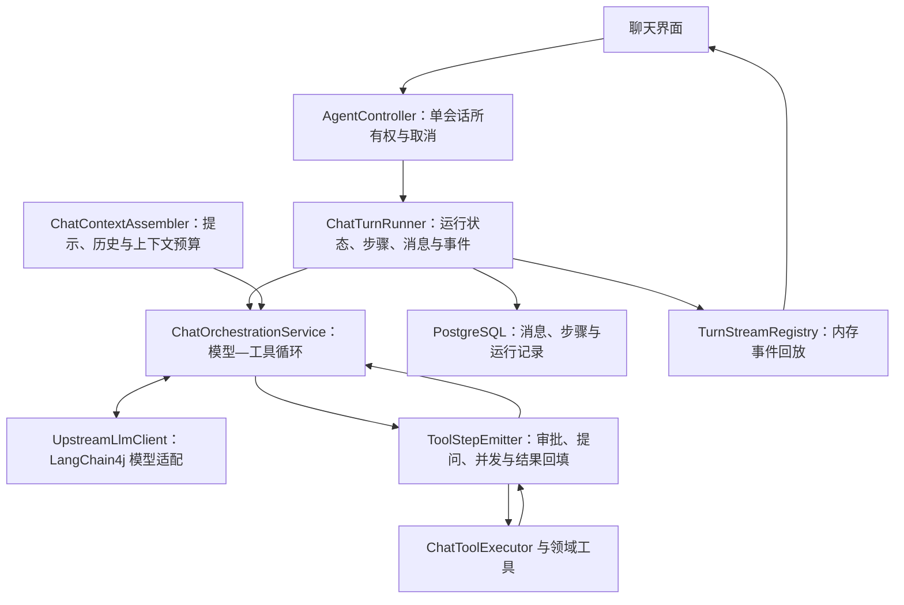

# Nora 与独立 Agent Harness 调研的对照研究

日期：2026-10-07。结论依据当前工作区源码、既有真实会话审计和当天 E2E 记录。本轮只读核查，新增这份报告，没有修改业务代码或重新执行用户任务。

## 结论

Nora 已有可用的 Agent 内核：LangChain4j 模型适配、模型—工具循环、工具批量执行、审批与提问、取消、运行记录，以及页面断开后的流式接续。下一步最有价值的工作是完善**每轮请求的错误恢复、真实结束原因、运行中纠偏和结果评测**。

现有网页采集业务还具备计划、采集记录、质量检查和导出验收。这是可以复用的领域经验。通用聊天运行目前缺少同等清晰的结果判断；上下文压缩和重启处理也主要保障“能够结束、保留部分记录”，尚不足以证明长任务能够可靠延续。

建议保留当前单会话执行循环和 LangChain4j，在现有模块内修补。优先级应按真实失败与使用体验确定，暂时没有证据支持引入固定 planner / executor / critic、动态 DAG 或新的分布式工作流平台。

## 研究范围与证据边界

基准是[独立调研报告](/D:/claude/Nora/docs/research/agent-harness-design-2026-10-07.md)。其中 Codex、OpenCode、Pi 使用固定源码快照；Claude Agent SDK 使用公开契约，不推断 Claude Code 私有实现。各产品的源码、文档和作者观点有不同证据强度，不能混为一谈。

Nora 核查覆盖 agent-service 对话入口、执行循环、模型适配、工具调度与返回、上下文组装、持久化、重启处理、前端聊天发送和接续，以及 scripts 下相关 E2E / 工具评测。知识图谱工具本轮没有暴露，采用限定范围的源码检索和方法阅读；以下“尚未接通”仅指这些实际检查的路径。

复用的测试证据来自[当天工具 E2E 记录](/D:/claude/Nora/logs/agent-tools-e2e-2026-10-07.json)。这些用例使用真实服务与模型、测试档位 minimal；不能拿它们与此前 max 档位的慢会话直接比较整体性能。既有测试脚本的存在也不等于本轮重新运行或证明全部行为正确。

## 1. 当前架构与报告是否一致

实际执行链路如下：

这个职责划分与报告的最小参考架构总体一致。LangChain4j 已经负责模型调用和协议对象，应用自己的循环负责 Nora 的会话、工具策略和产品交互。拥有应用循环本身合理，不能仅因为有手写循环就判断“没有使用 LangChain4j”。

当前的问题集中在几个职责之间的数据契约：模型上下文由 UI 步骤重建；完成状态从步骤状态推断；重试资格依赖整轮是否调用过工具。它们比新增一个“大而全的 Agent 类”更值得处理。

证据：[主循环](/D:/claude/Nora/nora-api/services/agent-service/src/main/java/com/nora/agent/service/ChatOrchestrationService.java:443)、[SDK 适配](/D:/claude/Nora/nora-api/services/agent-service/src/main/java/com/nora/agent/service/UpstreamLlmClient.java:65)、[运行收集器](/D:/claude/Nora/nora-api/services/agent-service/src/main/java/com/nora/agent/controller/ChatTurnRunner.java:87)。

## 2. 按八个维度对照

| 维度 | 独立报告的关键要求 | Nora 当前实现与证据 | 判断 |
|---|---|---|---|
| 执行循环与终止 | 完整工具调用执行后回填；协议结束、运行结束和目标验收分开 | 有真实循环；纯工具轮次无需先输出文字；无工具且 phase 为 final_answer / 缺省时结束。运行状态按异常和步骤状态汇总 | 循环基础具备，收尾语义需要修正 |
| 并发与依赖 | 独立操作可并发；交互和共享资源写入保持约束；并发能力与风险级别分开 | 最多 4 个任务并发，按调用顺序回填；ASK 和混合不适合并发的批次串行；FULL 下允许命令并发；浏览器与未知工具串行 | 已具备，保持保守策略并补结果回归 |
| 工具与环境 | 清楚的参数、目标、真实失败、退出码、截断和可回读证据 | 终端返回 exit code / cwd / timeout，固定内置 PowerShell；工作区、技能目录、数据源和服务信息可注入；MCP 有 eager / lazy；输出有界且标记截断 | 大体具备；环境描述、策略重复和原始输出回读仍可打磨 |
| 上下文与记忆 | 证据与当前模型视图分离；保留约束、完整调用关系和继续执行所需信息 | 用户要求保留，最近历史重建工具调用/结果；早期结果按头尾压缩，图片按批次回收；文件记忆有预算；本轮保存 SDK AiMessage | 部分具备；任务进展摘要与跨轮协议信息保真不足 |
| 流式与用户交互 | UI 断开不终止任务；事件可接续；用户能中途纠偏 | 后台继续，按 turnId / seq 回放，滚动缺口有处理；ask_user 可挂起等答案；普通消息在运行中前端拒发、后端拒绝 | 接续已具备，主动纠偏缺失 |
| 错误、重试与取消 | 瞬时模型失败合理重试；参数错误交给模型修正；写操作结果未知先核对；取消不重试 | 原始模型错误保留；有一次有限空流重试、溢出压缩、能力拒绝降级；MCP 区分连接失败与调用后 unknown；取消覆盖批量工具 | 工具错误处理已有良好基础，模型请求重试条件过窄 |
| 长任务与恢复 | 进度、证据和未决操作可重建；重启后先核对状态 | chat_run 持久化；重启把未结束运行标为 interrupted；agent_step 保存部分过程；网页任务有落盘计划与验收单 | 安全中断策略合理，通用任务续跑能力有限 |
| 评测与可观测性 | 用真实最终状态评测；固定条件比较成功、耗时、轮次、成本和恢复 | 有真实浏览器、编辑、审批、取消等 E2E，有工具选择评测和请求日志；缺少统一的结果级重复评测入口 | 有基础，下一步应把结果回归连接起来 |

相关行业依据：[Codex 固定快照](https://github.com/openai/codex/tree/5a3140176e668a2f72f3c098490eb7f7052d9d85)、[Claude SDK 循环契约](https://code.claude.com/docs/en/agent-sdk/agent-loop)、[OpenCode 固定快照](https://github.com/anomalyco/opencode/tree/ecc4916b5a9608c30e6dd58a67f2137b594407ca)、[Pi 固定快照](https://github.com/badlogic/pi-mono/tree/eb326d265ae0b88489a6d10319307780df827cdf)。详细方法和版本说明见独立报告。

## 3. 优先处理的具体缺口

### 3.1 每轮模型请求的重试条件过窄

当前 StreamTurnResult.retryable 只接受 INTERRUPTED / INCOMPLETE，且要求没有正文、推理和工具调用。主循环再限制 retryUsed=false、loopDetector.attempts()==0。因此，一旦此前执行过一个工具，后续模型请求即使在收到任何内容前断线，也不能进入这条重试路径。

HTTP 错误在适配层通常进入 FAILED；Nora 显式重试路径没有按 HTTP 429 / 可恢复的 5xx 分类，也没有退避、抖动或 Retry-After 处理。这是对当前应用代码的结论，不能据此断言 SDK 或中转内部从不重试。

这里应区分两个动作：

- 重发本轮模型请求：已有工具结果继续放在上下文里，不重新执行上一批工具。
- 重放工具操作：可能重复产生副作用，需要另外判断结果是否未知、是否可安全重放。

最小修改是以**当前请求响应状态**决定模型重试资格，保留有限尝试和取消检查；对确认可恢复的请求失败退避后重试。对于已经产生部分输出的流，先明确截断与 attempt 归属，避免重复追加文本。参数错误、权限拒绝、内容过滤和用户取消不按瞬时连接失败处理。

不需要通过降低思考档位或设置新的推理 token 上限来完成这一修补。

证据：[retryable 判定](/D:/claude/Nora/nora-api/services/agent-service/src/main/java/com/nora/agent/service/StreamTurnResult.java:35)、[主循环重试门槛](/D:/claude/Nora/nora-api/services/agent-service/src/main/java/com/nora/agent/service/ChatOrchestrationService.java:529)、[HTTP / I/O 失败映射](/D:/claude/Nora/nora-api/services/agent-service/src/main/java/com/nora/agent/service/UpstreamLlmClient.java:103)。参考 [OpenCode retry 实现所在快照](https://github.com/anomalyco/opencode/tree/ecc4916b5a9608c30e6dd58a67f2137b594407ca/packages/opencode/src/session)。

验收：在第二轮模型请求、第一批工具已成功落地之后制造一次可恢复连接失败；恢复后完成任务，确认上一批写操作没有再次执行。再覆盖 429、可恢复 5xx、不可重试错误和退避期间取消。

### 3.2 运行结束、过程中失败和目标完成没有分开

ChatTurnRunner 的 completed / partial / failed 主要由以下条件决定：是否有异常、是否有可用答案或成功工具、步骤中是否存在 failed / unknown / partial。

这会产生两种可由代码推导的情况：

- 某工具先失败，模型换方法完成并验证了目标：因为旧失败仍在，整轮仍可能是 partial。
- 没有异常，模型给了普通文本但目标未实现：整轮仍可能是 completed。

当天批量与编辑 E2E 的预期错误检查通过，但运行状态仍为 partial，也直接说明这个字段记录的是过程中存在失败，不能直接当成任务成功率。

另一个明确缺口是主循环的异常收尾：非取消异常只记日志，随后与达到 max-tool-rounds 的路径一样，调用 tool_choice=none 的最终回答。异常原因 / 轮次耗尽没有独立的结束契约传到 ChatTurnRunner；如果最终回答正常，运行状态可能掩盖真实中断原因。当前配置上限为 100 轮；这是工具循环上限，与每次模型的输出 token 上限不同。

最小修改：

1. 保留真实结束原因，例如正常结束、用户取消、请求失败、循环上限；异常可以附带已完成成果，但不能靠最后一段文字改写原因。
2. 过程错误继续保留，避免用户失去诊断证据。
3. 将“本轮运行结束”与“结果已验收”分开表达。已有浏览器任务使用 verified 验收单，优先复用它；其他任务按业务实际结果检查。开放式回答没有可验证判据时，不制造一个自动验收结论。

这不要求给每个对话再加一个 LLM 评审代理。

证据：[状态汇总](/D:/claude/Nora/nora-api/services/agent-service/src/main/java/com/nora/agent/controller/ChatTurnRunner.java:399)、[异常及循环耗尽收尾](/D:/claude/Nora/nora-api/services/agent-service/src/main/java/com/nora/agent/service/ChatOrchestrationService.java:560)、[禁止工具的最终请求](/D:/claude/Nora/nora-api/services/agent-service/src/main/java/com/nora/agent/service/ChatOrchestrationService.java:914)、[已有网页验收状态](/D:/claude/Nora/nora-api/services/agent-service/src/main/java/com/nora/agent/service/BrowserTaskService.java:28)。

验收：先失败后成功的任务显示正确最终结果；循环上限和内部异常保留原因；网页任务没有通过实际验收时，不显示“成果已验收”。

### 3.3 运行中只能等待或取消，不能追加纠偏指令

后端发送入口以 activeTurns.putIfAbsent 保证单会话只有一轮。这是正确的所有权约束，但目前“同一轮接收新指令”与“再启动一轮”没有分开的通道。前端 sendMessage 在 isSending 时直接返回，sendTaskMessage 直接抛错；后端返回 TURN_IN_PROGRESS。

ask_user 是模型主动提问后的回答通道，不能替代用户主动发来的“改为只处理前十条”“不用继续查日志了”。

可以在当前会话运行对象上接入一个有顺序的消息队列，并在工具批次结束、下一次模型请求前消费。新指令带消息 ID，记录接收与消费状态；队列按同一个会话所有者处理，不另起并行主循环。

如果本轮即将收尾，应再次检查未消费消息，避免用户消息已经被接受却丢失。长时间模型思考期间，先提供停止能力；是否支持立即中断本次请求并注入纠偏，可作为后续增强，不能把“下一安全边界消费”宣传成实时打断。

证据：[后端同会话冲突](/D:/claude/Nora/nora-api/services/agent-service/src/main/java/com/nora/agent/controller/AgentController.java:141)、[前端发送门槛](/D:/claude/Nora/nora-web/src/hooks/useChat.ts:458)。参考 [Codex App Server 的 turn 生命周期与 steer 契约](https://learn.chatgpt.com/docs/app-server)、[Pi 循环所在固定快照](https://github.com/badlogic/pi-mono/tree/eb326d265ae0b88489a6d10319307780df827cdf/packages/agent/src)。

验收：任务执行中修改范围；界面显示已接收；下一安全边界按新范围执行；临近收尾、取消和刷新时没有遗失或重复消费。

### 3.4 评测需要从“选对工具”推进到“结果正确”

scripts/tool-eval.sh 现在主要判断调用集合是否包含 expectAny，或负例是否没有工具。它能发现工具选择退化，但不能发现“调用编辑工具后文件内容仍不对”“导出文件为空”等结果错误。

Nora 已有真实结果检查：工具批量 E2E 检查落盘字节、调用时间重叠和取消；浏览器 E2E 检查任务 ID、verified 和实际 CSV。应整理这些现有脚本，建立小型结果回归入口，增加当前已确认缺口的用例即可。

第一批建议覆盖：文件读取与编辑、网页采集导出、失败后换方法完成、后续模型请求恢复、取消、运行中纠偏，以及上下文压力下保持约束。依赖尚未实现的能力先标为缺口，不伪造通过。

每次记录同一模型、协议、渠道、思考配置、环境和提示版本，检查真实文件 / API 状态 / 验收单；同时记录模型轮次、请求耗时、工具耗时和上游 usage。重复运行后报告成功次数和耗时分布，小样本先用中位数与最长耗时，不制造不可靠的百分位结论。

单元冒烟测试按照项目约定继续只执行路径；行为正确性放在真实服务 E2E 中核实。

证据：[现有工具选择判定](/D:/claude/Nora/scripts/tool-eval.sh:140)、[真实批量工具验收](/D:/claude/Nora/scripts/e2e-agent-tool-batch.py)、[真实浏览器 Agent 验收](/D:/claude/Nora/scripts/e2e-browser-agent.py:194)。行业依据：[Anthropic 对 Agent 结果、轨迹和重复评测的说明](https://www.anthropic.com/engineering/demystifying-evals-for-ai-agents)。

## 4. 第二阶段：上下文和可恢复证据

### 上下文已实现的部分

- 历史选择保留用户要求，并选择预算内最近最多 40 条消息；保留不了全部历史用户要求时明确报错。
- 历史工具按 round 重建 assistant 调用和 tool 返回，避免随意留下孤立工具结果。
- 当前执行循环保存 LangChain4j AiMessage 对象，后续请求优先复用。
- 压缩只缩减较早工具结果内容，保留调用结构；图片按调用批次回收。
- SOUL / AGENTS / USER / MEMORY 文件有逐文件和总预算，日记按需读取。

这些基础应保留。上下文预算用于避免请求溢出，与限制模型思考长度是不同职责。

### 当前能力边界

早期工具结果压缩为固定头尾文本；没有提炼“已完成事项、当前约束、未决操作、下一步”。错误结果只保留较短头部，关键细节如果在中段可能丢失。初次执行时，过长输出在进入消息与步骤前已被工具统一截断；单纯把聊天历史保存到数据库并不能恢复被裁掉的原文。

跨用户轮次使用 ChatStepDto 重建调用，而不是保存和恢复完整 SDK 消息。历史恢复代码不会恢复本轮 AiMessage 中的 thinking / 签名等协议附属信息。是否影响某个具体模型，需要按该协议进行真实长会话验证；本次不能把它直接定性为所有模型的协议故障。

用户消息一直保留也有已知容量边界：足够长的会话最终会超过历史预算并要求切换模型或新会话。当前没有可靠的“当前有效要求”摘要替代旧要求，这是安全但有限的取舍。

最小后续工作：先做上下文压力 E2E；对不可重新取得的重要长输出，保存到已有工作区并提供回读路径；把验证过的任务进展与来源记录成简短状态。协议需要的附属信息由 SDK 格式保留，不重新手写另一套协议实现。只有压力测试确认需要语义摘要，再加入可追溯的压缩摘要。

证据：[历史选择与要求保留](/D:/claude/Nora/nora-api/services/agent-service/src/main/java/com/nora/agent/service/ChatContextAssembler.java:164)、[历史重建](/D:/claude/Nora/nora-api/services/agent-service/src/main/java/com/nora/agent/service/ChatContextAssembler.java:211)、[固定压缩](/D:/claude/Nora/nora-api/services/agent-service/src/main/java/com/nora/agent/service/ChatContextAssembler.java:486)、[初次输出截断](/D:/claude/Nora/nora-api/services/agent-service/src/main/java/com/nora/agent/service/ChatToolExecutor.java:1103)、[本轮 SDK 消息复用](/D:/claude/Nora/nora-api/services/agent-service/src/main/java/com/nora/agent/service/UpstreamLlmClient.java:176)。参考 [Anthropic 上下文工程](https://www.anthropic.com/engineering/effective-context-engineering-for-ai-agents)。

### 重启处理的现状与正确边界

StaleRunRecovery 把上一进程遗留的 queued / running / awaiting_approval / cancelling 标为 interrupted，避免直接重复执行可能已有副作用的操作。对当前单节点个人工作台，这个默认行为合理。

但“标记中断”还不等于“恢复任务”。活跃所有权、事件缓冲、等待中的 Future 都依赖进程。审批票据有 Redis 镜像和跨实例回传，不能因此认为整个执行循环可以重启恢复。

数据库步骤目前只有 session_id、step_index、round_index 等信息，saveStep 未保存稳定 run_id / stepId；loadMessages 读取 chat_message，不会用中断前的 agent_step 重建模型上下文。运行开始和工具步骤虽然分别落库，最后的 assistant 消息直到收尾才写入。因此崩溃发生在工具已执行、整轮未收尾之间时，继续执行所需的证据不完整。

若确实要支持更长任务，优先给现有步骤记录接上运行和调用身份；续跑前展示最后已确认成果与未知操作，查询实际状态后继续。先实现人工发起的安全续跑即可，暂时不要求自动重放所有步骤。

证据：[重启处理](/D:/claude/Nora/nora-api/services/agent-service/src/main/java/com/nora/agent/config/StaleRunRecovery.java:11)、[步骤落库字段](/D:/claude/Nora/nora-api/services/agent-service/src/main/java/com/nora/agent/service/ChatStoreService.java:426)、[历史读取范围](/D:/claude/Nora/nora-api/services/agent-service/src/main/java/com/nora/agent/service/ChatStoreService.java:155)、[收尾写入助手消息](/D:/claude/Nora/nora-api/services/agent-service/src/main/java/com/nora/agent/controller/ChatTurnRunner.java:379)。

## 5. 已有能力中值得保留的设计

**并发已经是真并发。** 三个命令用例的开始时间相差 7ms、重叠 2.716 秒，工具墙钟 4.572 秒。ASK 用例保持串行；批量取消用例在请求停止后约 0.392 秒退出。这是一次真实用例的证据，不代表任意脚本并发都安全，也不代表整体任务耗时减少同样比例。FULL 下命令是否独立仍需要模型遵守约束；共享文件、同一浏览器等资源操作继续保守处理。[调度代码](/D:/claude/Nora/nora-api/services/agent-service/src/main/java/com/nora/agent/service/ToolStepEmitter.java:69)、[测试记录](/D:/claude/Nora/logs/agent-tools-e2e-2026-10-07.json)。

**没有强制每轮输出进度文本。** 现有提示允许短轮次直接调工具，在重要发现、方案调整和等待时解释进度。这与研究报告的交互建议一致。增加强制说明会多消耗模型输出，也不能证明模型更会规划。[提示约定](/D:/claude/Nora/nora-api/services/agent-service/src/main/java/com/nora/agent/service/ChatContextAssembler.java:93)。

**页面断开不取消任务。** 有后台生命周期、turnId / seq 接续和回放缺口识别；这个机制应继续复用。它解决页面连接问题，不等同于进程崩溃恢复。[运行开始](/D:/claude/Nora/nora-api/services/agent-service/src/main/java/com/nora/agent/controller/ChatTurnRunner.java:95)、[事件缓冲与缺口](/D:/claude/Nora/nora-api/services/agent-service/src/main/java/com/nora/agent/service/TurnStreamRegistry.java:75)。

**MCP 的未知结果处理有正确的基本区分。** 连接建立前失败可重连；调用发出后发生异常，默认返回 unknown 并要求查询实际状态；仅在本地信任开关开启且工具声明只读时，允许该调用重试。此处不要退化成所有工具一律重发。[调用与重试策略](/D:/claude/Nora/nora-api/services/agent-service/src/main/java/com/nora/agent/service/McpServerService.java:428)。

**网页业务已有实际验收。** 计划、样本、采集结果、verified 回执和成果交付是结果导向的基础，可供其他明确业务复用。应复用数据和检查方式，而不是让所有普通对话都必须创建同样的网页任务流程。[已有任务状态](/D:/claude/Nora/nora-api/services/agent-service/src/main/java/com/nora/agent/service/BrowserTaskService.java:28)。

## 6. 架构与维护成本：小范围收拢即可

当前主要文件行数：ChatOrchestrationService 1119、ToolStepEmitter 1319、ChatToolExecutor 1216、ChatToolsSpec 980、ChatContextAssembler 786、ChatTurnRunner 593。行数只用于定位阅读成本，不直接代表设计错误。

更具体的维护问题是新增一个工具 / action 通常需要同时维护 schema、执行路由、参数展示与审批说明、风险判断，以及并发资格。ToolStepEmitter 同时包含调度、参数提取、审批文案和进度渲染，业务细节继续进入该文件会扩大理解与修改成本。

建议：

- 延续已有领域工具类，例如 FileWorkspaceTools，逐步把领域参数和返回解释放回所属业务。
- 复用 RiskClassifier 已有的 action 归一化，减少展示层、执行层再次解释同一动作的情况。
- 并发资格和风险级别保持不同含义：LOW 不自动代表只读，也不自动代表可以并发。收拢现有判断即可，暂不需要新的插件注册框架。
- 先把真实结束原因和请求重试契约厘清，再决定是否缩减中间 WireMessage 转换。避免为了行数重写已运行的模型适配。
- 事件回调目前包含同步 SSE 发送；生命周期已与页面分离，但慢消费者仍可能增加回调等待。先测量，只有出现明显延迟再复用现有执行设施隔离发送。

另有三处可顺手校准的事实：

1. 工作区引导文案说“写/删区外文件时会请求用户确认”，而 FULL 模式只审批 CRITICAL，HIGH 可以直接执行。文案应按权限档位描述。[引导文案](/D:/claude/Nora/nora-api/services/agent-service/src/main/java/com/nora/agent/service/AgentWorkspaceService.java:1156)、[审批分支](/D:/claude/Nora/nora-api/services/agent-service/src/main/java/com/nora/agent/service/ToolStepEmitter.java:312)。
2. SYSTEM_PROMPT 仍把 self-evolution 称为预期行为，默认种子文件还包含具名技能引用。把记忆、行为文件修改限定到用户授权或当前任务必要范围，减少与当前任务边界相冲突的诱因；本次没有证明这些剩余文本已造成某个新会话的错误。[自修改约定](/D:/claude/Nora/nora-api/services/agent-service/src/main/java/com/nora/agent/service/ChatContextAssembler.java:102)、[种子内容](/D:/claude/Nora/nora-api/services/agent-service/src/main/java/com/nora/agent/service/AgentWorkspaceService.java:157)。
3. 当前 DeepSeek 的 Anthropic 请求会移除 max_tokens，但模型名包含 Claude 的分支仍设置 32000，旧 Claude 分支设置 thinking budget 31999。不能笼统宣称所有渠道完全采用上游默认；应单独验证这些协议分支，不把它当作已审计 DeepSeek 会话变慢的原因。[模型分支](/D:/claude/Nora/nora-api/services/agent-service/src/main/java/com/nora/agent/service/UpstreamLlmClient.java:135)、[DeepSeek 类渠道请求修正](/D:/claude/Nora/nora-api/services/agent-service/src/main/java/com/nora/agent/service/UpstreamLlmClient.java:269)。

## 7. 对“感觉很慢”的重新解释

此前 sess-1791336885252 的审计中，1140.125 秒总耗时里，15 次模型请求累计 1132.459 秒，占 99.33%；31 次工具调用累计 6.972 秒。请求时间包括等待、流式输出、客户端处理等，不能都视为模型纯计算。

这个样本说明：工具并发能够缩短工具等待；减少不必要的模型往返和任务范围漂移，才更可能改善该类慢任务。该样本没有模型失败重试，不能用新重试策略解释它的耗时。

换行编辑、自动任务正文、命令中途失败等已在后续修改和 E2E 中处理，应看成已经修复的历史诱因。仍需用同模型、同渠道、同档位的同类任务重新测量，才能量化整体改善。现在没有足够证据断言模型本身有故障，也不能宣布总体性能已经解决。

证据：[会话审计与后续修复](/D:/claude/Nora/docs/reviews/session-1791336885252-audit-2026-10-07.md)。

## 8. 建议的最小落地顺序

| 顺序 | 工作 | 直接价值 | 完成判据 |
|---|---|---|---|
| 1 | 修正每轮模型请求重试与结束原因传递 | 后续请求短暂失败可恢复；真实异常不被最终文字掩盖 | 后续轮次恢复不重复既有工具；取消无重试；异常与循环上限原因可见 |
| 2 | 接入运行中纠偏 | 用户能缩小范围、改约束，减少无效继续执行 | 收到、消费、收尾均有明确状态；没有第二个主循环或消息丢失 |
| 3 | 整理已有 E2E 为小型结果回归，补上述用例 | 每次改动可比较真实结果、轮次和耗时 | 真实文件/API/回执核对通过；运行记录保留准确配置 |
| 4 | 根据上下文压力用例补原始输出回读与任务状态 | 长会话减少遗忘和重复查证 | 压缩前后保留约束与未决事项，可回读重要证据 |
| 5 | 有长期任务需求时补人工安全续跑 | 重启后能从已确认成果继续 | 未知操作先核对；已完成副作用不盲目重放 |

其中结果回归应伴随前两项实施，不必等全部功能结束才开始验收。当前尚无测量依据要求部署新的 Agent 框架、自动并发多代理、通用事务平台或全量知识记忆系统。
